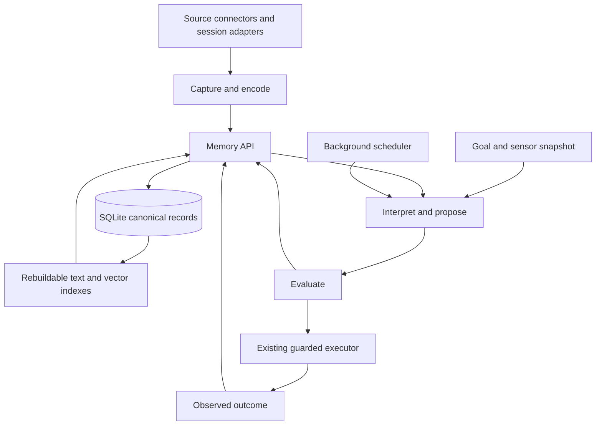
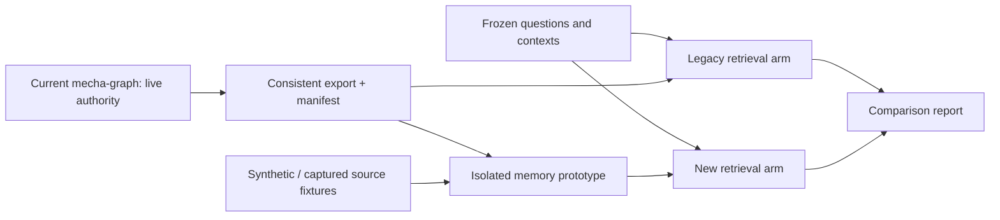

# Mecha memory: evidence, interpretation, and learning

Design draft · 2026-11-04 · original proposal retained below.

**Completion and evaluation addendum, 2026-11-09:** §31.20's bounded completion
observer and explicit native adapter are implemented and qualified on synthetic
software checks, recorded in HISTORY. The independently audited fresh comparison
saved correct outputs in 3/4 control versus 4/4 feedback sessions; the only
difference was a repaired omitted file, not demonstrated learning benefit.
§31.21 proposes a recurring system evaluation with separate memory and
adaptive-learning controls, both enabled for its primary track. Those general
controls and cross-harness runner are not yet implemented.

**Native vector recall addendum, 2026-11-09:** §31.19 is implemented and fully
qualified on synthetic software checks. The first independently audited paired
model comparison did not establish decision benefit: artifact completion and
no-evidence reasoning remain blockers. See HISTORY for unchanged first results
and HANDOFF for the next bounded work. This does not activate ordinary chat/web.

**Protected storage addendum, 2026-11-09:** explicit keyed native storage,
complete encrypted v8 snapshots and bounded historical restore are implemented
on the prototype branch. Restore requires current deletion/access authority and
refuses scope rollback; it does not supply full disaster recovery or merge newer
facts and withdrawals. See HISTORY for qualification and HANDOFF for current
operational gaps. The original design below remains the proposal record.

**Compact native context and concept appraisal addendum, 2026-11-09:** §31.17's
reader and explicit hypothesis-aware appraisal are implemented. Full originals,
canonical stored records and all provenance remain intact. The new read-only core
workflow reuses shared generation and factual validation without promoting
hypotheses into observations. See HISTORY for qualification and HANDOFF for the
remaining operational qualification; model benefit remains unestablished.

**Concept-benefit pilot addendum, 2026-11-08:** the explicit lifecycle in §31.15
is implemented by `memory_concept_workflow` and an independent finite-world
scorer. This adds no store, schema or production integration. See HISTORY for
qualified results and HANDOFF for remaining work; source/contract acceptance is
not semantic support. The [implementation plan](superpowers/plans/2026-11-08-concept-benefit-pilot.md)
fixes fourteen first-response slots and the equal-evidence comparison. The
post-phase tests revised-concept utility, not an isolated causal effect of revision.

**Native-evidence and concept-rumination addendum, 2026-11-08:** §§31.14–31.15
now have separate default-off implementations: complete source-bound native facts
with read-only appraisal, and one provisional concept revision that preserves
prior evidence, counterexamples and access restrictions. The older v4 support
contract remains unchanged. Native concept admission, useful transfer and automatic
learning remain open; qualification and the fixed paired experiment are recorded
in HISTORY, with current next work in HANDOFF. See the
[native evidence and rumination plan](superpowers/plans/2026-11-08-native-evidence-concept-rumination.md).

**Situated implementation addendum, 2026-11-07:** §31.7 is implemented in a
new explicit v7 synthetic store with shared interpretation generation, exact
source-linked hypotheses, host-only needs assessment and current/historical
retrieval. Authored ordinary-agent integration passes; final qualification and
the equal-source model comparison are recorded separately in HISTORY. Automatic
context orchestration, production capture, useful concept learning and rumination
remain open. See the [situated plan](superpowers/plans/2026-11-07-situated-interpretation.md)
and the runnable command in `prototypes/memory/README.md`.

**Earlier implementation addendum, 2026-11-07:** §31 A+B now have an explicit synthetic
host-capture adapter and an authored cross-process task demonstration. V6 stores
bounded observations with current source guards; full existing appraisal and
sensor context remain host-only. See HISTORY for qualification and limits, and
`prototypes/memory/README.md` for the runnable example. §31 C, real-model transfer,
automatic production capture and broader situated interpretation remain open.
The completed scope and contracts are in the
[implementation plan](superpowers/plans/2026-11-07-appraisal-bridge.md).

**Evaluation addendum, 2026-11-07:** §30's frozen 48-response comparison is
complete: 20/24 paired information improvements, 0 regressions; both arms 24/24
correct from their own evidence. Fast/thinking combined support 22/24 versus 24/24,
with 4.95x output tokens for thinking. See HISTORY for all denominators, failures,
independent reviews and limits; this does not establish production learning.

**Implementation addendum, 2026-11-07:** §28's v3 constraint/abstention
protocol and corrective diagnostic are implemented; §29's opt-in v4 separates
host comparison provenance from model citations. V4 changes the citation contract,
not demonstrated model capability. See `HISTORY.md` for qualification and the
unchanged prior results; `HANDOFF.md` records current next work.

**Implementation addendum, 2026-11-06:** the default-off prototype includes
§19 recall views, §20 checked reconsideration, §21 bounded observation acquisition,
and §22 their combined v3 development trial. The latter improved within-run
structured decisions 9/24 to 24/24 and independently supported rationale plus decision
8/24 to 23/24, with 15 additional calls. Query and final prose defects remain.
§23 and §24's durable guarded-read slice is now implemented and qualified at
`59ee1882b`: explicit v3 lifecycle, guarded synthetic acquisition and restart/crash
checks. That read adapter makes no model calls. §25 now adds an explicit v4 durable
model-decision runtime at `3ed543a17`, with raw responses saved before source-only
assessment and one optional revision. §26 now adds a closed host-simulated action,
independent outcome and retained StepFeedback at `4379eef50`. §27 now adds read-only
paired outcome reappraisal at `3be9ddecf`. Its 20-call
development pilot found no primary simulator-optimal gain (4/8 versus 4/8) and four
host-withheld infeasible proposals; required model abstention remains unreliable.
Production appraisal integration remains unqualified. See `HANDOFF.md` for current
state and `HISTORY.md` for verified work; earlier proposals/results remain below.

**Owner decision — independent systems for now (2026-11-05):** mecha-graph
remains the owner's independent personal knowledge system. Mecha v2 develops
the agent's experience, interpretation, and learning memory. Replacing or resetting
an agent must preserve the owner's knowledge; another agent need not inherit its
predecessor's conclusions. Agent memory remains under the owner's control.

Both systems need similar episode, provenance, temporal, retrieval, and revision
machinery. Reuse architectural patterns and keep interfaces compatible, while
preserving source authority, permissions, and separate lifecycles. V2 may query
authorized personal knowledge and retain attributed references or interpretations;
an agent inference does not become an owner-stated fact. Integration, a shared
implementation, or migration can be reconsidered once v2 works reliably. No merger
or personal-store migration is required for the current prototype. This decision
supersedes any assumed mandatory mecha-graph replacement in the original proposal
below; its migration sections describe future options, not an approved cutover.

**Requirements addendum (2026-11-05, feature branch):** explicit requirement
scope/state, step-bound guard references, and separate outcome judgments are now
implemented. V3 exposed format failures; V4 constrains candidate references but
semantic requirement/guard coverage remains unreliable. This is a structural
prototype, not validated action authority. See [HISTORY](HISTORY.md) for all replay
results, including regressions and the diagnostic-goal confound; §13 tracks this
increment and the next action-binding work.

**Evaluator-constraint addendum (2026-11-05, feature branch):** no-concept
applicability is now host-derived, original and provisional concept citations are
separate, and an already-recommended plan is preserved instead of rewritten.
The six-case replay completed all workflows with five correct initial prerequisite
judgments; explicit guards improved but shared-requirement analogies remained
unreliable. These are reused development cases, not proof of policy improvement.
See [HISTORY](HISTORY.md) for measurements and limitations.

**Passage-citation addendum (2026-11-05, feature branch):** assessments now select
host-issued passage IDs, with exact quotations and byte ranges constructed by the
host. A frozen six-case calibration separates citation binding, prerequisite
judgments and separate artifact review. The six-case Spark run completed five
workflows; all returned quotations were exact, but analogy judgments and revision
quality remained unreliable. This does not establish semantic correctness. See
[HISTORY](HISTORY.md).

**Plan-evaluator addendum (2026-11-05, feature branch):** the prototype now has
bounded, provider-neutral plan assessment and one optional revision/reassessment
round over retrieved memory. Host checks enforce citation provenance, complete
judgments and unresolved-information handling. Semantic judgments remain fallible;
this is not production action authorization or a world-model simulator. See
[usage](../prototypes/memory/README.md) and [HISTORY](HISTORY.md).

**Provisional-concept addendum (2026-11-05, feature branch):** core now generates
and retains a bounded source-backed abstraction with explicit applicability,
support, counterexamples and all consulted dependencies. Context retrieval carries
concepts with their sources as untrusted hypotheses. This does not establish
semantic validity, autonomous learning, live rumination or production readiness.
See [HISTORY](HISTORY.md) and [usage](../prototypes/memory/README.md).

**Prototype addendum (2026-11-04):** an opt-in synthetic implementation now
exercises capture, scoped/temporal retrieval, revisions, provenance and forgetting.
The default-off `memory-prototype` Cargo feature now exposes it through the main
`mecha memory --experimental --db PATH` CLI, sharing the standalone fixture.
See [prototype usage and limits](../prototypes/memory/README.md). The production
design below remains unimplemented beyond that subset. The owner explicitly
deferred nightly activity migration until its value is established; the nightly
section is a future design, not current implementation scope.

**Episode baseline addendum (2026-11-04, feature branch):** the prototype now
captures explicit synthetic native JSONL sessions, retains exact records and
source order, and exposes BM25 evidence retrieval with bounded context windows.
A 32-case synthetic baseline/oracle report measures evidence coverage; model
reasoning and concept learning remain unimplemented. See prototype usage above.

**Model comparison addendum (2026-11-04, isolated Spark prototype):**
`memory::model_evaluation::run` compares lexical, bounded goal-aware and oracle
evidence with the same local answer model on 16 new synthetic cases. It measures
structured choices/citations, abstention, latency and tokens; it does not learn
concepts or execute plans. See the research addendum for the measured results.

**Evidence-informed retrieval addendum (2026-11-05, isolated prototype):**
`memory::model_evaluation::followup::run` adds bounded evidence-informed search
and explicit citation schemas, with separate development and fresh holdout cases.
This remains a synthetic diagnostic, not a runtime appraisal adapter. See
[research §8](AGENT-MEMORY-SYSTEMS-RESEARCH.md#8-evidence-informed-search-and-constrained-citations)
and [delivery history](HISTORY.md) for measured results and remaining limits.

**Required-mention addendum (2026-11-05, local prototype):** scoped recall can
require a literal name in candidate anchors. A no-model replay demonstrates
coverage gains given manual bindings; automatic bindings, aliases and runtime
integration remain unbuilt. See research §9 and HISTORY; the prior model scores
are unchanged.

**Automatic binding addendum (2026-11-05, isolated Spark prototype):**
`evaluate-model --auto-bindings` compares the same source-grounded planner's
queries with and without name enforcement on new synthetic scenarios. Research
§10 and HISTORY record improved coverage/choices and remaining source-span and
citation-contract failures. This is a measured retrieval component, not a runtime
planning/appraisal integration or production-store migration.

**Read-only context addendum (2026-11-05, feature branch):** `Memory::context`
now assembles bounded source episodes and supported temporal relations under a
host-owned policy. Exact contiguous source selections replace composed names in
this runtime path; historical comparison protocols stay unchanged. An explicit
`run --memory-context` option supplies packets through `goal_context`. This is a
synthetic-only planning reader, not automatic concept learning or homeostat/
appraisal/rumination wiring. See prototype usage and HISTORY.

The [agent-memory systems research](AGENT-MEMORY-SYSTEMS-RESEARCH.md) compares
external retrieval, consolidation and abstraction mechanisms with current
mecha-graph source, and proposes small evaluations before adopting them.

The owner has selected SQLite, an open-source and durable foundation, with
Mecha owning the memory model. Borrow temporal provenance and hybrid retrieval
ideas from Graphiti and version/snapshot/branch ideas from TerminusDB. Do not
depend on either project. Optimize first for one personal Mecha installation;
other Mechas own their memories and exchange explicitly authorized records.

This document proposes the schema and behavior. The implementation choices
below are recommendations, not additional owner rulings. No live store was
exported, changed, or re-ingested during this design. Source availability in
the installed system still needs a read-only inventory.

## 1. Purpose and boundaries

Memory preserves what was encountered, how it was interpreted, what was tried,
and what happened. It supplies evidence to reasoning; it does not decide goals,
authorize tools, or turn model output into trusted instructions.

The central distinction is **storage, epistemic standing, retrieval, and
execution authority are separate**. Automatically storing an attributed claim
does not accept it as fact. Retrieving a useful concept does not install a
behavior rule. We eliminate the requirement to approve every extracted claim
by retaining claims as attributed evidence, with uncertainty and provenance.
Existing gates for trusted-prefix learning and persona recall remain intact.

Goals:

- One memory API for episodes, entities, relations, interpretations, concepts,
  experiences, and assessments; thin CLI/MCP/application adapters.
- Reappraise the same evidence under different goals, beliefs, needs, and
  resources without replacing the evidence or its earlier interpretations.
- Reproduce the memory supplied to a decision, subject to later forgetting
  and current access restrictions.
- Support bounded simulation overlays and explicit adoption of evaluated
  changes; distinguish actual, predicted, assumed, and counterfactual records.
- Retain complete consulted-input lineage, not only the citations a model
  chooses to report, for security and forgetting.
- Reduce duplicate extraction, evidence preparation, and retrieval code.

Non-goals for the first implementation: a general database version-control
engine; distributed replication/CRDTs; autonomous policy changes outside
existing learning gates; replacing the executor, charter, outbox, or session
log; migrating persona databases into one shared file; a new model per stage.

## 2. What exists and what should survive

Source inspected at Mecha `dfe48be8e4ed11aadd824b471f91817b7f3312b8` and
mecha-graph `6a31a39a1a1602e40723779331c0810e36654fd0`.
The latter had an untracked `t32_graph_import.py`, which was not used or edited.
Paths beginning `mecha-graph-core` refer to the sibling mecha-graph repository.

| Owning source / symbol | Finding | Design consequence |
|---|---|---|
| `mecha-graph-core/src/sources/mod.rs::Source`, `ingest_with` | Deterministic source links precede model work. Capture policies can archive data and remove source files. | Retain connector parsing and native identities; inventory archives before re-fetching. |
| `episode.rs::upsert_episode`, `store_raw` | Episode updates replace body/metadata; raw rows are not an episode-version history. Generic capture only stores raw when none is present. | Preserve the actual surviving artifacts, possibly of different ages; do not invent past versions or assume raw and rendered text correspond. |
| `enrich.rs::Envelope`, `store_enrichment` | One envelope per episode, overwritten on refresh; Bee can supply native enrichment. | Reuse native mappings; version outputs and keep native summaries distinct from recordings. |
| `extract.rs`, `precheck.rs`, `ladder.rs` | Durable-fact extraction and adoption/review machinery. | Replace blanket fact candidacy with attributed relational claims; preserve corrections and decisions. |
| `fact.rs::attach_derivation` | Maximum sensitivity is computed over contributors, but one newest episode becomes the anchor. | Preserve legacy classification; full multi-input lineage cannot be recovered from that anchor alone. |
| `search.rs::bm25_ranked`, `vec_ranked` | Global candidate limits precede candidate filtering. | Rank within the eligible population; test filtered recall explicitly. |
| `mecha-graph-mcp/src/main.rs` fact upsert path | Adapter contains confidence-based acceptance behavior. | One core write/adoption contract; caller confidence never grants authority. |
| `mecha-core/src/grounding.rs::calls`, `admit` | Existing evidence traversal and citation dereference checks. | Reuse them. Citation presence is not semantic entailment. |
| `distill.rs`, `mecha-cli/src/commands/distill.rs` | Shared transcript preparation and cached-prefix appraisal follow-up already exist. | Preserve these efficiencies; replace outputs incrementally. |
| `appraisal_store.rs::TextAppraisal`, `Clean` | Interpretations and clean-only learning/retrieval boundary. | Adapt records without relaxing the clean-only paths. |
| `appraisal.rs::of_session`, `homeostat.rs::Homeostat`, `goal.rs::GoalRef` | Outcome accounting, shared sensor survey, typed goal references. | Keep deterministic computation and goal authorship outside storage. |
| `comparison.rs::ComparisonStore`, `mecha-cli/src/probe.rs::prepare_probe` | Shared comparison records and replay preparation. | Adapt into assessment references before replacing their stores. |
| `replay_run.rs`, `counterfactual.rs`, `experiment.rs` | Recorded-prefix probes and controlled trials. | Keep their narrow validity conditions; memory branching is not a world simulator. |
| `persona/memory.rs` | Separate database per persona; explicit shared store; origin-gated recall and source-based forgetting. | Preserve physical isolation and existing recall policy; share code later through adapters. |

The previous convergence direction in [LEARNING-STORE-RESEARCH.md §6](LEARNING-STORE-RESEARCH.md#6-when-to-move-and-where)
is consistent with this design. [APPRAISAL-WIRING-DESIGN.md](APPRAISAL-WIRING-DESIGN.md)
has compatibility requirements, including the pinned legacy distillation
output and measured prerequisites for folding in the reflector. This draft
does not silently repeal them. A new extractor is a versioned alternative in
shadow until the corresponding replacement gate passes.

## 3. Architecture and ownership



Start as `mecha_core::memory`, divided into `model`, `store`, `access`,
`retrieve`, `ingest`, `scenario`, `forget`, and `migration` modules. These are
responsibility boundaries, not eight new services or agents. Model orchestration
uses the existing Provider and permit abstractions outside database transactions.

Canonical assistant memory lives in `~/.mecha/memory/`. The path is host-owned,
outside the tool workspace, not configurable by repository content. One
installation owns the writer. The running Mecha service brokers writes; offline
CLI maintenance takes an exclusive installation lock. Concurrent service/CLI
writers must not bypass this ownership. Readers use bounded connections and
short transactions. Network clients use the Mecha API, never a network-mounted
database file. Flowmail uses compatibility endpoints rather than writing tables.

One database is one physical security domain: assistant, each persona, and
explicit shared memory stay separate. Within assistant memory, required access
scopes distinguish source/account/project permissions. No implicit cross-domain
join. Cross-domain use is an export/import operation with fresh authorization.

Keep operational truth in its current owner initially: charter, task board,
workflow commitments, outbox, permissions, and learned-rule activation. Memory
stores versioned observations/references to them, not a second writable board.
The board can remain behind the graph compatibility adapter while graph memory
is replaced. Do not delete graph task/project/goal tables at memory cutover.

### Tasks, operational state, and Markdown

**Recommended destination:** task/todo, project, and workflow state can share
the assistant's encrypted SQLite database, in separately owned `task_*` and
`workflow_*` tables. Sharing a transaction boundary does not mean sharing a
generic model-writable graph interface. `tasks` owns transitions; `memory`
owns attributed observations about them. Memory extraction may propose a task
or report a commitment; only the task API can create/change the operational
record under the caller's existing permissions. A todo and a task are the same
operational type, not two synchronized stores.

This is a later consolidation target, not a prerequisite for the memory
prototype. Today the board lives in mecha-graph and Mecha reaches it through
MCP. `workflow.rs` owns execution references and checks, and `closure.rs` owns
the closure journal/appraisal contract. Preserve those boundaries during the
prototype. Move each owner once, with a compatible API and stable task IDs.

| Information | Recommended authoritative storage | Reason |
|---|---|---|
| Tasks, project status, dependencies, due/defer/completed times, external synchronization state | Typed SQLite operational tables, eventually co-located with assistant memory | Transactions, concurrent updates, indexed queries, reliable completion events. |
| Task/project descriptions and notes | Text/Markdown fields or referenced documents | Rich human-authored content does not need to become graph structure. |
| Owner charter, policy, configuration, skills | Existing owner-controlled files | Explicit authorship and review boundaries remain; memory holds versioned references. |
| Session transcripts, original attachments, generated artifacts | Existing source/artifact stores initially | Retention and access needs differ; memory captures or references with declared fidelity. |
| Credentials and encryption keys | Existing secret stores outside the database | No secret becomes retrievable memory. |
| FTS, embeddings, rollups, demand statistics | Rebuildable indexes/projections | They are derived, versioned, and erasable. |
| Outbox/delivery, workflow runner ownership, learned-policy activation | Current owners initially | Consolidation must preserve uncertainty, crash recovery, and authority independently. |

Markdown is a useful export/edit interface, not a second autonomous task
authority. Export stable task IDs and expected revisions. An import computes
an explicit patch through the task API, rejects concurrent conflicts, and
applies closure rules; checking a box is never an unchecked SQL status update.
Do not continuously reconcile two independently editable authorities. Plaintext
exports of private tasks require an explicit destination and retention policy.

The later operational schema must preserve at least:

```text
TaskRecordV1 {
  task_id, entity_id, revision, title, description,
  status:inbox|next|waiting|scheduled|done|dropped,
  task_type, due_at?, defer_until?, estimate_min?, context_tag?,
  priority_score?, priority_factors, completed_at?, parent_id?, scope_id?,
  project_id?, captured_from?, owner_note?, external_refs:[]
}
TaskTransitionV1 {
  event_id, task_id, expected_revision, from_status, to_status,
  actor, authorization_receipt, occurred_at, recorded_at,
  run_id?, closure_evidence_refs:[], appraisal_job_id?
}
```

Project outcomes, target/review dates, goal horizons/success criteria, dependency
cycle checks, and external sync versions also survive. Task status, transition
event, and pending appraisal job commit atomically once co-located. Appraisal
runs after commit, with an idempotent result key; a model/network call never
holds the transaction. Existing closure authorization, uncertain external
delivery, and workflow stale-run protection cannot be replaced by a status
column. This follow-on needs its own operational migrations and parity checks.

### Encryption and dependencies

Preserve encrypted-at-rest protection for imported private graph data. Proposed
implementation choice: use one SQLCipher-enabled SQLite build for the Mecha
binary, with a matching `rusqlite` version, rather than linking the graph's
older crate directly. Both SQLite and the SQLCipher distribution actually used
must pass the open-source/dependency review. Existing persona databases must
still open and their migrations/tests must pass. Failure to load a key is an
error, never a fallback to a new empty/plaintext store.

The exact binding/build version is an implementation qualification decision.
Until it passes, private production migration is disabled; synthetic tests can
use ordinary SQLite. Keys are outside workspaces and exports; restrictive file
permissions and the existing sandbox protect the files. Encryption protects
storage, not a model already authorized to read it.

## 4. Record semantics

Every canonical object has a stable ID and immutable revisions during normal
operation. Forgetting is the explicit exception. A revision includes its
transaction, previous revision, producer run, origin, epistemic mode, and
security labels. Object IDs are locally minted UUIDs; foreign IDs are mapped,
not trusted as authority. Content hashes detect equal bytes, not truth.

| Kind | Typed contents and meaning |
|---|---|
| `evidence` | Exact captured bytes, normalized text, capture fidelity, source item, occurrence interval, media type, decoder version. A transcript/summary is labeled as such, not as original audio. |
| `entity` | Kind, display label, aliases and source-backed identifiers. Identity hypotheses remain reversible; similar names do not auto-merge people. |
| `relation` | Predicate, named role bindings, polarity, attribution, valid interval, and stated/inferred/native basis. Includes event relations and claims, not just durable facts. |
| `context` | Goal chain and versions, belief refs, sensor values with units/status/sample time/expiry, resources, budget, and situation key. Unknown is not zero. |
| `interpretation` | Context reference, episode refs, candidate meaning, role bindings, assumptions, predictions, alternatives, and applicability. Several can coexist. |
| `plan` | Context/interpretation refs, ordered or partially ordered steps, preconditions, predicted outcomes, constraints, budget, and verification criteria. |
| `experience` | Trigger, context, retrieval receipt, interpretations/plans considered, selected plan/action refs, observed outcome refs, assessment refs. Observation can arrive later as a revision. |
| `concept` | Named role/relationship template, applicability conditions, proposed consequences, positive and negative examples, exceptions, and held-out assessment refs. |
| `assessment` | Subject revision, method/version, evidence, criterion, outcome, uncertainty/calibration, evaluation environment, model/seed if applicable, and costs. |

`epistemic_mode` is `observed`, `reported`, `inferred`, `assumed`, or
`simulated`. Observed means an event/result was recorded, not that all text
inside it is true. Reported claims retain the speaker/source. `lifecycle` is
`active`, `superseded`, `withdrawn`, `needs_revalidation`, or `quarantined`;
active means eligible for its permitted uses, not universally true.

Relation example, entirely synthetic:

```text
predicate: offered_assistance
roles: helper=Person-A, beneficiary=Person-B, task=Proposal-C
valid interval: before 2026-12-10, timezone recorded
attribution: author of Message-D
basis: source-stated; modality: reported
support: Evidence-D revision 2, UTF-8 byte span [120, 187)
```

A calendar attendee field deterministically means an invitation lists that
attendee; it is not evidence they actually attended. Deterministic parsing does
not make a third-party claim trusted. This distinction applies to every native
source mapping.

### Time: occurrence, validity, and knowledge history

The old graph has useful semantics to retain: `episode.occurred_at/occurred_end`
and `fact.valid_from/valid_to/ingested_at/invalidated_at` in `migrations.rs`.
`fact::close_valid_time` distinguishes a relation that ended from
`invalidate_never_true`, which retracts an erroneous claim. Preserve that
distinction, not the old implementation's in-place timestamp rewrites.

Three questions require distinct fields:

1. **When did the source event happen?** Evidence occurrence interval, with
   timezone and precision. An email sent in June may describe employment in May.
2. **When does the relation hold?** Relation valid interval `[from, to)`; the
   start is included and the end excluded. A relationship can end without the
   past claim becoming wrong. Repeated disjoint periods are separate claims
   linked to the same entities, not one interval spanning an absence.
3. **When did Mecha know this version?** Main change sequence and commit time.
   Revisions preserve corrections and late-arriving evidence. Commit sequence
   resolves order even when wall-clock timestamps tie.

Expose `retrieve(..., known_at: Snapshot, valid_at: Instant|Date|Range, ...)`.
First resolve object revisions at `known_at`; then filter valid time and current
permissions. `known_at=now, valid_at=May` asks what today's evidence says about
May. `known_at=June1, valid_at=May` asks what was recorded by June 1 about May.
Historical simulation uses the latter to prevent hindsight leakage.

Synthetic example: on June 1 a message reports that Person-A joined Org-B on
May 1. On July 10 another reports departure on June 30. The new revision has
valid interval `[May1, June30)` and remains an active historical claim. A June 2
snapshot cannot know the departure. If an August correction says the affiliation
never existed, append a withdrawal with its correction evidence: current belief
queries omit it for every valid date, while the earlier snapshot still shows
the then-recorded claim. Do not fall back to the pre-withdrawal revision.

Bounds are explicit: `known`, `unknown`, or `unbounded`. A NULL timestamp alone
cannot distinguish missing evidence from a deliberately open interval.
`unbounded` means no asserted bound, not a proof that a relationship persists
forever. Missing/approximate bounds return possible matches with uncertainty;
they cannot satisfy a strict definite-overlap query. Store precision,
earliest/latest alternatives for approximate bounds, and original timezone in
the validated relation payload. The API derives definite/possible coverage
from these; a nominal timestamp is never treated as exact if precision says
otherwise. Point events use evidence occurrence semantics, not empty relation
intervals. All-day calendar dates and recurrence rules preserve local date/zone
and exception IDs; scheduled attendance is still not observed attendance.

Imported legacy timestamps stay available as source history metadata.
`change_set.committed_at` records import time, not a fabricated historical
transaction. A source snapshot cannot reconstruct overwritten versions, so
pre-import knowledge-time queries report incomplete coverage unless the export
actually contains sufficient history. Imported NULL bounds default to unknown
unless source semantics establish an open bound. Verification time, retrieval
time, and confidence decay are separate from valid time: staleness may request
revalidation but cannot manufacture a real-world end date.

The legacy never-true retraction encodes an empty valid interval. Import it as
a withdrawn claim, retaining those original timestamps in legacy metadata,
not as an active zero-length relation (the new interval constraint rejects
that). An invalidation timestamp alone does not establish whether a claim
ended, was superseded, or was erroneous; use the available correction/history
evidence, otherwise mark the interpretation unresolved rather than invent it.

### Shared envelope, typed payloads

Use common revision/provenance tables, explicit relational tables for searchable
roles and identifiers, and schema-validated JSON for structured cognitive
payloads. Do not implement an unconstrained universal JSON node store. Rust
tagged types and versioned JSON schemas define required fields for each kind;
unknown kinds/versions are retained for export but quarantined from reasoning.

Example payload contracts:

```text
ContextV1 {
  captured_at, goal_chain:[{GoalRef, owner_or_runtime_authority, version}],
  beliefs:[RevisionId], sensors:[{key,value?,unit,status,sampled_at,expires_at?}],
  resources, budget, situation
}
InterpretationV1 {
  context:RevisionId, episodes:[RevisionId], meaning, bindings,
  assumptions:[RevisionId], predictions:[{criterion,expected,deadline?}],
  alternatives:[RevisionId], applicability
}
PlanV1 {
  context:RevisionId, interpretations:[RevisionId],
  steps:[{id,after:[],action_spec,preconditions,predictions,checks}], constraints
}
ExperienceV1 {
  context:RevisionId, trigger_refs:[], retrieval_ids:[], interpretation_refs:[],
  plan_refs:[], selected_plan?, action_receipts:[], outcome_refs:[], assessment_refs:[]
}
ConceptV1 {
  label, roles:[{name,type}], relations:[{predicate,bindings}], applicability,
  consequences:[], examples:[RevisionId], counterexamples:[RevisionId],
  exceptions:[], evaluation_refs:[]
}
AssessmentV1 {
  subject:RevisionId, criterion, method, method_version, environment,
  result:pass|fail|preferred|tied|inconclusive|unavailable,
  evidence:[], comparison_arms:[], uncertainty?, costs, experiment_manifest?
}
```

All revision references inside payloads must also appear in the dependency
table with an appropriate role. This makes deletion and provenance auditable
without arbitrary JSON text search. Strings such as criteria and action specs
remain data and never authorize tool calls.

## 5. Proposed SQLite schema

The following executable DDL is a **design model**, not a production migration.
It establishes keys, relations, and query shape. App validation contracts after
the block are required; a successful SQL insert alone is not admission.

```sql
PRAGMA foreign_keys = ON;

CREATE TABLE memory_meta (
  singleton INTEGER PRIMARY KEY CHECK(singleton=1),
  instance_id TEXT NOT NULL, domain_id TEXT NOT NULL,
  schema_version INTEGER NOT NULL, security_epoch INTEGER NOT NULL DEFAULT 0
);
CREATE TABLE branch (
  id TEXT PRIMARY KEY, base_main_seq INTEGER NOT NULL CHECK(base_main_seq>=0),
  state TEXT NOT NULL CHECK(state IN ('active','closed')),
  expires_at TEXT
);
INSERT INTO branch VALUES ('main',0,'active',NULL);
CREATE TABLE change_set (
  seq INTEGER PRIMARY KEY AUTOINCREMENT,
  branch_id TEXT NOT NULL REFERENCES branch(id),
  request_id TEXT NOT NULL UNIQUE, operation TEXT NOT NULL,
  producer_run TEXT NOT NULL, committed_at TEXT NOT NULL
);
CREATE TABLE object (
  id TEXT PRIMARY KEY,
  kind TEXT NOT NULL CHECK(kind IN
    ('evidence','entity','relation','context','interpretation','plan',
     'experience','concept','assessment'))
);
CREATE TABLE revision (
  id TEXT PRIMARY KEY, object_id TEXT NOT NULL REFERENCES object(id),
  change_seq INTEGER NOT NULL REFERENCES change_set(seq),
  previous_id TEXT REFERENCES revision(id),
  schema_version INTEGER NOT NULL,
  origin TEXT NOT NULL CHECK(origin IN ('owner','native','model','import','unknown')),
  epistemic_mode TEXT NOT NULL CHECK(epistemic_mode IN
    ('observed','reported','inferred','assumed','simulated')),
  lifecycle TEXT NOT NULL CHECK(lifecycle IN
    ('active','superseded','withdrawn','needs_revalidation','quarantined')),
  sensitivity INTEGER NOT NULL DEFAULT 3 CHECK(sensitivity BETWEEN 0 AND 3),
  private_data INTEGER NOT NULL DEFAULT 1 CHECK(private_data IN (0,1)),
  untrusted_input INTEGER NOT NULL DEFAULT 1 CHECK(untrusted_input IN (0,1)),
  payload_json TEXT NOT NULL CHECK(json_valid(payload_json)),
  UNIQUE(object_id,change_seq)
);
CREATE INDEX revision_object_time ON revision(object_id,change_seq DESC);
CREATE INDEX change_branch_time ON change_set(branch_id,seq);
CREATE TABLE required_scope (
  revision_id TEXT NOT NULL REFERENCES revision(id), scope_id TEXT NOT NULL,
  PRIMARY KEY(revision_id,scope_id)
);
CREATE TABLE dependency (
  output_revision TEXT NOT NULL REFERENCES revision(id),
  input_revision TEXT NOT NULL REFERENCES revision(id),
  role TEXT NOT NULL CHECK(role IN
    ('consulted','supports','contradicts','context','assumes','evaluates','outcome','identity')),
  selector_json TEXT NOT NULL DEFAULT '{}' CHECK(json_valid(selector_json)),
  PRIMARY KEY(output_revision,input_revision,role),
  CHECK(output_revision<>input_revision)
);
CREATE INDEX dependency_reverse ON dependency(input_revision,output_revision);
CREATE TABLE source_item (
  id TEXT PRIMARY KEY, connector TEXT NOT NULL, account_scope TEXT NOT NULL,
  source_key TEXT NOT NULL, evidence_object TEXT NOT NULL UNIQUE REFERENCES object(id),
  UNIQUE(connector,account_scope,source_key)
);
CREATE TABLE evidence_content (
  revision_id TEXT PRIMARY KEY REFERENCES revision(id),
  source_item_id TEXT REFERENCES source_item(id), media_type TEXT NOT NULL,
  capture_kind TEXT NOT NULL CHECK(capture_kind IN
    ('original','native_export','rendered','summary','external_reference')),
  bytes BLOB, text_content TEXT, content_hash TEXT,
  occurred_from TEXT, occurred_to TEXT, source_timezone TEXT,
  upstream_version TEXT, decoder_version TEXT NOT NULL,
  availability TEXT NOT NULL CHECK(availability IN ('present','partial','unavailable'))
);
CREATE TABLE entity_identifier (
  revision_id TEXT NOT NULL REFERENCES revision(id),
  scheme TEXT NOT NULL, value TEXT NOT NULL, assertion_basis TEXT NOT NULL,
  PRIMARY KEY(revision_id,scheme,value)
);
CREATE INDEX entity_identifier_lookup ON entity_identifier(scheme,value);
CREATE TABLE predicate_definition (
  name TEXT NOT NULL, version INTEGER NOT NULL,
  definition_json TEXT NOT NULL CHECK(json_valid(definition_json)),
  PRIMARY KEY(name,version)
);
CREATE TABLE relation_detail (
  revision_id TEXT PRIMARY KEY REFERENCES revision(id), predicate TEXT NOT NULL,
  predicate_version INTEGER NOT NULL,
  polarity INTEGER NOT NULL CHECK(polarity IN (-1,1)),
  valid_from TEXT, valid_to TEXT,
  from_kind TEXT NOT NULL CHECK(from_kind IN ('known','unknown','unbounded')),
  to_kind TEXT NOT NULL CHECK(to_kind IN ('known','unknown','unbounded')),
  attribution_revision TEXT REFERENCES revision(id),
  assertion_basis TEXT NOT NULL CHECK(assertion_basis IN ('native','stated','inferred','legacy')),
  FOREIGN KEY(predicate,predicate_version) REFERENCES predicate_definition(name,version),
  CHECK((from_kind='known')=(valid_from IS NOT NULL)),
  CHECK((to_kind='known')=(valid_to IS NOT NULL)),
  CHECK(valid_from IS NULL OR valid_to IS NULL OR valid_from<valid_to)
);
CREATE INDEX relation_predicate ON relation_detail(predicate,revision_id);
CREATE INDEX relation_validity ON relation_detail(predicate,valid_from,valid_to);
CREATE TABLE role_binding (
  relation_revision TEXT NOT NULL REFERENCES relation_detail(revision_id),
  role TEXT NOT NULL, ordinal INTEGER NOT NULL DEFAULT 0,
  entity_object TEXT REFERENCES object(id),
  entity_revision TEXT REFERENCES revision(id),
  literal_json TEXT CHECK(json_valid(literal_json)),
  PRIMARY KEY(relation_revision,role,ordinal),
  CHECK((entity_object IS NOT NULL)+(literal_json IS NOT NULL)=1),
  CHECK((entity_object IS NULL)=(entity_revision IS NULL))
);
CREATE INDEX role_entity ON role_binding(entity_object,role,relation_revision);
CREATE TABLE extraction_run (
  id TEXT PRIMARY KEY, evidence_revision TEXT NOT NULL REFERENCES revision(id),
  pipeline_version TEXT NOT NULL, representation_version TEXT NOT NULL,
  producer_config_json TEXT NOT NULL CHECK(json_valid(producer_config_json)),
  state TEXT NOT NULL CHECK(state IN ('pending','running','complete','failed','cancelled')),
  activated_change INTEGER REFERENCES change_set(seq),
  replaces_run TEXT REFERENCES extraction_run(id),
  UNIQUE(evidence_revision,pipeline_version,representation_version)
);
CREATE TABLE extraction_output (
  run_id TEXT NOT NULL REFERENCES extraction_run(id),
  revision_id TEXT NOT NULL REFERENCES revision(id),
  ownership TEXT NOT NULL CHECK(ownership IN ('owned','referenced')),
  PRIMARY KEY(run_id,revision_id)
);
CREATE TABLE snapshot (
  id TEXT PRIMARY KEY, branch_id TEXT NOT NULL REFERENCES branch(id),
  through_seq INTEGER NOT NULL CHECK(through_seq>=0),
  security_epoch INTEGER NOT NULL, created_at TEXT NOT NULL
);
CREATE TABLE retrieval_receipt (
  id TEXT PRIMARY KEY, snapshot_id TEXT NOT NULL REFERENCES snapshot(id),
  consumer_run TEXT NOT NULL, policy_version TEXT NOT NULL,
  query_json TEXT NOT NULL CHECK(json_valid(query_json)),
  result_json TEXT NOT NULL CHECK(json_valid(result_json)),
  served_at TEXT NOT NULL
);
CREATE TABLE retrieval_member (
  receipt_id TEXT NOT NULL REFERENCES retrieval_receipt(id),
  revision_id TEXT NOT NULL REFERENCES revision(id), ordinal INTEGER NOT NULL,
  PRIMARY KEY(receipt_id,revision_id)
);
CREATE TABLE index_state (
  revision_id TEXT NOT NULL REFERENCES revision(id),
  index_kind TEXT NOT NULL, model_version TEXT NOT NULL,
  status TEXT NOT NULL CHECK(status IN ('pending','ready','failed')),
  PRIMARY KEY(revision_id,index_kind,model_version)
);
CREATE TABLE work_item (
  id TEXT PRIMARY KEY, kind TEXT NOT NULL, dedupe_key TEXT NOT NULL UNIQUE,
  input_revision TEXT REFERENCES revision(id), expected_security_epoch INTEGER NOT NULL,
  state TEXT NOT NULL CHECK(state IN ('pending','leased','done','failed','cancelled')),
  lease_until TEXT, attempts INTEGER NOT NULL DEFAULT 0,
  payload_json TEXT NOT NULL CHECK(json_valid(payload_json))
);
CREATE TABLE import_map (
  source_instance TEXT NOT NULL, source_table TEXT NOT NULL, source_id TEXT NOT NULL,
  artifact_hash TEXT NOT NULL, target_revision TEXT NOT NULL REFERENCES revision(id),
  fidelity TEXT NOT NULL,
  PRIMARY KEY(source_instance,source_table,source_id,artifact_hash)
);
CREATE TABLE restriction (
  object_id TEXT PRIMARY KEY REFERENCES object(id),
  reason_code TEXT NOT NULL, installed_epoch INTEGER NOT NULL
);
CREATE TABLE legacy_group_member (
  group_id TEXT NOT NULL, object_id TEXT NOT NULL REFERENCES object(id),
  membership TEXT NOT NULL CHECK(membership IN ('possible_source','incomplete_derivative')),
  PRIMARY KEY(group_id,object_id,membership)
);
CREATE TABLE source_suppression (
  key_hmac TEXT PRIMARY KEY, key_version INTEGER NOT NULL,
  installed_epoch INTEGER NOT NULL
);
CREATE TABLE forget_job (
  id TEXT PRIMARY KEY, state TEXT NOT NULL CHECK(state IN
    ('blocked','purging','local_complete','external_retention_pending','failed')),
  installed_epoch INTEGER NOT NULL, counts_json TEXT NOT NULL CHECK(json_valid(counts_json))
);
CREATE TABLE adoption (
  id TEXT PRIMARY KEY, scenario_snapshot TEXT NOT NULL REFERENCES snapshot(id),
  expected_main_seq INTEGER NOT NULL, assessment_revision TEXT NOT NULL REFERENCES revision(id),
  applied_change INTEGER REFERENCES change_set(seq),
  state TEXT NOT NULL CHECK(state IN ('proposed','applied','conflict','rejected'))
);
```

### Schema enforcement and indexing

- `revision.payload_json` must conform to the tagged payload for `object.kind`.
  Evidence/relations have exactly one matching typed-detail row; other kinds
  cannot have those rows. All writes go through a transaction validator.
- UTC timestamps use a canonical representation; absent/uncertain occurrence
  times remain absent, with a declared precision in the evidence payload.
  Import time never substitutes for event time without a fidelity flag.
- `previous_id` belongs to the same object and must equal the visible revision
  being replaced. The write requires this expected revision; stale writes
  return `Conflict` rather than last-write-wins.
- Dependencies are acyclic, reference earlier revisions or a topologically
  ordered group within one transaction, and cover **all consulted inputs**.
  Backlinks from later assessments are computed, not written into old revisions.
- `entity_identifier` is an asserted identifier, not a global uniqueness proof.
  Source-native exact IDs can resolve within a source/account; ambiguous or
  conflicting identity assertions are retained rather than merged silently.
- Each entity role binds both the stable object and the exact entity revision
  consulted when the relation was created. They must match, and that revision
  must have an `identity` dependency edge. Historical interpretation uses this
  binding. Current display may optionally show a newer alias or identity
  correction, explicitly marked, after access checking and adding that exact
  revision to the retrieval receipt/exposure. Identity correction never silently
  rewires old relations; it creates a new assertion and triggers revalidation.
- Every source, context, and consulted record adds its required scopes to the
  output. A reader must possess **all** required scopes; derivation never unions
  the audience. Sensitivity/taint take conservative joins including the whole
  generation context. Unknown origin remains untrusted. A source's native
  structure grants no instruction authority.
- `source_item` keys and identifier values are private database contents. Do
  not put them into unencrypted logs, transaction request IDs, or metrics.
- Add FTS5 over permitted text projections and a replaceable vector index
  keyed by `(revision_id, encoder_version, representation_version)`. These
  physical index tables are intentionally outside the canonical schema.
  Each extension must implement rebuild, erase, and conformance tests.
- Add indexes guided by bounded lookup, temporal filtering, and reverse
  dependency workloads. No arbitrary user/model SQL endpoint.
- Predicate definitions version role names/types, aliases, inverse-role
  mappings, cardinality expectations, and optional freshness priors. They are
  declarative host-managed vocabulary, not executable instructions. A concept
  can propose a new predicate; extraction cannot rewrite an existing definition.
  Canonical inverse expansion swaps roles explicitly. Cardinality violations
  produce conflicts to evaluate, not silent overwrite of competing claims.
  Definition content contains no personal examples; those use ordinary scoped
  memory records. A per-predicate change-rate prior never closes valid time.

### Snapshot resolution

For main snapshot N, each object resolves to its latest revision with a main
change sequence <= N. Select the latest revision **before** filtering its
lifecycle, otherwise a withdrawal would resurrect the older active revision.

For scenario snapshot S, first find the latest scenario revision <= S; if no
override exists, resolve main at the branch's fixed `base_main_seq`. An explicit
withdrawal masks the base. First version supports one-level overlays only;
main never sees a scenario revision by default. New scenario objects stay in
that branch. Base references and scenario IDs are installed by the host.

All resolutions then apply **current** restrictions, required scopes, and
forgetting status. A historical snapshot is not a historical permission grant.
If required content has been forgotten, return `Unavailable(Forgotten)` and
mark exact reproduction impossible; never substitute a newer record silently.

## 6. Core operations

All calls receive an opaque host-minted `AccessContext`: principal, physical
domain, allowed scopes/capabilities, conversation exposure, purpose, and budget.
Tool arguments cannot manufacture this context. Distinguish `capture`,
`derive`, `read`, `scenario_write`, `adopt`, `forget`, and `export` capabilities.

| Operation | Contract and atomic boundary |
|---|---|
| `capture(source_envelope, request_id)` | Check suppression; resolve stable source identity; append evidence revision and indexing/encoding work in one transaction. Return exact revision ID and fidelity. No model call. |
| `encode(evidence_revision, pipeline_version)` | Load permitted input outside a write transaction; parse native fields, resolve candidates, optionally call a bounded local model. Commit validated claims/entities and complete input lineage only if source, policy epoch, and expected heads remain valid. |
| `retrieve(query, snapshot, state_ref, budget)` | Resolve authorized and temporally eligible records first; hybrid retrieval plus bounded graph expansion; return a typed packet, exposure labels, and receipt listing exact revisions. |
| `append_derivation(kind, payload, inputs, expected_heads)` | Validate references, spans, types, provenance, and scope/taint joins; write new revisions/dependencies and jobs atomically. No acceptance based on model confidence alone. |
| `revise(object, expected_revision, replacement, reason)` | Append a revision preserving history. Mark dependent active knowledge for revalidation through a durable reverse-dependency job. Existing evidence is not rewritten. |
| `snapshot()` | Capture a committed main/branch sequence and policy epoch; return a handle. No copying of the whole database. |
| `fork(snapshot, ttl)` | Create a bounded scenario overlay with a fixed main base and expiry. Return an isolated handle; no egress or real execution capabilities. |
| `assess(subject, evaluation_record)` | Store a typed assessment and its evidence/method. Method capability is assigned by evaluator host; model text cannot claim an executable test ran. |
| `adopt(selected_changes, expected_main, assessment)` | Validate selected changes against current main and the existing destination policy. Apply atomically or return conflicts. Never wholesale merge simulated outcomes as observations. |
| `forget(targets)` | Install restrictions/suppression and advance security epoch before returning acknowledgement; enqueue complete local purge and cross-store cleanup. Report completion stages explicitly. |
| `export(selection, recipient)` / `import(bundle)` | Authorize disclosure, minimize content, preserve epistemic labels, map IDs, and record imported provenance. No permissions or policy authority are inherited. |

Errors are typed: `Denied`, `Conflict`, `Suppressed`, `Unavailable`,
`IncompleteLineage`, `UnsupportedSchema`, `BudgetExceeded`, `IndexLag`,
`CorruptStore`. Unreadable stores are not empty results. Retrying an operation
with the same request ID is idempotent; request/result receipts must be
redactable and expire, not become a second permanent store of content.

### Capture and extraction details

Source identity is `(connector, account, stable upstream ID)`. Compare new
content to the **current** revision; A -> B -> A is a real third revision,
not deduplicated against all history. Replayed source cursor/version tokens
are idempotent, and a source-side delete is a withdrawn-source observation,
not necessarily the owner's command to forget local history.

Keep each email/message as an evidence item when recoverable; thread and
conversation groupings are derived relations. For calendars preserve event
UID plus recurrence-instance identity. For notes preserve source note IDs.
Capture source bytes and a versioned normalized representation; selectors
address UTF-8 byte ranges in that exact representation, with optional
structured JSON selectors validated against the captured source. Partial
coverage is explicit. Evidence clipping must never masquerade as full reading.

### Extraction generations and retirement

An extraction run records the exact evidence revision, pipeline/representation
versions, model identity/weights when available, prompt/schema hashes, decode
settings, and a complete output manifest. A failed or cancelled run has no
activated generation. The version tuple identifies one canonical completed
generation; intentional alternatives receive a distinct pipeline/experiment
version. Intermediate model output is not visible as active knowledge.

On successful completion, one transaction appends outputs, their dependencies,
the manifest, withdrawals of the preceding generation's exclusively owned
claims, and `activated_change`. Zero outputs is a valid complete generation:
it withdraws the old owned claims just as a non-empty replacement does. Failed
re-extraction of an unchanged source keeps the last successful generation
available with its actual pipeline version; it never pretends to be current.

Source replacement immediately makes claims derived from its previous revision
stale for current-state retrieval, without waiting for the extraction job.
Eligibility checks the source head at the requested snapshot. Old claims remain
available in historical/explicit stale-evidence queries with their attribution;
they are not current beliefs while replacement is pending. A failed extraction
of a changed source therefore leaves a visible coverage gap, not the old answer.
Dependents such as concepts and plans become `needs_revalidation` logically at
read time; background jobs materialize that status but do not define its timing.

Outputs have fresh identities per generation unless an exact deterministic
output key proves continuity. Never fuzzy-match model prose to overwrite a
curated object. The manifest distinguishes run-owned claims from referenced
shared entity identities and owner-curated records; replacement only withdraws
run-owned claims. Identity labels/links learned from a source retain their own
provenance, and source changes can invalidate those assertions without deleting
an independently supported entity. Owned outputs adopted or corrected elsewhere
are new derivations with their own identity and revalidation obligations.

Pipeline order: capture -> deterministic decode -> identifier candidates ->
optional relation extraction -> structural grounding -> atomic append ->
asynchronous search indexing. Native summaries are labeled native summaries;
LLM summaries are derived records. Source assertions, interpretation, and
concept abstraction are distinct outputs. First learn simple reusable
relational templates, not a new neural representation system.

No per-item human queue is created by normal extraction. Low-support claims
remain reported/inferred and can be used as qualified evidence in an exposed
reasoning context. Ambiguous identity links remain unresolved. Questions are
raised when uncertainty changes a consequential decision. Trusted instructions,
charter changes, and tool permission changes cannot be installed via this path.

### Retrieval and caching

Request specifies task/question, optional goal/context reference, entity/source
filters, valid-time range, epistemic modes, and record kinds. Host adds mandatory
scope/domain filters. Retrieval stages:

1. Resolve snapshot/liveness/current restrictions and eligible IDs.
2. Search lexical/vector representations within the eligible set. Approximate
   backends must expose coverage limits; compare to exact eligible-set search.
3. Expand a bounded number of relational/provenance edges without crossing
   permissions. Include contradictory claims and material exceptions when
   eligible, not only confirming neighbors.
4. Rank by explicit task/state relevance and evidence quality; pack to a token
   budget. Repeated retrieval is not new corroboration.
5. Record exact served revisions, truncation/coverage, encoder/retriever
   versions, and missing evidence. Update the conversation's exposure before
   supplying content to a model.

Cache keys include domain, principal/scope fingerprint, security epoch,
snapshot, relevant context/goal version, query/filter, and model/index version.
Policy/forget changes invalidate cache eligibility immediately. If vector
indexing lags, return lexical results with the lag flag or require an exact
snapshot-ready response for experiments. Never silently search later memory.

## 7. Appraisal, planning, rumination, and concepts

### Live loop

1. At a meaningful event, the runtime captures the current goal chain and
   homeostatic/resource readings once into `ContextV1`; it does not re-query
   every sensor independently for each module.
2. Retrieve relevant episodes, relations, concepts, and evaluated experiences.
3. Reasoning produces one or more `InterpretationV1` records conditioned on
   that context. They may differ from older interpretations without conflicting
   with the underlying evidence.
4. Propose plans. Evaluation checks grounding, feasibility, predictions, and
   alternatives. Return a vector of criteria/assessments, not one universal
   meaning score. Goal authority and hard constraints cannot be outvoted by
   enough small predicted benefits.
5. Existing runtime selects and executes under the existing permission system.
   Record the action receipt and actual observations into an experience.
6. Evaluate prediction/outcome mismatch and goal progress. New observations
   may trigger reinterpretation, another plan, or a consolidation job.

### Background loop

The scheduler selects bounded experiences based on unresolved mismatches,
repeated failures, missing evidence, or a scheduled consolidation budget.
Rumination invokes the same retrieval, interpretation, proposal, and evaluation
interfaces with a recorded or explicitly varied state. It does not launch an
independent ingestion/learning architecture.

Concept creation proposes a role-bound pattern from experiences and use:
`abstract(experiences, assessments) -> ConceptV1`. Evaluate it on held-out
experiences or fresh tasks for retrieval, interpretation, or planning benefit.
Store failure cases and scope. Reusing a concept does not count as independent
support for itself; group evidence by underlying source lineage and keep
simulated support separate. Concepts can be useful hypotheses before they
qualify for broader use, and must be revised or withdrawn when evidence changes.

Evaluation environments are explicit: recorded-prefix replay, deterministic
fixture, model-predicted future, or observed real outcome. Existing replay's
divergence limits remain. A simulation overlay stores assumptions and predicted
events; it does not produce consequences without a world/environment model.

### Scenario adoption

Store `base_main_seq`, scenario snapshot, consulted revisions, and the evaluated
selected changes. Adoption requires unchanged selected targets **and** valid
dependencies under current main. If premises were corrected, forgotten, or
newly restricted, reject as stale and re-evaluate. Recheck expected heads and
security epoch inside the final transaction to close the race with writes.

Resolve scenario-only dependencies before applying: copy the complete consulted
closure needed by the selected changes into durable main records in topological
order, mint new IDs, and rewrite typed references and dependency edges. Existing
main evidence remains referenced by its exact revision. Copied assumptions and
simulation results remain `assumed`/`simulated` audit evidence and are excluded
from ordinary observed/reported fact retrieval. Copying audit evidence grants
no policy authority. Validate all actual-world premises against current main;
if their heads changed, re-evaluate. Unrelated scenario changes are not copied.
Reject adoption if the required closure exceeds the budget or lacks lineage;
never truncate it to force adoption through.

Record the old-to-new mapping as opaque administrative metadata in the adoption
assessment payload; its dependency edges point to the durable remapped revisions,
not the expiring originals. After adoption, no canonical payload requires an
expiring scenario revision to dereference: provenance is self-contained in the
durable copied closure. The original scenario snapshot ID is administrative
audit metadata. Expiry closes the scenario and purges only unadopted contents;
adopted copies remain subject to normal forgetting. No raw source modification
from a scenario can be promoted as an observed source event.

Distinct new claims can coexist and be linked as contradictory; do not silently
overwrite one with another. Promotion creates ordinary new main revisions with
an adoption record. Predictions remain predictions. An existing behavior-rule
activation still goes through `learning`'s gate/retirement path; a successful
memory assessment cannot bypass it. There is no generic model-callable merge.

### Adapter and retirement map

| Current component | First integration | Eventual retirement condition |
|---|---|---|
| graph `Source` parsers/enrichment | Reuse behind capture/encode; preserve source IDs. | Old ingestion writer stops after catch-up and source parity. |
| graph `router`/`search` | Compatibility ContextPack over memory retrieval; preserve flags/budgets. | All callers use memory API; filtered recall passes. |
| graph fact candidates/precheck | Import as legacy claims/decisions; new claims use attribution. | No caller depends on per-fact approval for evidence storage. |
| `AppraisalStore` | Mirror schema adapter/reference, then read from memory. | Record parity and existing clean gates pass; one writer remains. |
| distiller + reflector | Shared captured session evidence; new encoder in shadow. | Existing lesson-source comparison and pinned-output compatibility addressed explicitly. |
| `homeostat`, `goal_context`, `planning` | Emit/read versioned context and bounded memory packets. | Duplicate lookup glue removed; sensor and goal owners stay. |
| `ComparisonStore`, `experiment`, replay probes | Reference existing records through AssessmentV1. | Lossless conversion and grader parity, including inconclusive reasons. |
| `LearningStore` | Reference candidate rules/validations from memory. | A later migration preserves ordering, hashes, provenance, probation, retirement, and owner rules. |
| persona memory | Keep databases and current policy; no migration in first slice. | Separate design demonstrates isolation, sharing, recall, and forget parity. |
| graph board/task state | Retain operational adapter/UIDs. | A separately validated board replacement, not memory cutover. |

Dual reads are permitted in shadow comparison, not mixed silently in production.
Each migrated record family has one authoritative writer. Compatibility exports
are projections, not an independently writable second source of truth.

### Nightly ingestion, processing, and experiments

Move reusable mechanisms incrementally into core; do not port the nightly shell
script wholesale or wait to define processing contracts. Core already owns
much of Mecha's reasoning. The target is a shared set of bounded operations
used interactively, on source changes, and by background workers. OS timers or
Mecha's scheduler choose **when** to enqueue them; core defines **what** they do.
Provider-specific fetch/authentication and external writeback remain adapters.
The memory store persists jobs and results; it does not become the owner of
every experiment, learning gate, or model scheduler.

Audited repository entry points are graph `scripts/nightly.sh` and Mecha
`scripts/ruminate.sh`, `scripts/learn-live.sh`, and the rumination service/timer.
This is source-code inventory, not a claim about which versions/timers are
installed or currently enabled. Inventory those before operational changes.

| Existing stage | New owner/direction | When to migrate |
|---|---|---|
| `source sync`, source cursors, raw capture | Connector adapters emit versioned envelopes; core capture owns idempotence, provenance and work enqueueing. | First prototype via export/replay; keep live connectors unchanged. |
| `link --auto`, mentions, native identities, calendar joins | Core deterministic encoding/identity operations with source-specific parsers. | Early, with fixtures showing invitation/co-occurrence is not attendance/social truth. |
| `invalidate-phantoms`, `decay` | Identity correction and derivation revalidation using full dependencies. | Preserve intent; do not copy legacy repair SQL or treat freshness as evidence of an end date. |
| `embed` | Core index jobs over eligible representations; replaceable embedding provider. | After exact/lexical retrieval, with versioned keys and erasure support. |
| `extract`, `precheck`, `summarize` | Core encode/assess/derive; summaries and claims stay attributed. | Bounded shadow comparison before replacing the legacy pipeline. No approval-per-claim backlog. |
| `bee-facts`, corrections backfill | Correction import is core data; Bee accept/reject writeback remains its adapter's existing authority. | Keep one live writer; shadow never acknowledges, deletes, or publishes upstream. |
| `memory-md`, stats | Scoped export projection and health/queue metrics. | After query parity; generated prose never becomes a new trusted policy prefix. |
| Mecha reflect/distill and live learning sweep | Existing core orchestration, adapted to shared evidence/results. | Respect pinned outputs and lesson-source comparison gates; avoid duplicate session parsing/model calls. |
| Validate, compare, retire, learn, harness rumination | Existing experiment/evaluation/learning owners with memory references. | Adapt storage incrementally; preserve holdouts, retirement order and activation gates. |
| Persona memory writing | Existing physically isolated store and recall policy. | Later, independently qualified migration. |
| Self-play, link proposals, novelty/concept exploration | Bounded experiments producing hypotheses and assessments. | Add only against explicit evaluation questions; port useful behavior after measurement. |

Graph `docs/PLAN.md` describes proposer/solver/judge self-play inspiration;
the audited `nightly.sh` is not itself a complete self-play runner. Do not infer
an installed self-play schedule from that document. Dialogues/probes and other
scheduled units need an installed-job inventory before replacement.

The current graph script has real ordering dependencies: sync → link → phantom
repair → decay, followed by extraction/precheck/summaries. The new runner uses
explicit input revisions and dependencies, not merely the previous command's
exit. A failed capture blocks only jobs requiring that capture; independent
work may continue. A failed required stage cannot become an empty successful
result. Facts created after an embedding pass enqueue their own index jobs,
so they need not wait another night. Generation replacement remains atomic,
including successful zero-output extractions (§6).

Extend `work_item`'s typed payload with input manifest, predecessor job IDs,
pipeline/config versions, model identity, attempt/lease token, budget/deadline,
and completion receipt. Its dedupe key covers domain, operation, input revision
set and configuration version. Validate an acyclic job graph. Commit canonical
capture plus its initial work items together. Claim/renew/complete uses a lease
generation token and expected heads/security epoch, so an expired worker cannot
overwrite its replacement. Retries may repeat computation but cannot duplicate
committed effects. External side effects use their existing outbox/sync
idempotency path; this queue does not promise exactly-once network execution.

Use existing `permit` and model-selection mechanisms; no new competing GPU
polling loop or silent model swap. Record the actual model and interrupted/
deferred/failed status. Budgets bound model tokens, jobs, wall time and queue
age. CPU capture and privacy maintenance do not depend on model availability.
Nighttime is useful for expensive catch-up; cheap capture/index enqueueing can
be event-driven. A quiet queue is not a requirement to manufacture self-play.

Preserve the evaluation order in Mecha's rumination path: measurement before
the sweep consumes fresh examples; retire harmful rules before expensive later
passes and again after learning can widen them. Live learning means recent
session comparisons are not automatically held out. Self-play and a model
grading its own proposals are diagnostic evidence, not independent proof.

For each migrated job family: record baseline outputs/cost/backlog → replay
identical inputs in shadow → compare quality and operational behavior → switch
one writer → disable the old scheduled invocation for that family. Two bounded
experimental arms may run for measurement; two production schedulers may not
independently process the same family indefinitely.

## 8. Security and complete forgetting

Follow [TRIFECTA.md](TRIFECTA.md) and [EGRESS-DESIGN.md](EGRESS-DESIGN.md).
Moving a capability in-process must preserve `private_data`, `untrusted_input`,
and the runtime's `None/Blind/Chosen` egress classification. Memory reads may
arm the interlock; storage age, local origin of a summary, or successful
evaluation never cleans third-party content. A quarantined encoder has no
tools, egress, secret keys, or permission to adopt changes. Local inference is
the default for personal-memory extraction; an external provider requires
the existing explicit disclosure policy.

The dependency graph includes everything supplied to the producing pass,
including contexts, examples, retrieved concepts, and auxiliary tool outputs.
This is deliberately more conservative than a list of supporting quotes.
Bound input packets to avoid unnecessarily broad taint and purge closure.
Persisted work requests and retrieval queries may themselves contain private
text; include them in retention and forgetting. No original content in logs,
metrics, idempotency keys, or schema migration notes.

`forget` is a durable, multi-stage operation:

1. In a short exclusive write, install object restrictions, HMAC source-key
   suppression, and a new security epoch. Block roots immediately. Reads must
   reject any revision with a restricted ancestor while closure is being
   materialized; if that check cannot finish within budget, withhold the result.
2. Cancel leased jobs, invalidate caches and scenario handles, and enumerate
   dependency descendants, retrieval receipts, work payloads, exports, and
   connected legacy records. A writer rechecks epoch before committing.
3. Purge the root's revisions and derived revisions that incorporated it,
   including copied quotes, concepts, normalized text, vectors, and FTS content.
   Remove affected receipts/query payloads and mappings that disclose content.
   Purge children before parents and clear historical previous pointers where
   necessary; do not leave foreign-key failures half-completing a purge.
4. Where independent evidence remains, enqueue a **new derivation** using only
   surviving inputs. Never keep the old derived prose and merely remove its
   citation. Preserve persona's existing recomputation requirement separately.
5. Close readers, apply the supported secure-deletion/index-cleanup procedure,
   checkpoint/truncate WAL, and verify canonical tables plus all registered
   indexes. Fail or report incomplete cleanup if an extension cannot erase its
   shadow storage. Track `local_complete` separately from external copies and
   backup expiry. Physical media/snapshots outside Mecha's control are not
   claimed erased.

Restriction propagation must prevent resurrection from **all** old revisions,
branches, import bundles, and restored backups. If an object has a clean older
revision but its current content was purged, do not fall back automatically;
mark the object blocked until an explicit new derivation resolves it. Retain
only minimal opaque audit counts/IDs and keyed suppression tokens, not deleted
text or unhashed source identifiers. Restore is an offline maintenance path:
apply the current suppression ledger before enabling any reads. Copies given
to other Mechas cannot be assumed remotely erased; record notification status
and remove local export payloads.

Legacy incomplete lineage needs an additional conservative rule. Every retained
legacy derivative/archive with missing inputs belongs to a provenance group
listing all possible source objects. If trustworthy narrower membership cannot
be established, the group spans the entire import snapshot. This is an
uncertainty bound, not a claim that every member supports every derivative.
Forgetting any possible source immediately restricts all incomplete derivatives
in that group and their descendants, including owner-audit access, before
purging them. Record the larger affected count in the forget preview/result.
Rebuild from independent surviving source records if desired. Merely quarantining
such text is insufficient. An artifact that cannot be placed in a defensible
group is not retained in the queryable store. The original encrypted recovery
copy remains an external-retention obligation until destroyed or expires.

Retrieval receipts also record the context/revisions used to form a query in
`retrieval_member` (their role and served ordinal are in `result_json`), not
only returned hits. Work payloads must have a registered input-dependency list
in their schema; on uncertainty an epoch change cancels and purges the whole
work payload. These contracts prevent a zero-result query or pending job from
retaining forgotten text outside the revision graph. Access-time guards apply
to these records as well as canonical revisions.

Changing access without forgetting also increments the security epoch. Revoking
a premise's scope must restrict descendants at read time even if their old
materialized scope sets were less restrictive. Pure historical queries cannot
bypass current dependency restrictions.

## 9. mecha-graph migration: preserve first, selectively re-extract

### Why neither a fact-only export nor a clean re-fetch is sufficient

| Source | What the code can retain | Migration treatment |
|---|---|---|
| Bee mirror / stream | Mirror files may have been removed after capture; streaming items archive JSON. Native summaries and transcript availability differ by item. | Prefer captured artifact with declared fidelity; preserve native versus model-derived fields. No assumption that audio or full transcript exists. |
| Reflect | `ingest_zip` archives episode text and can delete the ZIP; some note bodies gain a title. | Preserve archived text and note ID. Call it captured/rendered export when bytes differ from original ZIP entry. |
| Email mbox | Episode display truncates individual bodies and total thread; capture may retain concatenated message source. Archive file may be deleted. | Use captured message source where parseable; split into message evidence with membership links. Retain thread display as legacy rendition; do not treat clipping as complete mail. |
| Calendar ICS | Normalized event episode; `raw=None`; current feed is assumed re-fetchable by old code. | Preserve surviving historical event rendition. A newly fetched feed is new evidence, not a reconstruction of old states. |
| Slack | Episode rendition and source reference; `raw=None` in inspected adapter. | Import as rendered evidence; fetch originals only where still accessible, preserving source revision/time differences. |
| Agent sessions | Hermes/Claude adapters reference external SQLite/JSONL; Mecha distillation is a separate derived source. | Check original transcripts read-only; never label a distilled episode as a raw transcript. Preserve existing session boundaries and origin. |
| Other connectors/custom imports | Coverage not yet established for installed data. | Inventory by source; quarantine unsupported schema/source families instead of dropping them. |

Generic `ingest_with` archives only when raw is absent, even on episode update.
Thus an archived raw record may be older than the current rendered episode.
Import both as separate artifacts if correspondence cannot be demonstrated;
do not fabricate an exact supports link between them. Legacy fact derivations
may have lost all but one contributor. Missing lineage remains marked missing.
When correspondence is unknown, give raw and rendered artifacts distinct legacy
source identities linked by an administrative association. Do not order them as
source revisions unless metadata establishes that order.

### Strategy comparison

| Strategy | Preserves | Loses/risks |
|---|---|---|
| Structural graph import | Identities, human work, task links, surviving evidence and decisions. | Old extraction errors and incomplete provenance remain unless labeled. |
| Re-import raw only | Consistent new extraction and source granularity where originals exist. | Missing historical sources, corrections, identity work, tombstones, and current board links. |
| **Recommended hybrid** | Durable source/identity/decision transfer plus selective re-extraction. | Requires an explicit migration manifest and temporary compatibility adapter. |

### Migration protocol

1. **Read-only inventory.** Use the owning graph binary/SQLCipher connection;
   no plaintext export as the default. Report counts by source/capture fidelity,
   known missing origins, encrypted-store status, table coverage, identities,
   human decisions, tombstones, board links, and source artifact availability.
   Do not print private source bodies, credentials, or source paths in reports.
   This design has not measured those installed-store counts.
2. **Consistent recovery copy.** Use a SQLite-supported consistent backup or a
   quiesced, verified encrypted fork; never copy a live main file without its
   WAL semantics. Existing `pkg fork` is a full copy, not a cheap logical
   branch. Verify restore and include schema version, counts, and digests.
3. **Versioned transfer bundle.** Build an exporter using the old engine so
   SQLite/SQLCipher version differences do not require direct library linking.
   Stream into the new protected store or an encrypted temporary bundle.
   Manifest contains source instance ID, schema/repository versions, a complete
   table inventory, per-table counts/digests, extraction recipes, and explicit
   omissions. No keys in the bundle. Keep stable source and legacy UIDs.
4. **Suppress first.** Import source deletion tombstones and identity corrections
   before any raw data. Preserve rejection/correction history and exact native
   identifiers. Human decisions remain human only when a recorded method
   establishes that; an accepted status or high confidence does not prove it.
5. **Transfer evidence and curated knowledge.** Preserve all surviving artifacts,
   timestamps, sensitivity, annotations, and legacy records with ID mappings.
   Import facts as `legacy` reported/inferred claims, qualified by recorded
   provenance. Incomplete-lineage claims are owner-audit-only/quarantined until
   rederived; they do not enter trusted-prefix learning. Preserve rejections
   as decisions so extraction cannot silently reinstate a denied claim.
   Register incomplete legacy derivatives/archive rows in the conservative
   provenance groups from §8. Importing a group cannot create a route around
   existing suppression; affected group contents stay blocked or are discarded.
6. **Re-extract selectively.** Use the new pipeline on originals/captures with
   sufficient fidelity, one version at a time. Preserve source time/identity;
   record extraction time separately. Compare new output with legacy claims;
   no duplicate corroboration for the same underlying message. Missing raw
   input means `unavailable`, not an empty episode or successful reprocessing.
7. **Shadow reads.** Paired queries over a frozen corpus, same privacy scopes
   and token budgets. Compare coverage, contradictions, provenance, latency,
   plan utility, model cost, and queued work. Freeze concept-training versus
   held-out evaluation partitions by source lineage and time.
8. **Catch-up and cutover.** Pause old memory writers briefly, reconcile changed
   source identities and content hashes from a final consistent export, and
   verify parity. Old ingestion timestamps alone cannot detect every update;
   `event_log` coverage is not assumed complete. Route one record family at a
   time to the new API. Keep board operations through their current authority.
9. **Rollback.** Keep old data read-only and retain a redacted/retention-controlled
   journal of new source events. If reverting reads, stop new derived writes
   and replay only source events through a tested compatibility path; opaque
   new concepts stay in the new store. Reapply all intervening suppression
   decisions before serving the old snapshot. Rollback must not revive deleted
   data or silently discard newly captured events.
10. **Retire.** Remove old writers and redundant inference only after their
    parity gates pass. Dispose of encrypted staging/backup copies under an
    explicit retention policy; do not keep a permanent second personal store.

Export completeness is checked against the actual SQLite schema, not just a
handwritten list. The existing graph `db::COPY_TABLES` and coverage test are
useful precedents. Carry `fact_observation`, annotations, aliases/identifiers,
external refs, tombstones, class/decision history, and board tables; preserve
unmapped data in the protected legacy archive until a documented disposition
exists. Rebuild embeddings, FTS, interaction rollups, and derived rankings.
Neither migration nor extraction repeats Bee confirm/delete writebacks or
other external side effects.

### Schema preservation checklist

The initial draft expressed several old fields only implicitly in typed
payloads. The following mapping is required for migration qualification, even
when the new representation differs. Verify it against the actual migrated
schema, including later migrations, rather than treating this as a frozen
export column list.

| Existing schema feature | New representation / required behavior |
|---|---|
| `nodes`, `node_alias`, `node_identifier` | Entity revisions preserve type, display/canonical labels, aliases with origin, normalized identity keys, properties and scope links. Alias lookup gets a rebuildable index; uncertain merges remain reversible. |
| `episode`, `episode_raw` | Evidence/source items preserve UID mapping, source/ref, occurrence start/end, location, metadata, sensitivity, and each surviving raw/rendered artifact with fidelity. Geographic metadata remains scoped private data. |
| `mention` | Source-backed `mentions` relations binding an entity to an evidence attribution; preserve extractor/confidence and spans when known. A mention does not imply an interpersonal relation. Missing legacy spans stay missing. |
| `predicate`, `predicate_alias`, `node_slot` | Versioned predicate definitions and host-managed completeness schemas retain inverses/role direction, aliases, cardinality, route and privacy ceilings. Missing slots are unknowns, not authorization to research a person. |
| `fact` | Relation revisions preserve subject/object or literal, natural-language statement, polarity, valid interval, origin/method, confidence and source links. Knowledge-history fidelity is explicit. Negative relations are retrievable but cannot be traversed as positive edges. |
| `fact_observation` | Separate evidence/assessment records for asserted, corroborated, verified, disputed and corrected sightings, with original time, method and confidence. Distinct supporting episodes remain distinct; copied/repeated claims do not become independent corroboration. |
| `episode_annotation`, `episode_enrichment` | Source-linked owner notes/tags and versioned native/model enrichment. Human annotation is distinguishable from source text; imports do not invent model versions. |
| `node_context.instruction` versus `summary` | Owner-authored instruction stays in an authority-controlled context owner; generated summaries stay scoped derived memory. No import/extraction turns a summary into an instruction. |
| `assign_rule`, `node_field` | Preserve rule enablement, field schemas, ordering/options and assignment provenance in the operational compatibility export. Activate only through the existing owner, not through general memory import. |
| `task_detail`, `project_detail`, `goal_detail`, `external_ref` | Retain all board dates/statuses/review settings, hierarchical links, external IDs, sync direction and checkpoints. Current board remains authoritative until its separately tested migration (§3). |
| `fact_candidate`, `class_ledger`, `agent_verdict` | Preserve proposals, owner decisions, rejection reasons, model verdicts/outcomes and calibration history as legacy assessments. Do not transfer an old trust rung into execution authority. |
| `query_log`, `retrieval_touch`, `event_log` | Retrieval receipts, scoped audit events and rebuildable demand statistics; preserve measured history when useful, labeling imported aggregates. Unknown counts are not reconstructed observations. |
| `person_interaction`, FTS, vectors, confidence/weight/priority aggregates | Rebuildable projections with algorithm/version provenance. Preserve meaningful historical scores as legacy metadata, not authoritative new scores. Future calendar events do not count as completed interactions. |
| `extract_state`, `ingest_state` | Extraction generations and connector cursor/job checkpoints, with attempt/failure status. Legacy cursors cannot prove complete change capture. |
| `episode_tombstone`, `undo_log` | Suppression imported before content; normal edits may be undoable, privacy deletion is not. Undo/archive copies join the deletion inventory and cannot resurrect forgotten data. |

Unmapped rows/columns must be reported, never silently dropped. A preservation
report categorizes each as canonical import, authority-owned compatibility
state, rebuildable projection, or explicitly retained protected archive. A
generic archive alone is not query/behavior parity.

### Prototype alongside mecha-graph

**Build a separate, disposable shadow store before replacing anything.** Use
the same Rust memory API and executable schema intended for core, accessed by
an experimental CLI/harness. A host-selected prototype root and separate key
are mandatory; no default to a live Mecha or graph path. No timer installation,
normal MCP registration, or production read switch is implicit in running it.



Start with synthetic notes, calendar changes and messages covering identities,
temporal corrections, negations, task references, and deletion. The first slice
implements capture, entity/relational encoding, lexical/temporal retrieval,
source dereference and forgetting. Next import a bounded consistent graph
snapshot and compare the same questions and frozen contexts against an isolated
legacy copy and the new store. Private snapshots require qualified encryption
and the same restrictions/retention discipline as production.

Run two distinct comparisons: (1) preserve existing claims to measure storage/
retrieval parity, and (2) re-extract from the same available source artifacts to
measure new encoding. Do not attribute a retrieval gain to the database when
one arm received richer evidence. Store snapshot/input hashes, pipeline/model
versions, eligibility rules and budgets in the experiment manifest. Legacy
answers are a baseline, not ground truth; manually adjudicated synthetic and
held-out source-backed questions supply accuracy checks.

Then add a small context → interpretation → plan → observed-outcome exercise,
followed by concept induction and scenario replay. An explicit experimental
run can consume prototype context, with ordinary taint and execution guards;
default live runs continue using the old graph. Simulated task transitions
cannot change the real board. Score grounding, temporal correctness, useful
retrieval, concept transfer, abstention, latency, compute and maintenance cost.

Only after snapshot experiments pass should a one-way catch-up adapter feed
new source envelopes into the shadow store. It must observe source edits,
deletions and permission changes, not just append events or ingestion dates.
Before serving a live shadow read, synchronize restrictions through the declared
source watermark; a disconnected/stale restriction bridge blocks that read.
Use a shared source suppression decision with acknowledgement from both stores;
forgetting is incomplete while a shadow copy or comparison artifact retains
content. Freeze evaluation on static snapshots until that bridge is available.

Do not rerun source connectors just to feed shadow if that would duplicate
fetches, confirmations, deletions or other side effects. Export through a
read-only consistent snapshot or extend the existing capture boundary once;
only one connector owns upstream synchronization. Pause shadow freely without
disabling production. Promote a record family only after its coverage,
correctness, privacy, recovery and workload gates pass (§10); retain the tested
rollback/suppression procedure above. This makes the prototype useful even if
the eventual decision is to keep part of mecha-graph.

## 10. Worked lifecycle and acceptance cases

Synthetic lifecycle: a note says Proposal-C is due Friday; a calendar export
shows limited free time; earlier observed work required preparation. Encode
the note as an attributed deadline claim, and the calendar as scheduled events.
The same evidence supports different interpretations for different goals and
resource states. A candidate `preparation bottleneck` concept binds deadline,
preparation requirement, and available work windows. A plan predicts a benefit
from reserving a window. Simulation records predicted outcomes; real execution
records the actual result. Evaluation can support revising the concept's scope.

If the note is corrected to Monday, append the source revision and revalidate
dependent interpretations/plans. Historical reads still describe Friday as the
claim known then. If the note is forgotten, block its dependency closure across
history/scenarios and reconstruct a concept only from independent surviving
evidence. The memory store never turns a hypothetical reservation into an
actual calendar write.

Required conformance suite, all synthetic before private migration:

| Case | Required result |
|---|---|
| Duplicate ingestion / A-B-A source edits | Retry is a no-op; real return to A creates a new version. |
| Concurrent revise/adopt | Expected-head conflict, no lost update or partial plan adoption. |
| Same episode, changed goals or sensor state | Separate interpretations share evidence; original source remains unchanged. |
| Citation exists but claim is unsupported | Structural check may pass; semantic assessment remains separate. |
| Contradictory source claims | Both retained with attribution and temporal scope; no last-write-wins truth. |
| Ended versus retracted relation | Ended claim answers historical valid time; current withdrawal does not; past knowledge snapshots remain distinguishable. |
| Late arrival, uncertain dates, interval boundary | Two-clock queries do not leak later knowledge; unknown dates are possible rather than definite matches; end boundary is excluded. |
| Task edit via Markdown or API | Same transition authorization and expected-revision checks; one authoritative board and one closure event. |
| Failed dependency / expired job lease | Dependent work waits; stale worker cannot commit; retries do not duplicate effects. |
| Production plus shadow | No upstream double writes; identical-input comparison is reproducible; forgetting blocks stale shadow results. |
| Selective retrieval | Correct eligible-set results; privacy-filtered misses cannot look like complete search. |
| Scenario fork/adoption | Base isolation; no future evidence; assumed/simulated outcomes retain modality. |
| Prompt injection distilled into a concept | Untrusted exposure and policy gates persist through capture, retrieval, and adoption. |
| Revoke/forget during model work | Stale job cannot commit or return cached data after the epoch change. |
| Missing historical source / legacy raw mismatch | Explicit partial/unavailable fidelity; no invented lineage. |
| Forget root with several derivatives | No source or derivative content in canonical/index/receipt/scenario stores; independent rederivation only. |
| Restore/import after forget | Suppression prevents resurrection before serving any reads. |
| Crash after capture before indexing | Evidence durable, indexing job resumes exactly once semantically. |
| Old persona/board integration | Existing physical separation, recall policy, UIDs, closure behavior remain intact. |

Measure database and model time separately: capture latency, p50/p95 retrieval,
eligible-set recall, writer wait, index lag, queue age, inference tokens/calls,
disk growth, purge duration, and recovery completeness. Establish baseline and
pass thresholds before viewing treatment results. No speedup or deletion
guarantee is inferred from this design alone.

## 11. Delivery slices and decisions

1. **Inventory and contract fixtures.** Define golden source artifacts and the
   export manifest; preserve existing behavior. Qualify one SQLite/SQLCipher
   build and the dependency/license footprint.
2. **Evidence, revisions, access, and forgetting.** Implement capture, snapshots,
   dependency tracking, suppression, restore checks, and exact/lexical retrieval.
   These invariants precede model-generated knowledge.
3. **Relational encoding and legacy bridge.** Native parsing, grounded extraction,
   identity hypotheses, hybrid retrieval, and a lossless hybrid import in shadow.
4. **Live interpretation and experience.** Context snapshots, appraisal/planning
   adapters, observed outcomes, assessment references. Demonstrate utility on a
   small task domain before changing the default path.
5. **Concept learning and scenario overlays.** Bounded abstraction, held-out
   evaluation, rumination, stale-premise checks, selective adoption. General
   merge, distributed memory, and persona-store migration remain deferred.

Owner-selected direction: SQLite; Mecha owns functionality; open source and
long-term stability outrank specialized features; personal installation first;
explicit sharing between Mechas; no approval-per-inference memory workflow.

Recommended choices made here: hybrid migration, one-level scenarios, strict
separation of memory from operational authority, conservative dependency-based
forgetting, and an encrypted production store. The builder may choose concrete
Rust type placement, SQL query plans, batch sizes, and optional vector backend
after measurement. It may not relax authority, lineage, isolation, or forgetting
semantics to meet a performance target.

The installed-data inventory determines how much can be re-extracted and the
scope of the cutover; no current assumption of complete original data is made.
Before actual cutover, produce a reviewable inventory, fidelity report,
shadow comparison, rollback demonstration, and retention proposal. This draft
authorizes no deletion, source re-fetch, external writeback, or production
cutover by itself.

## 12. Design references

- [Graphiti](https://github.com/getzep/graphiti): temporal graph/episode
  provenance and hybrid retrieval inspiration. No dependency or benchmark
  claim is inherited.
- [TerminusDB](https://terminusdb.com/docs/): snapshots, isolated changes, and
  explicit adoption inspiration. No general Git-for-data implementation.
- [SQLite long-term support](https://www.sqlite.org/lts.html) and
  [WAL](https://www.sqlite.org/wal.html): foundational storage rationale.
- [TRIFECTA.md](TRIFECTA.md), [GOAL-SYSTEM-DESIGN.md](GOAL-SYSTEM-DESIGN.md),
  [APPRAISAL-WIRING-DESIGN.md](APPRAISAL-WIRING-DESIGN.md),
  [LEARNING-AUTONOMY-DESIGN.md](LEARNING-AUTONOMY-DESIGN.md), and
  [PERSONA-DESIGN.md](PERSONA-DESIGN.md): existing owners and compatibility
  constraints; source behavior takes precedence over historical status prose.

## 13. Requirements and action guards — implementation plan (2026-11-05)

Approved direction: improve the existing bounded evaluator, then connect one
controlled experience-to-outcome loop. Keep the default-off synthetic boundary
and the personal-knowledge/agent-memory separation. No action authority changes.

This increment uses Rust/Serde in `memory::plan_assessment`, with a small
`plan_requirements` module for the closed requirement vocabulary and validation.
No schema migration, new service, or new model call is needed. Requirements are
model interpretations, not host-certified constraints: each names a 1-based plan
step, condition, universal/specific/unknown scope, current met/unmet/unknown state,
and original passage citations. An optional guard selects the complete conditional step verbatim from the
candidate-specific schema; exact text verifies location, not semantics.
Unknown scope stays unresolved. Known/unmet unguarded requirements override an
optimistic checklist; unknown unguarded requirements withhold recommendation.

Outcome uncertainty gets its own checklist dimension. An unknown outcome does not
by itself invalidate an otherwise supported action; a contradicted predicted
outcome still requires revision. Recommendation means consideration of the next
steps, not guaranteed goal achievement. Factual support continues to gate invented
resources, permissions, exemptions, and unconditional success assumptions.

- [x] Add failing tests for requirement precedence, exact guard/source binding,
  unknown scope, absent/duplicate/out-of-range fields, and uncertain outcomes.
- [x] Implement the bounded V4 response contract (repairing V3 format failures) and host checks; retain source
  revalidation, concept separation and adequate-plan preservation.
- [x] Harden calibration protocol/status validation; add fresh synthetic scheduling,
  approval and data-access fixtures. A subsequent correction removes diagnostic
  case names from model-visible goals; original confounded runs remain retained.
- [x] Run targeted and required workspace checks, independent code review, and a
  bounded resident-model replay on the isolated Spark prototype if reachable.
- [x] Record measured limitations and update the living Site, keeping prior results
  distinct. Proceed to runtime-loop integration only after assessing these results.

Review focus: guards copied from a different step; unknown scope disguised as a
local exemption; omission of known conditions (semantic coverage is still model-
dependent); unsupported alternatives disguised as uncertain outcomes; old reports
misgraded as current protocol. Tests exercise the first, second, and fifth host
contracts; fresh model cases diagnose the third and fourth semantic limitations.

Follow-up identified by artifact review: action-to-requirement bindings should
name the consequential action/target, the applicable condition, and the state
permitting execution. An unanswered-request timeout cannot satisfy consent.
Separate valid next information gathering from eventual completion. Restrict repair
input to original evidence and assessments; exclude storage access metadata.
Before runtime integration, resolve the remaining status/question schema mismatch
and measure irrelevant requirements, missed blockers and unnecessary rewrites.

## 14. Bound step repair — implementation plan (2026-11-05)

Goal: prevent a repair from replacing an approval/consent condition with a timeout
or adding an unguarded action. This is a bounded advisory prototype, not an action
executor or proof that model-extracted conditions are correct.

Architecture: keep the existing three-call limit and candidate format. Assign
host-local requirement IDs in the initial assessment. Replace free-text plan
replacement with one keep/gate/defer edit per original step. The host generates
revised text and retains an explicit mapping to the original candidate, step and
requirements. A gate applies to the entire step (including any later actions in
its text) and must retain ALL original conditions for that step. Defer adds no
new activity. Unknown scope or oversized gate text permits defer, not an invented
condition. Keeping a step cannot discard a recorded unmet/unknown unguarded
requirement. A no-op edit set is rejected. Reassessment remains mandatory; no
model judgment gains execution authority.

Tech stack: Rust/Serde in core, existing Python calibration; no new dependencies,
services, stores or CLI. New `plan_repair.rs` owns schema, validation and rendering.
`plan_requirements.rs` assigns requirement IDs. `plan_assessment.rs` orchestrates
and supplies only projected task/source/assessment content, never the whole
ContextPacket. Goal references remain in returned audit context but are omitted
from citable model evidence; the event describes the task. Status-specific check
schemas require a question for unknown, and original evidence for known judgments.

- [x] Add red tests in `plan_assessment_tests.rs`: routing ID/operational metadata
  exclusion, exact retained prerequisite IDs, timeout/free-text rejection,
  missing/duplicate edits, scope/size bounds, unsafe keep and unchanged-source
  freshness. Existing adequate-candidate preservation remains covered.
- [x] Implement `repair::request(&AssessmentReport) -> EvaluationCall` and
  `repair::apply(&AssessmentReport, &str) -> (Candidate, RepairPlan)`; carry
  `EvaluationReport.repair` for traceability, protocol `bound-repair-v5`.
- [x] Align conditional check schemas and repair replay tests; run standalone,
  Python, fmt, strict Clippy and workspace tests. Independent code review.
- [x] Qualify on the same neutral eleven-case and reused six-case development
  sets on isolated Spark. Preserve failures and compare cost/repair semantics;
  do not tune on gold or call it a holdout. Update and publish the living Site.

Review focus: a guard binding to the wrong candidate or step; condition omission;
whole-step bounds with several actions; operational metadata in either prompt;
no-op repairs and all-deferred plans incorrectly counted as useful goal progress.
Model condition relevance, scope and state remain fallible. A gate does not make
a harmful or nonsensical original step useful. Restricted repairs intentionally
cannot add an information request or new alternative; that requires a separately
specified action-generation interface after this smaller contract is qualified.

Qualification: implementation contracts passed, but semantic quality did not. See the
2026-11-05 V5 record in HISTORY and current next action in HANDOFF. All model runs
remain reused development diagnostics; no live action selection is authorized by
an evaluator recommendation.

## 15. Explicit action branches and guard coverage (2026-11-05)

Approved direction: isolate structural guard enforcement from language extraction.
Implementation choice: a pure `memory::guard_coverage::check(&Contract, &Plan)`
returning a `CoverageReport`; no model, database changes, execution permission or
production integration. Fixture-authored contracts supply additional information,
not an automatically extracted or authoritative world model. Existing V5 stays
unchanged as a free-text comparison; do not claim matched-input improvement.

A contract declares named conditions (with met/unmet/unknown snapshot observations)
and named actions with explicit prerequisite bindings. Each binding separately
records applicable/not-applicable/unknown rule applicability. Plans are bounded
trees: action references, or a condition branch with explicit met/unmet/unknown
arms, each a sequence. Empty arms mean no action, not inferred success. An action
with an empty prerequisite list is unconstrained only relative to this supplied
contract. Contract authors, not plan authors, own the prerequisite list.

The checker walks every structurally feasible branch, retaining path-local condition
states. Conflicting nested tests of the same condition mark an occurrence unreachable;
assumptions never escape their arm into a following action. An applicable prerequisite
requires a met assumption on the path; unmet/unknown/missing conditions are uncovered.
Unknown applicability stays unresolved. Not-applicable bindings do not constrain that
action. Snapshot observations report whether a path matches the supplied snapshot;
they never stand in for a future guard. There are no state updates, loops, condition
aliases or hidden action effects. Repeated checks observe the same immutable condition
within this experiment; a real executor will need fresh observations/invalidation.

Report every action occurrence with structural reachability, observation match,
coverage issues and path assumptions. Summaries distinguish covered/uncovered/unresolved
and no reachable actions, and never return an execution authorization or plan-quality
score. Validate declarations and references even in unreachable arms. Reject duplicate
IDs, duplicate prerequisite bindings, dangling references, unknown fields, oversized
inputs and excessive depth/count instead of silently ignoring content. Budgets:
64 KiB input JSON, 32 conditions/actions, 16 requirements/action, 128 nodes, depth 8;
condition/action descriptions <=500 bytes and ASCII IDs <=64 bytes.

Implementation tasks (native execution in existing isolated worktree):
1. Add `guard_coverage.rs` types, checker and `guard_coverage_tests.rs`. First run
   hand-checked tests red: guarded publication covered; unconditional tail uncovered;
   wrong condition/polarity/unknown/fallback uncovered; permitted question covered;
   all requirements needed; unknown applicability unresolved; contradictory arms
   unreachable; observations cannot hide uncovered future paths; malformed/budget
   inputs rejected. Then implement the traversal/validation and run standalone tests.
2. Add standalone qualification binary `guard_coverage` under `prototypes/memory`
   (not a replacement Mecha CLI) and frozen synthetic JSON cases, with expected
   labels used only by the runner. Run against real core checker, retain report and
   case/input hashes. Include no-action and malformed inputs separately from coverage.
3. Run fmt, strict Clippy and workspace checks, independent code review, document
   results and limitations, and publish the existing living Site. No Spark model
   replay needed for a deterministic checker; production remains unchanged.

Review focus: branch assumptions leaking into later actions; false/unknown polarity
counting as permission; contradictory paths inflating success; future guards hidden
by a currently met observation; malformed hidden arms; an input action relabeling
itself as unconstrained. The last is a contract-authoring problem: separate contract
from plan, but do not pretend fixture authoring proves real-world completeness.

§15 completed at core source `33f4f68be`: 16/16 frozen structural cases matched;
independent exhaustive-state oracle agreed on 150 generated plans. See HISTORY
for checks and publication, HANDOFF for source-linked extraction next. Coverage
is conditional on the supplied immutable contract, not a semantic-quality gate.

## 16. Source-linked structure extraction (2026-11-05)

Implement the next approved increment in the existing worktree, using the existing
local-only model transport. A one-shot, tool-free translation receives only bounded
synthetic evidence passages and original plan paragraphs, never expected structures
or case names. It produces a contract, the unchanged plan's action/branch tree,
source links, and unresolved interpretation notes. This is extraction, not repair:
unsafe actions, unconditional tails, unknown fallbacks and target distinctions must
survive. The model authors both contract and plan, so neither is authoritative.

Core `memory::plan_extraction::prepare(Input) -> Prepared` owns an immutable source
receipt; `Prepared::request()` exposes prompt/schema and `finish(&Prepared, &str)`
validates a response and runs the existing checker. Evidence and plan passages get
host IDs. Links target condition meanings, observations, action meanings, each
requirement binding and every action/branch occurrence. Host construction returns
exact original passage bytes, source IDs, and hashes; model quotes/offsets are never
trusted. Known observations and rule applicability need evidence; node/action links
need plan passages. Unknown observations may have empty evidence. Source membership
is not entailment, completeness, freshness, or authorization. Entire passages are
cited, not model-selected spans. No database reads/writes, runtime hooks or execution.

Bounds: input <=32 KiB; 1..16 evidence passages and 1..16 plan paragraphs, each
<=2000 UTF-8 bytes; source IDs unique <=128 bytes. Response <=64 KiB; existing
coverage declaration/node/depth bounds; <=256 links, 0..4 unique cited passages per
link, <=8 unresolved notes of <=500 bytes. Missing/duplicate/foreign links,
wrong source kinds and unknown JSON fields fail closed. A parsed report remains
untrusted even if it has no unresolved notes and structural coverage is covered.

Native implementation sequence (no new dependencies):
1. Write failing core tests for immutable source binding, exact host citations,
   link completeness/kind checking, invalid structures and bounds. Implement
   prepare/schema/finish in core and export through the standalone harness.
2. Add an opt-in `memory extract-plan` CLI adapter reusing LocalMemoryModel;
   explicit synthetic file/model/endpoint/holds required. The inherited --db is
   unused and never opened. Preserve raw replies, usage and failures. Test CLI
   parsing and core/adapter behavior. Add a frozen 12-case synthetic development
   cohort and runner; expected annotations enter only post-generation review.
3. Run local checks and isolated Spark model calls (one per case, no tuning or
   retries). Separately record host-valid output, faithful actions, condition
   identity/state, prerequisite bindings, branch polarity/scope/order, source
   entailment, and structural status. Independent review grades the artifacts;
   a matching coverage label alone is not extraction success. No holdout claim.
4. Independent code review, required workspace checks, handoff/history and Site
   publication. Keep older V5 and hand-authored structural results distinct.

Review focus: deleting an unsafe tail to obtain covered; confusing actors/targets;
turning absence of approval into approval or timeout permission; citing plan text
as evidence of a rule; accepting a real but semantically unrelated citation;
recursive/oversize responses and zero-action plans inflating success. Natural
language ambiguity stays visible; effects, loops, changing observations, real
memory retrieval, semantic verification and automatic repair remain future work.

§16 follow-up, based on retained V1 artifacts: the model repeatedly invented link
JSON pointers (including field/container paths the contract explicitly disallowed).
V2 moves passage IDs inline beside each described value/node. The host derives all
report target pointers. This removes model-authored addressing; it does not relax
citation membership/kind/completeness or semantic review. Keep V1 artifacts, protocol
and binary pinned, rerun the same cohort separately as reused development data, and
report format validity separately from semantic errors. No gold-informed prompt
examples or extra inference calls. The same immutable-condition limits apply.

§16 implementation and qualification completed at `eb405ff1f`; the model-quality
gate did not pass (V1 and V2 each 1/12 faithful). See HISTORY for both preserved
runs. The later §17 diagnostic supersedes staged extraction as the immediate
next step; see HANDOFF for the controlled workflow next. No live integration.

## 17. Bounded extraction versus direct judgment diagnostic

Before expanding the extraction architecture, compare two representations on the
same frozen 12 synthetic development inputs: existing V2 extraction plus the
structural checker, versus a direct source-linked coverage judgment. Cross each
with explicit thinking off/on, keeping resident model, seed 7, temperature 0.6,
8192 total output cap, timeout and no-retry policy fixed. Rotate arm order by
case. Equal caps are not equal compute; retain tokens, duration and returned
reasoning character count (never reasoning text). Verify the server reasoning
budget and record it. No new model, database writes or actions.

The direct baseline answers the SAME structural question: every applicable
prerequisite must be guarded on every reachable path; current observations alone
are not future guards; unknown applicability is unresolved. It returns a label,
a short explanation and evidence/plan passage IDs. Host receipt binding proves
membership, not truth. Preserve the existing V2 prompt/schema unchanged. Grade
labels and source-supported explanations separately; extraction fidelity still
requires review. Failed calls stay in denominators. These reused cases diagnose
configuration/representation effects, not generalization or production readiness.

Implement core baseline prompt/parser, opt-in CLI mode and reasoning audit, then
an artifact-preserving four-arm runner with failure/leakage tests. Review code,
run locally and on the isolated Spark binary, independently inspect outputs, and
publish the findings. Choose the simplest viable representation for one bounded
experience-to-decision-to-outcome workflow next; further extraction stages must
be justified by failures that block that workflow.

§17 budget calibration: the inherited-4096 pilot (`a7c2db727`) completed only
case 1's four arms before an operator stop during case 2 extraction/thinking.
Extraction/thinking timed out at 180s; direct/thinking returned the correct label
at 144.1s versus 12.8s for direct/fast. Keep all pilot artifacts and the interrupted
attempt; do not call it a 12-case result. For a NEW complete matrix, explicitly
request 512 reasoning tokens through the existing request-local provider field.
The shared server remains at 4096; record configured and requested budgets
separately. Keep V2 extraction prompt/schema, model, evidence, seed, total output
cap and timeout unchanged. This is a budget/configuration diagnostic, not tuning
against withheld labels. Report observed latency under the shared server load.

## 18. Smallest controlled experience-to-outcome workflow

The next integration target is a synthetic, finite-choice experiment, not a live
action executor. Reuse `Memory::capture`, `snapshot`, `context`, `RevisionRef` and
the existing tool-free inference adapter. Avoid a new store or generic workflow
engine. The fixture host owns the available action IDs, resource state, current
state revision and deterministic outcome function; a model only proposes an ID
or abstains. A proposal never authorizes an external tool.

1. Capture an observed event and the result of a fixture-controlled action as
   separate source records. Retain the event/decision/outcome references and the
   host's current goal/resource snapshot in a trace. A proposed or imagined
   outcome must not be inserted through the observed-outcome path.
2. Present a later decision with neutral action names. Retrieve earlier episodes
   through the existing bounded context API. Let the model select an available
   action and supporting passage IDs; the host binds original citations. The
   fixture rejects unknown IDs and stale current-state revisions before computing
   any outcome. This controlled result is an observation, not a model grade.
3. Change one goal or resource constraint while retaining the same earlier
   experiences. Measure whether the choice changes appropriately. The initial
   fixture keeps action effects fixed and fully specifies the task boundary;
   transfer to changing environments remains a later experiment.
4. Compare no episodic memory, retrieved raw episodes and oracle-selected episodes
   under the same model/call budget. No-memory uncertainty is scored explicitly,
   not counted as failure merely for lacking information it was never supplied.
   Keep retrieval coverage, decision quality, abstention, provenance and measured
   outcome separate. Use fresh cases, disclose authored fixtures, preserve all
   failures and report cost. Add concepts as a separate subsequent ablation only
   after raw episode memory demonstrates value.

First gate: a replayable event → proposed choice → host-observed outcome → later
retrieval trace survives restart; outcomes cannot be forged by model output;
retraction/source restrictions invalidate reuse; and changing context produces
useful choices on fresh controlled cases. No action-tree extraction, nightly
migration, personal data, unrestricted planning or production rollout is needed
to answer this first memory-benefit question. The full learning and security
milestones remain beyond this experiment.

§17 implementation and complete capped qualification are recorded at code
`2b612c175` and in HISTORY. Direct output improved completion, but strict semantic
review passed only 4/12 fast and 5/12 thinking; neither path is an action validator.
§18 is implemented as `memory::experience` and `memory workflow-trial`; model
qualification is recorded separately below. The Site retains the earlier
diagnostic and interrupted pilot rather than pooling different experiments.

### §18 implementation plan (approved workflow; native execution)

**Goal:** measure whether retained, retrieved observations improve later choices
under changed goals/resources. **Architecture:** one fixture-only core module uses
existing Evidence captures, dependency edges and ContextPacket retrieval; one thin
CLI command supplies quarantined inference. No SQL migration or new production
runtime. **Stack:** existing Rust/SQLite/serde and Python artifact runner.

Task 1 — `memory/experience.rs` and `experience_tests.rs`: four frozen synthetic
workloads, three neutral methods each, three goal/resource contexts (12 cases).
The host alone computes deterministic duration/energy/quality outcomes. Training
traces contain separate event, proposed decision and observed outcome captures;
links use existing dependency rows, with scopes inherited atomically. Reopen the
store before decisions. A sealed Prepared receipt binds current world revision,
all supplied source revisions and visible passage IDs. Reject extra/duplicate JSON
fields, unknown action/citation IDs, stale state and revoked/withdrawn/forgotten
sources before recording a result. The model may abstain; no external actions.
RED→GREEN tests: trace persistence/dependencies; goal/energy budget changes alter
optimal choices; oracle and retrieved evidence agree in the simple fixture; no
memory leaks no metrics/gold; forged outcomes/duplicate JSON rejected; source or
state changes during inference stop writes; forgetting/restriction invalidates
both recall and dependent traces; row failures do not disappear. Run standalone
memory tests, then commit this core/CLI increment after its checks.

Task 2 — `memory workflow-trial --synthetic-input` in the main CLI, plus
`prototypes/memory/experience_trial.py`: one fast inference call per arm/case,
three arms (none/retrieved/oracle), rotated order, fixed resident model/seed 7,
max 2048 output tokens, no retries, controlled logging. Preserve prompt/schema,
raw final response, usage, timings, source citations and deterministic outcome in
rows. Failed calls stay in the denominator. A fresh DB is mandatory and closed
before final readback verification. The runner isolates home/config, checks the
resident model and saves binary/source/case hashes and incomplete progress.
Test CLI requirements, runner timeout/failure retention and model mismatch.

Task 3 — independent review; required workspace/standalone/Python checks; isolated
Spark build and one 36-call frozen development run; source/decision/outcome review;
site publication and scoped handoff/history. Compare task outcome separately from
appropriate uncertainty: no-memory abstention is not a factual error. Score choice,
evidence coverage, citation membership/completeness, actual feasible/optimal
outcome and goal-switch behavior separately. These easy literal-name retrieval
cases establish plumbing and information value, not corpus-scale search,
generalization, learned concepts or production action authority.

### §18 implemented boundaries

`World::prepare` retrieves training observations from a reopened store and seals
world/store identity and the current state revision. `World::finish` parses a
strict choice/citations/reason response, rejects forged outcome fields, and
`record_trace` rechecks every consulted source and its ancestors inside one
transaction. The host supplies observed fixture duration/energy/quality. New
trace captures inherit input scopes and dependency edges. A source change,
restriction, withdrawal or forgetting prevents reuse; forgetting also cascades
through dependent saved traces. The fixture's sealed path is not a generic claim
that every raw Evidence record is a trustworthy observation.

The 12 training traces are recorded before a database restart. The subsequent
12 decisions each run in no-memory, retrieved and oracle arms (36 calls), with
rotated arm order, identical model settings and a frozen pre-evaluation snapshot.
All three observed alternatives are needed for evidence-complete comparison;
oracle supplies those observations under the same source access and size limits.
The model receives no optimum or host effect table. State changes test immediate
reappraisal of the same memories; they do not update a policy or learn a concept.

Native execution used the existing isolated worktree and this design document as
the plan. Full source review covered the core/CLI and artifact runner. The reviewer
caught incomplete UTF-8 decoding aborting partial-output recovery; a reproduced
regression now decodes JSONL byte lines independently. The runner records completed
rows immediately and counts missing/failed rows separately from successful ones.
The CLI keeps logging at warn in the runner, uses existing resident-model holds,
and exposes neither tools nor normal agent configuration to inference.

### §18 qualification and the next refinement

Code `4fc8e14da` completed 36/36 calls on the isolated Spark binary with resident
`qwen3.6-35b-a3b-uncensored`, seed 7, temperature 0.6, fast inference, max 2048 and
no retries. No-memory appropriately abstained 12/12; retrieved and oracle arms
were feasible 12/12 and optimal 11/12 each. Both supplied all three observations
and all returned citations in every case. All 12 matched request/reply pairs
were identical, so oracle is a retrieval ceiling diagnostic, not an independent
replication. Three of four workloads adapted optimally across all three contexts.

Independent source review accepted 8/12 explanations per memory arm. Sable-3
selected Arden (10 minutes) while its reason correctly concluded Nori (6 minutes).
Kestrel-3, Juniper-3 and Sable-3 also falsely said all methods were feasible before
excluding an over-budget one. Marlin-3 instead called a feasible but slower method
"infeasible for the goal"; that terminology issue is recorded separately.
No-memory reasons correctly acknowledged missing observations. An independent
SQLite audit recomputed all 36 outcomes and verified all 144 stored records,
source hashes, durable citation maps and dependency links. Artifacts and exact
hashes are in `results/memory-experience-20261105/`, including `semantic-review.json`
and `independent-outcome-audit.json`.

This shows seeded experience reuse on authored deterministic development tasks,
not online learning: host exploration supplies the initial observations, and new
model outcomes are stored but excluded from the frozen comparison snapshot.
The same setting makes retrieval unusually easy. It is not a production gate.

**Next:** separate measurements from historical appraisals. Outcome passages
currently include `feasible=true` from the training budget, while that budget
lives in the linked event omitted from the passage. Carryover is a plausible
contributor, not an established cause. Compare a raw-measurement projection or
explicitly scoped prior-state view without discarding the original record.
Qualify current-state feasibility and structured-choice consistency separately
from prose, preserving this baseline. Freeze the revised protocol before unseen
cases, then test contradicted/outdated observations and missing evidence with an
information-gathering option. Concept/rumination ablations come afterward.

## 19. Context-scoped recall views (approved increment, 2026-11-06)

Preserve §18's original records, request format and results. Add a fixture-only
view projection: `legacy` presents the original outcome; `measurements` omits the
historical feasibility judgment; `scoped` presents the same measurements plus a
separately labeled historical appraisal and its source-linked original state.
Original source bytes/hashes remain in the receipt. Extra event context is read
from SQLite, checked for dependency membership/current authorization, and included
in pending/saved decision dependencies. The projection is deterministic, not a
new model extraction or endorsed fact. No schema migration or runtime authority.

Implementation sequence: add core projections and failing→passing provenance/
format-isolation tests; add a thin CLI opt-in and runner variant with all failures
retained; independent review and sequential workspace checks; isolated Spark run;
source/explanation review; Site and handoff update. Reuse the existing runner and
core row execution, rather than a second inference implementation. Three recall
views × 12 development cases = 36 matched calls, rotated order, same resident
model, seed 7, fast mode, max 2048, no retries. Only retrieved evidence is needed:
§18 established retrieved/oracle input equality. Keep the original no-memory and
oracle experiment accessible unchanged. Grade actual feasible/optimal choices,
citation completeness and semantic reason/choice consistency separately.

The preferred design before measurement is the measurements view: it has the
smallest payload and no context-dependent judgment to misread as a current fact.
This is a design choice, not a quality claim. Freeze it before any unseen model
trial. A format that still produces systematic unsupported claims remains
unqualified; do not iterate prompts against a holdout. New workload values/names,
incomplete observations and revised source evidence belong in a separately
reported follow-up, never pooled with this reused development set. Context-change
unit tests must continue to reject stale receipts and propagate restrictions.


### 19.1 Recorded result (6 November 2026)

Both fixed protocols completed 36/36 calls, same model/configuration, no retries
or transport/contract failures. Legacy/measurements/scoped optimal choices are
11/12 each; feasible choices 12/12, 12/12, 11/12. Independent strict prose scores
8/10/10 differ from strict decision scores 8/9/10: the latter also require a
matching, evidence-supported structured choice. Every view has a choice/reason
mismatch. Measurement-only therefore does not resolve the failure; its smaller
payload and clearer semantics are design advantages, not demonstrated accuracy gains.

On the separately fixed unseen cases, both memory arms have 8/9 optimal choices
with complete evidence and fail all 3 required missing-evidence abstentions.
Their 9/12 raw optimal count includes one lucky unsupported choice. No-memory
abstains appropriately 12/12. Retrieved and oracle inputs/replies match exactly;
there is no measured retrieval gap in these easy fixtures. The corrected Willow
measurement is present and its old revision absent, but the model still selects
the wrong method in the reduced-budget case while explaining the right one.

Keep the frozen results and audits in the two 20261106 result directories.
Next, evaluate a narrow source-grounded check of evidence sufficiency and current
constraint/goal consistency before simulated execution, with at most one bounded
reconsideration. Derive checks from supplied observations, never hidden fixture
truth. Test abstention separately from task success, and keep reasoning evaluation
separate from outcome arithmetic. New evaluation cases must be fixed before a
future model run; the present cases are now development evidence. Online recovery,
information gathering, concept formation and rumination are later increments.

## 20. Evidence checks and one reconsideration (approved increment, 2026-11-06)

Implement in the existing Rust core/CLI and shared Python runner. Preserve all
prior protocols. A new `--checked` protocol uses four fresh authored workloads
(Aster, Bramble, Cinder, Dahlia), three goal/resource contexts and two policy
rows per case. One initial model response is shared by baseline and checked
branches; the checked branch makes at most one further call when the host finds
missing evidence/citations, infeasibility, suboptimality or avoidable abstention.
This paired design measures revision of exactly the same draft: 12 initial calls
plus at most 12 reconsiderations, with shared-call costs explicitly accounted.

The deterministic checker consumes only the sealed request's original observation
texts and current state. Validate workload, host observation kind, method identity,
unique methods and unsigned cost/quality fields; incomplete or ambiguous evidence
cannot authorize a choice. Recompute current feasibility, ignoring historical
`feasible`. All three method observations are required by this fixture's contract.
An admissible action has complete evidence, supplied citations for every option,
and meets current energy/quality constraints. Goal-optimality is separate: a
feasible suboptimal final choice may execute and must remain a scored failure.
Abstention is always allowed; unnecessary abstention triggers reconsideration but
is never forced into action. Free-text rationale consistency is independently
reviewed, not certified by this arithmetic check.

Persist both model attempts and checks in the checked decision record. If the
final valid proposal remains inadmissible, record a host-withheld no-action outcome
and retain the original proposed method separately. Malformed/model-mismatched/
failed calls remain errors and do not become successful abstentions. No retry of
transport errors. Recheck the sealed receipt and source ancestors at atomic commit;
checks never confer production action authority. No database schema migration.

Execution plan (native implementation, independent review):
1. Add regressions in `experience_tests.rs` for missing/duplicate evidence,
   current constraints versus old appraisal, suboptimal-but-admissible choices,
   host withholding with retained proposal, stale sources, and bounded calls.
   Confirm failure with standalone `cargo test --manifest-path prototypes/memory/Cargo.toml`.
2. Add `experience_checks.rs`; share strict choice parsing and final trace writing
   with `experience.rs`. Add new trial enum/CLI flag and fixed fixture constants.
3. Extend `experience_trial.py` and its tests for 24 planned rows, 12 shared calls,
   optional reconsideration cost, withheld outcomes and partial-error denominators.
4. Run standalone/workspace tests, strict Clippy and formatting; independent review.
   Commit before isolated Spark build. Fix settings and cases before any model run.
5. Run the new protocol once, audit SQLite/provenance and every explanation,
   report raw drafts, revisions, withheld actions and grounded successes separately.
   Update the living Site and handoff. Do not merge or change production services.

Fresh fixture costs (minutes, energy, quality), ordered Nori/Arden/Quill:
Aster (5,8,9)/(9,2,7)/(7,4,8), reduced budget4;
Bramble (12,2,7)/(7,6,8)/(4,9,9), reduced budget6;
Cinder (6,5,8)/(10,2,9)/(3,8,7), reduced budget5, Quill observation omitted;
Dahlia (4,4,5)/(8,3,9)/(6,7,8), reduced budget3.
Other contexts retain budget10; minimum quality6; goals minutes/energy/minutes.
These values and settings are frozen before evaluation; no broad generalization claim.


### 20.1 Recorded paired result (2026-11-06)

Isolated clean Spark build `c75a65310` completed 24/24 policy rows from 12 shared
initial calls plus 4 reconsiderations. Settings remained qwen3.6-35b-a3b-uncensored,
seed 7, temperature 0.6, fast, max 2048, no transport retries; no call/format failures.
Baseline versus checked: supported optimal choices 8/9→9/9; required abstentions
0/3→3/3; host-withheld final actions 0 in both. Raw optimality falls 10/12→9/12
because two unsupported guesses were lucky and are now correctly abstained.
Dahlia-1 fixes its Arden choice/Quill explanation mismatch. Aster-3 and Bramble-3
retain contradictory all-feasible openings despite valid structured choices;
this arithmetic checker does not evaluate prose. Independent strict justified
decisions improve 6/12→10/12; prose support alone remains 10/12. Actual usage 5839 input/1878
output tokens; extra calls add 2207/434 tokens and 5.99 seconds. One shared-server
run is descriptive; no equal-cost unguided reconsideration control was tested.

Read-only SQLite audit independently recomputed all 24 checks/outcomes and verified
105 revisions, source/projection hashes, dependencies and persisted attempts.
Artifacts are untracked in `results/memory-checked-20261106/`. This is bounded
fixture evidence, not generalization, online learning or production readiness.
The next useful integration is an explicit bounded observation request after
insufficient evidence, with fresh source receipts, unavailable-information cases
and changing observations. Preserve these cases as development evidence.

## 21. One bounded observation request (approved increment, 2026-11-06)

Goal: turn insufficient comparison evidence into one explicitly scoped measurement
request, preserve its host result, then make a fresh decision. Implement natively
in Rust using existing capture, source receipts, assessment and trace commit code.
Keep prior protocols unchanged. Use a separate synthetic observation protocol,
not an external tool, a new service, or production action authority.

Twelve fixed cases: Elm/Fern/Grove/Heather × three existing goal/resource contexts.
Elm/Fern initially lack Quill. Grove/Heather have a Nori measurement superseded by
a host correction notice; the old measurement remains in revision history, but
is excluded from current comparison evidence. Grove's new Nori measurement differs
from its old one. Elm/Grove can supply the requested measurement; Fern/Heather
cannot. This is source-correction recovery, not detection of an unannounced change.

Each case has a single shared model request: choose one missing method to observe,
or abstain. Host validates the strict schema, supplied citations, missing-method
membership and sealed source/state receipt. Two policies then each receive one
final decision call: control gets no new measurement, observe gets the host's
measurement or explicit unavailable result. At most one observation attempt per
policy; no inference retries or second reconsideration. Calls are matched (12 shared
requests +24 final decisions =36 maximum), but observation work is additional and
reported as a separate one-unit diagnostic cost, outside task energy budgets.
Malformed requests remain errors, not abstentions. The model can decline to query.

Reuse `World::prepare_view` with explicit source-selected observations (oracle
path under normal freshness/access checks), not a new search ranking claim. Each
case has separate seed traces and an explicit source set; later cases cannot see
prior requests/outcomes. Add private `Prepared.additional_sources` for lifecycle
receipts; include these references in persisted proposal metadata and atomic
freshness/dependency checks. A final decision depends on the observation-request
trace even when the requested measurement was unavailable. Old snapshots cannot
make superseded evidence usable. Current measurements never depend on a superseded
measurement; the fresh correction notice is their lifecycle input.

New `experience_observations.rs` owns request validation, one-use receipt, acquisition
status and paired run/report. Shared `checks::invoke/reply` avoid a second model
transport. CLI `workflow-trial --observe` is exclusive with other protocol flags;
runner `--experiment observe` retains separate schema/accounting. All judgments
remain synthetic and source-selected. Free-text semantics require separate review.

Fixed current costs (minutes, energy, quality), Nori/Arden/Quill:
Elm (4,8,8)/(9,2,9)/(6,4,8), reduced budget4;
Fern (6,6,8)/(10,2,9)/(4,8,8), reduced budget6;
Grove (12,8,8)/(8,2,9)/(6,4,8), reduced budget4;
Heather (9,7,8)/(7,2,9)/(5,5,8), reduced budget5.
Other budgets 10, minimum quality 6, goals minutes/energy/minutes. Superseded Nori
records in Grove/Heather report 1 minute; no hidden current effects enter requests.

Execution plan (existing worktree, native execution, independent final review):
- [x] Add failing tests: missing-method-only query, stale/foreign receipt, duplicate
  JSON/foreign citation rejection, unavailable/declined outcomes, consumed budget,
  correction history retained, final dependencies and no cross-case evidence.
- [x] Implement bounded acquisition and fresh final decision in core; add CLI flag.
- [x] Extend runner accounting/tests: shared query once, optional final calls, errors,
  actual acquisition units, source-selected evidence and 24-row denominators.
- [x] Run standalone/Python tests, workspace build/tests and strict Clippy/fmt;
  independently review, commit and build isolated Spark binary.
- [x] Run fixed model protocol once, audit original sources/receipts/outcomes and
  every response separately; publish Site results and update handoff/history.

### 21.1 First run and bounded interface refinement

Protocol v1 (`8b7adf0b3`) completed its matrix with 24 actual calls, but only
12/24 policy rows were host-valid. All 12 shared queries selected the missing
method correctly; six Grove/Heather queries also cited the literal `Correction
notice`, which was not an issued passage ID. The host rejected those queries,
producing 12 error rows with no acquisition or final decision. Elm observation
cases made three supported optimal choices; the other nine final proposals
acted despite missing comparison evidence and were withheld. Model abstention
was zero. Retain `results/memory-observe-20261106/` unchanged; completion of the
artifact matrix does not mean success of its rows.

V2 enumerates the real observation citation IDs in the query response schema and
identifies correction text as host metadata with host-retained provenance. Before
the final call, it supplies `checks::assess` missing-method and candidate-feasibility
information, computed only from current supplied observations. It leaves the final
choice enum unchanged: an abstention forced by schema would not demonstrate model
judgment. This is a reused-case development refinement with a distinct protocol
`experience-observe-v2`, not an independent validation or generalization result.

### 21.2 V2 development result (2026-11-06)

Clean isolated Spark build `ed6d0e887` completed all 36 calls and 24 rows with
no call/format failures. All 12 shared queries selected the missing method with
valid IDs. Six observations and six unavailable results were stored. Observation
produced 5/6 supported optimal decisions in answerable cases; Elm-3 correctly
selected Quill but omitted the citation for the ruled-out Nori, so the host
withheld it. Only 2/6 unavailable cases abstained; the other four were withheld.
Control abstained 5/12 times and had seven proposals withheld. Independent strict
final decisions (supported explanation and justified matching choice) were 4/12
control and 7/12 observe. Query identity success is not semantic proof: one query
misstated Nori's energy. Heather-1's final reason ends mid-sentence at 1000 characters;
no stop reason was recorded, so its mechanism is not inferred.

Read-only audit verifies 24 outcomes and 240 stored revisions, hashes, source/projection
bindings, per-case isolation, acquisition dependencies and correction history.
All three Grove observation decisions use the fresh 12-minute Nori measurement;
old one-minute evidence remains only in history. Actual usage: 12912 input/4531
output tokens, 61.3 seconds, 12 diagnostic units. This is reused-case development
with added host guidance and information; no equal-cost or generalization claim.
Software qualification: 6054 all-feature Spark tests passed, 25 ignored; 140 standalone
checks and 38 Python tests; strict Clippy/fmt passed. No main deployment changed.

Next combine existing bounded reconsideration with acquisition: retain a rejected
draft, allow one source-only retry, then recheck at commit. This targets abstention
and omitted citations before adding a durable runtime adapter. Keep automatic
concept discovery and extraction expansion deferred. The in-memory World allowance
is not yet a persisted, restart-safe production action lifecycle.

The fixed v1 run and separately labeled v2 development rerun are retained; neither
was silently replaced. Research Site v0.14 published both results on 2026-11-06
(source `21af89fbe5f0db8a5b3244e01d19ee8810896b96`).

## 22. One reconsideration after acquisition (approved increment, 2026-11-06)

Reuse the existing checked-workflow reconsideration helper after the observation
protocol's initial decision. Keep v2 unchanged; expose opt-in `--observe --reconsider`
and runner `--experiment observe-reconsider` as `experience-observe-v3`.
A source-only finding triggers at most one extra model call (36 baseline calls,
60 maximum); malformed/failed calls remain errors, with attempts retained. Both
attempts use the same prepared receipt. Only the final proposal can commit, after
normal atomic freshness/access checks. No additional acquisition, state refresh,
forced abstention, relaxed citation contract, or production authority.

Factor the existing reconsideration code into one helper shared by both protocols.
Keep its prompt and schema unchanged; store before/after assessments, optional retry,
and final withholding in each observation row and persisted proposal. Accounting
includes all retries and deduplicates the shared measurement query. Compare initial
and final structured decisions within the same run, separately from semantic review.
This is development on the same fixed cases with extra inference cost.

Execution: regression tests for a bounded retry, preserved valid drafts, persistent
refusal, failed retry, stale receipt at commit and accurate accounting; implement
core helper plus thin CLI/runner changes; qualify baseline/full suite on Spark and
standalone/Python locally; independent code review; isolated pinned build and fixed
trial; source/outcome and independent prose audits; update Site and handoff/history.


### 22.1 Development result and qualification

Code `d3cacdcfe` completed 51 unique calls (36 initial +15 reconsiderations),
24 rows, no call/format failures. Within this run control improved from 4/12 to
12/12 justified abstentions. Observe improved from five supported optimal decisions
and zero appropriate abstentions to 6/6 supported optimal available cases and 6/6
appropriate unavailable-case abstentions. No final proposals required host withholding.
The independent review still rejects one control explanation's dominance claim,
so strict supported final decisions are 11/12 control and 12/12 observe. One shared
query invents Nori's energy as four instead of eight; query prose is supported in
11/12 cases. Correct structured choices do not certify explanations.

The read-only audit verifies all 24 rows and 240 revisions, current source closures,
exact retry/schema/evidence binding, retained attempts, correction history and cost
accounting. Actual usage is 22,620 input /6,088 output tokens; summed call time
83.121 seconds, trial wall time 84.6 seconds, 12 measurement units. Extra compute and
reused authored cases make this a development result, not an equal-budget comparison
or independent generalization. Original v1/v2 results remain retained separately.

Exact-source qualification: 6057 all-feature Spark tests passed, 25 ignored; strict
workspace Clippy/build passed. Locally 143 standalone checks and 40 Python tests
passed. The unchanged Spark baseline first encountered a transient ETXTBSY worker
spawn failure; the exact test and full unchanged suite passed on retry. This does
not establish a fix to that separate interpreter defect. The isolated binary and
manifest source hashes are verified; production remains unchanged.

## 23. Next increment: durable guarded read (design, not implemented)

Start with one explicitly selected synthetic fixture read through
`Agent::dispatch_one`, under `mecha memory --experimental`. Bind the file, workspace,
tool and scope on the host. This existing dispatcher traverses ordinary guards and
mutates conversation taint; there is no need for a second tool executor or planner.
Record successful/refused/failed/indeterminate reads separately. Successful reading
is an observation, not evidence that a larger task succeeded. Do not promote
model-written JSON fields into host observations.

Use a small SQLite lifecycle table containing opaque task/receipt IDs, generation,
phase, reserved acquisition/reconsideration allowances and terminal record ID.
Keep all content in existing revision-backed objects, including the host-bound task,
sealed inputs, model attempts, dispatch result and assessment. A new supported schema
version must make older writers fail closed. Reopening a receipt is a checked store
lookup, never a trusted caller-deserialized object. JSONL remains original audit
input; `Session::append` neither fsyncs each record nor shares a transaction with
SQLite, so it cannot own the restart-safe allowance.

Reserve the acquisition atomically with receipt checks **before** dispatch. Never
hold a SQLite transaction over tool execution or inference. A committed result is
reused on resume. A reservation with no settled result after process loss remains
indeterminate and spent; no silent replay or claim of exactly-once execution.
Reserve reconsideration before inference as well. Final commit rechecks the original
complete source/dependency set, current scopes/restrictions and task generation.
A resumed task re-establishes current tool authority and conservative taint.

Cancellation before dispatch prevents dispatch; after a result, it preserves what
actually happened but prevents a later decision commit. Retain that observation as
recallable evidence under its normal scope, clearly marked with the cancelled task.
Forgetting is stronger: extend `Memory::forget` transactionally to invalidate affected
lifecycle rows and remove content while retaining opaque anti-resurrection markers.
A pending writer cannot recreate forgotten work. No duplicated source/model text in
the operational table. Local database forgetting does not erase source JSONL or
previously exported reports.

The first contract is a host-selected bounded read, with an optional model choice
to request that read or abstain; it grants no arbitrary path selection. Store the
canonical lifecycle once in SQLite; any JSONL projection is secondary evidence and
cannot authorize recovery. Reuse actual `planning::StepFeedback` and appraisal
records when available; do not manufacture them for a standalone read. General
semantic evaluation remains a separate task from checking this lifecycle.

Parallel work packets, with one integrator owning shared interfaces and docs:

1. **Lifecycle store:** schema/API, opaque receipts/permits, transactional reservation,
   reopen/cancel/forget, two-connection races and stale-source tests.
2. **Guarded read adapter:** `dispatch_one`, host-bound file and jail, provenance,
   cancellation and taint; unit-test the adapter against a narrow lifecycle contract
   while the store is built. Integrate only after that contract is fixed.
3. **Independent qualification:** crash/reopen at reservation/dispatch/settlement/commit,
   retry budget across restarts, refusal/error distinctions, forgotten dependencies,
   model-spoofed observations, retained private/external taint and no default activation.
4. **Thin CLI and evidence integration:** explicit start/status/resume after store and
   adapter APIs stabilize; source-linked projections of actual existing appraisal and
   step feedback only. Parent owns integration, Spark qualification and Site updates.

Acceptance is one restart-safe read/observation/decision path with source erasure and
security intact. This is not automatic chat capture, a general-purpose action agent,
concept learning, owner-knowledge migration or a replacement nightly scheduler.

## 24. Durable-read implementation plan (2026-11-06)

Specification: §23. Scope is one explicit synthetic file read, with no model required
for lifecycle qualification. A host-supplied request/abstain proposal is retained as
such; it is not scored as model reasoning. Existing inference/reconsideration stays
in its separate experiment until a later integration. The durable allowance API must
be capable of bounding reconsideration across restarts, but this command does not
invent a model call or appraisal record.

### Global constraints

- Default-off memory feature, explicit synthetic acknowledgment and database/task/
  workspace identity; no production configuration, owner store or nightly discovery.
- Existing guarded dispatcher and path jail; no model-selected tool/path or new action
  authority. Preserve private/untrusted taint on resume and distinguish host observation
  of returned bytes from trust in those bytes.
- Reserve before external work, never hold a database transaction across an await,
  never replay a spent unresolved reservation, and never refresh away original sources.
- Revision-backed content and complete source dependencies; cancellation blocks final
  decisions, forgetting erases dependent content and blocks late settlement/recreation.
- Source observations, proposals, assessments and operational status remain distinct.
  A successful read is not a successful task; JSONL is not recovery authority.
- Separate agent worktrees, narrow file ownership, shared contract fixed before edits;
  parent controls integration, Spark runs, shared docs and Site. Production untouched.

### Task 1: lifecycle store

Own memory/durable.rs and tests, schema/sql/store/forget adaptations and module export.
Define host-bound task specification, opaque receipt/reservation and status APIs.
Version the lifecycle schema and keep old database handling explicit. Use existing
capture/dependency machinery for all content, small operational table for identity,
phase and allowances. Implement create/prepare/reserve/settle/status/resume/cancel/
finalize with current scope and source checks. A crashed pending call remains spent
and indeterminate; stored outcome is reusable without dispatch. Typed host settlement
must be inaccessible through model JSON or generic capture. Add regression tests for
two-connection reservation races, mismatched context, stale/restricted/forgotten input,
reopening, cancellation and one-use budgets. Report exact APIs before implementation.

### Task 2: guarded read adapter

Own crate-root memory_runtime.rs and adapter tests, gated by memory-prototype.
Keep runtime dependencies out of memory/mod.rs so its standalone harness remains usable. Reuse Agent::dispatch_one for the
host-bound fs_read, ordinary RunContext, guards, cancellation and conversation taint.
No provider calls or orphan transcript blocks. Expose a narrow typed result for store
settlement; construct it only through the host dispatch path. Keep adapter independent
until Task 1 interface is fixed. Test actual synthetic read, jail refusal, policy/user
refusal as supported by existing trace, tool error and cancellation; verify retained
taint blocks chosen egress. Do not change agent loop or production registry.

### Task 3: thin CLI and lifecycle integration

After Tasks 1/2 APIs settle, wire explicit start/status/resume/cancel into experimental
memory CLI, core owning orchestration. Instantiate a minimal existing guarded runtime
without discovering production providers/config/stores. Retain host proposal and result;
resume must not repeat a read. Use current caller authority, not stored permission.
Keep tests subprocess-visible and exercise restart boundaries. Add bounded synthetic
qualification command/script if needed; do not add model benchmarks for this plumbing.

### Task 4: independent review and qualification

Review task diffs for spec compliance and correctness; fix major/medium findings and
re-review. Independently exercise crash boundaries, simultaneous reservations,
source changes, erasure during pending operations, taint restoration and model-spoofed
observation refusal. Run appropriate targeted tests, full workspace all-feature build/
tests/strict Clippy on Spark, fmt and diff checks. Install only an isolated prototype
binary and execute explicit synthetic CLI lifecycle. Update source-grounded handoff,
history, architecture and Site with measured behavior and remaining limits.


## 25. Durable model decisions after a guarded read (2026-11-06)

Build the authorized next slice beside the default-off prototype: one successful
host-bound synthetic file observation, an immutable objective/resource contract,
one local model decision, a source-only check, and at most one reconsideration.
Retain recommend, abstain, withheld and failed separately; do not execute a selected
method or label a recommendation a measured outcome. The owner knowledge graph,
production services and nightly activities remain independent.

Explicit new schema v4 stores a single model binding per durable-read receipt.
Existing v1-v3 files remain supported without silent migration. Read lifecycles run
on v3/v4; v3's supplied-JSON finish cannot bypass v4 model validation. Content stays
in revision-backed records; operational tables retain only opaque identities,
phases, spent allowances and references. Bind model identifier, seed, evidence view,
contract and checker version before the first call. Reopening cannot change them.

Use one strict received-JSON measurement envelope with explicit workload, unsigned
minutes/energy/quality per unique fixed method, and format terminator. The explicit
host-authored synthetic contract does not prove that arbitrary file claims are true.
The hash identifies exactly the normalized, bounded FsRead result, not the original
whole disk file. Reject malformed/byte-truncated, duplicate-key, unknown-field or
workload-mismatched envelopes. A valid line-bounded prefix is still only evidence
about received bytes; make no full-file completeness claim. Missing alternatives
remain missing. The source-only checker must never read hidden simulator truth.

Factor existing experience assessment/revision-request helpers instead of duplicating
its arithmetic. The current objectives remain minimize energy/minutes; all three
methods and all consulted evidence remain bound even when uncited. No-memory view
validates and binds the same source but supplies no measurement passages. Visible
measurement passages retain their original observation reference/hash and separate
projection hashes. Contract, request and response schema are immutable per attempt.

Reserve each initial/revision call atomically before inference, then recheck the
opaque guard after awaited resident-model/hold preflight immediately before sending.
No SQLite transaction spans inference. The local provider remains tool-free,
loopback-only, resident-model-only, with zero transport retries and its existing
180-second timeout. A changed model response, refusal, truncation, malformed JSON or
transport error remains a recorded failed attempt, never fallback success.

Settlement saves the actual reply/error/usage/timing independently from its host
assessment. A crash after settlement can repeat pure assessment and proceed without
another initial call. A reservation with no settled result remains indeterminate
and spent; no permit is reconstructed on reopen. One optional revision is permitted
only after an initial host finding. Failed initial or revision attempts are terminal;
no extra inference is concealed as repair. Finalization requires the applicable
settled assessment and every original source still current and authorized.

Cancellation retains the result of an already-started call but blocks new calls,
assessment and finalization. Source change/forgetting denies late content settlement;
this can leave a spent unresolved attempt rather than retain invalidated private
content. Forgetting any lifecycle member removes model contract, requests, replies,
errors, assessments and final decision plus sibling records atomically, suppressing
erased source keys. Exported reports remain outside database erasure. Cooperative
cancellation after the final pre-call check is not exactly-once inference execution.

Qualify with independent process-loss, concurrent cancellation/forgetting and reply
failure tests, then a small frozen synthetic no-memory/observed comparison. Score
initial supported choices, appropriate abstention and host withholding separately;
report optional revision gains and additional calls/tokens/time separately. No-memory
abstention is often correct, so fewer abstentions alone is not a benefit. This tests
use of supplied recalled evidence, not corpus-scale retrieval or general learning.

## 26. One durable synthetic action and independent outcome (2026-11-06)

Approved next increment: consume a finalized, source-checked recommendation through
one explicitly authorized host fixture, retain its actual outcome separately, and
project deterministic goal feedback for later recall. This is a default-off finite
fixture qualification, not a general executor or production appraisal integration.
The implementation plan is
[`durable-synthetic-actions`](superpowers/plans/2026-11-06-durable-synthetic-actions.md).

Use an explicitly created v5 store with one action binding per final decision;
never migrate a prior database implicitly. Separate the action's identity and
cancellation state from the completed model workflow. Reserve its one allowance
before execution. After a crash, a reserved action without an outcome remains
indeterminate; only an already-saved actual outcome can resume pure evaluation.
This provides at-most-once dispatch, not exactly-once effects or knowledge of what
happened during an unrecorded crash window.

Bind an explicit closed fixture/version/state and authenticate the final
recommendation against the retained source, exact request and actual model reply.
Abstention, withholding and failure grant no action. Model-authored prose cannot
select an executor, path, command or fixture state. Recheck source freshness,
current access and cancellation immediately before execution, with no database
transaction spanning the effect. Cancellation racing after that safe point may
retain a real completed observation but cannot authorize another action or later
feedback; changed/restricted/forgotten sources refuse late content.

The fixture supplies actual numeric costs and quality independently of the source
measurement claims. Preserve `expected_from_evidence` beside the actual observation;
do not call it a numeric model forecast. Store outcome and feedback as separate
source-linked revisions. Unknown and refused outcomes carry no invented numeric
measurements and are not graded as measured performance failures. Project the
original contract's resource and quality checks into existing `StepFeedback`, with
no invented task-board goal and no repurposing of model-call count fields. Success
against those criteria does not certify optimality or a correct free-text rationale.

Generic recall can return the retained observation under the ordinary dependency,
access, temporal and forgetting rules. It remains private/untrusted evidence, not
an automatically promoted lesson or proof of present execution authority. Forgetting
any lifecycle sibling erases the complete dependent lifecycle and suppresses its
capture keys. Reports exported outside the database remain outside this erasure
boundary. Qualification separates scripted process tests and fixture executions from
new model inference, learning gains and broad generalization claims.


## 27. Reappraise a recalled actual outcome under a new goal

2026-11-06. Extend the synthetic prototype with a read-only paired evaluation,
not another durable executor. Both arms retain the same original measurement
source; only SourceAndOutcome sees the actual outcome recalled from the completed
v5 action. SourceOnly is not the older no-observations arm. No source is rewritten,
no outcome is reimported as fabricated measurements, and no new action executes.

Preparation binds an explicit existing action, current finite Contract, Access
and bounded RecallQuery at one snapshot. The first preparation exports its Snapshot; every later prepare/run
accepts that exact snapshot and the pilot verifies snapshot plus raw recall and
request equality before counting a call. Follow the action's model/read links to
recover original read bytes and provenance. Recall through Memory::recall, retain
raw hits/ranks/controls, and require the action observation's exact revision and
bytes to appear. A miss fails preparation rather than silently using direct lookup.
Validate the observation against the operational action/spec and same-workload,
fixture/state/choice binding; a generic Evidence record with matching prose cannot
become a host result. Never consult the simulator effect table during preparation,
prompting or checking. Restriction, forgetting or source revision invalidates
pending use; retain the existing transitive freshness rule. Already-cancelled or
unfinalized actions are ineligible; finalized actions remain terminal and cannot
be cancelled through the supported API.

The versioned decision-support policy is explicit: for the same deterministic
workload, a retained numeric actual observation supersedes the corresponding
source expectation in current arithmetic. Keep both originals visible and separately
hashed; source expectations are labeled as such. Unknown/refused outcomes have no
numeric override. Historical appraisal/Failed labels, old recommendations and gold
choices are excluded from model-visible projections. Stable passage IDs enumerate
all visible evidence, not correct choices. Cite originals and actuals used in the
comparison. Arithmetic may share the existing checker through a typed helper,
without changing earlier prompt/schema bytes or classifying expectations as facts.

A prepared pair has opaque source/access bindings and a guard rechecked after
provider-discovery awaits, immediately before each call and after inference. No
transaction spans inference. One first-response call per arm, no reconsideration;
malformed/refused/wrong-model/truncated replies remain failed rows. Reports retain
requests, raw replies, optional usage, timings, source/projection hashes and checks.
A current-source invalidation aborts the pair, prevents subsequent calls and
returns no newly exposed source-dependent audit or reply content. Ordinary model
failures remain reportable rows. Final recommendations are advisory, private/untrusted and executed:false. Exported
reports are point-in-time artifacts, not revocable durable execution receipts.

The fixed development pilot reuses the prior mismatch action: source Nori(4,2,8),
Arden(8,3,9), Quill(6,5,7), actual Nori(4,9,8), tuple=(minutes,energy,quality).
Minimize-minutes contracts (budget,minimum-quality) are (4,7),(10,7),(2,7),(4,9),
with expected source-only/outcome-supported choices Nori/Arden, Nori/Nori,
Nori/abstain, Arden/Arden. A separate (5,7) incomplete-knowledge diagnostic expects
Nori/Quill under visible evidence, although hidden simulator quality6 makes Quill
infeasible. Offline oracle scoring must not confuse missing information with a
reasoning failure, and oracle data never enters a request.

Freeze the five contracts, original artifacts, recall results, projections, exact
requests, model controls and independent rubric before calls. Two predetermined
seeds7 and19, counterbalanced arm order, yield20 first-response calls. Equal call
allowance does not mean equal token cost; report actual usage, unknown usage,
latency and failures. Use an already resident local model without switching/loading
it. These cases are development diagnostics, not a holdout or generalization claim.
A held-out source/outcome configuration remains separate follow-up work.

## 28. Constraint application and genuine abstention

2026-11-06. The preceding pilot supplied the needed evidence but produced four
infeasible outcome-arm proposals and no required model abstentions. A host veto
prevented those proposals from being recommended; it did not repair the model's
reasoning. This increment tests an explicit feasibility protocol over the existing
read-only outcome pair, with retrieval and source provenance held fixed.

Keep the original v1 protocol unchanged. An opt-in v2 supports choice-first or
feasibility-first responses, each with a 4,000-character explanation limit. The
latter asks for each method's effective minutes, energy, quality, source passage,
and separate energy/quality/combined feasibility checks. Every source ID remains
available in the schema; the correct source or answer is never preselected. State
the decision rule explicitly: energy must be at most the budget and quality at
least the minimum; minimize minutes among feasible methods; abstain if none is
feasible or the evidence cannot support comparison.

The host derives effective measurements independently from the original projected
evidence. A numeric actual for the same deterministic workload overrides its
expectation under the existing policy. Model-authored checks are claims, not
trusted observations. Inconsistent checks withhold the proposal while preserving
the raw answer for independent scoring. Correct citations do not establish correct
arithmetic or sound prose. Existing current-source guards and local-only transport
remain in force; no new database schema or executor is required.

Freeze four fresh configurations at seeds 31 and 43, with both source-only and
source-plus-outcome arms, and three treatments: choice-first without thinking,
feasibility-first without thinking, and feasibility-first with a 2,048-token
reasoning allowance inside an 8,192-token output cap. All three share the longer
reason limit. This is 48 first responses, without repair, retries or adaptive
replacement. It tests the response protocol as a bundle, not field order alone.
Requested thinking and returned reasoning-channel presence are separate evidence.

Create three isolated source stores and authenticated Arden/Quill actuals through
the existing durable action lifecycle using authored provider replies. Fixture
setup makes no real inference calls; the comparison executes no new actions.
The cases test feasibility gained, continued infeasibility, a quality override
requiring a different option, and a quality override requiring abstention.
One case deliberately leaves an unobserved alternative's source quality wrong:
visible-evidence abstention and the hidden simulator optimum must remain separate.

The independent Python rubric uses the authored source tuples and exact retained
actuals, never the runtime assessment's preferred answer. Report raw choice
correctness, required and unnecessary abstentions, check/provenance accuracy,
citation coverage, host withholding, explanation support, errors, costs and unknown
usage separately. Freeze sources, snapshots, requests, controls and the complete
schedule before inference. Preserve the preceding negative result. This is another
small development diagnostic, not a held-out demonstration of general memory benefit.

**Delivery correction:** the initial 48-slot run stopped after 22 recorded responses
and two uncertain dispatch slots. The emitted schema properties still placed choice
before candidate_checks; the required array's order did not deliver the intended
checks-first treatment. Preserve that incomplete run without an efficacy claim.
The corrected core protocol is v3 and explicitly emits candidate_checks first.
A separate 24-response diagnostic uses one new seed 59 and new contracts (3,9),
(1,9),(6,8),(6,9) on the same authenticated source/actual configurations. This keeps
total possible calls within 48 but sacrifices replication. Actual HTTP schema order
and returned response field order are measured explicitly; sorted exports alone
cannot establish generation order.

**Implemented and measured at `96f3c479f`:** the corrective 24-response run
completed with unchanged stores/settings and correct emitted field order. Visible
choices scored 5/8, 7/8 and 8/8; required abstentions 1/4, 3/4 and 4/4 for
choice-first, feasibility-first and feasibility-first with bounded reasoning.
Citation omissions keep both structured conditions below the complete acceptance
gate; the fast structured arm also has one false feasibility check. See HISTORY
for explanation support, costs and qualification. The one-seed result does not
establish generalization or production readiness.

## 29. Comparison provenance and model support

2026-11-07. A complete host evidence packet and the citations a model declares
are different records. The v3 diagnostic exposed omissions of superseded source
expectations even when the effective measurements and typed checks were correct.
Introduce an opt-in v4 feasibility-provenance mode; keep v1/v3 and their results
unchanged. The model must cite every effective measurement, including alternatives
ruled out. It may also cite superseded or non-numeric material. Missing active
evidence, fabricated citations and inconsistent candidate checks still fail closed.

The host separately retains every supplied source's revision and original/projection
hashes, each source's arithmetic role, the effective source for each method, and
exact omissions from the model's citation list. Host provenance is never appended
to model citations. The explanation remains explicitly unverified model prose;
arithmetic admissibility does not establish entailment or authorize execution.
Existing source guards, override policy and advisory optimization/abstention
findings remain unchanged. No persistence migration or second executor is needed.

First qualify the bookkeeping with authored replies over the actual CLI transport.
This changes the citation contract, not demonstrated model capability. Broader
multi-seed model evaluation requires a new frozen schedule and separate scoring;
never regrade the prior 24 responses as evidence of an improvement.


## 30. Frozen paired memory benefit diagnostic

The separately versioned `memory-benefit-pilot-v1` runner asks whether recalling
one authenticated actual improves a recommendation under new constraints. Six
numeric authored cases cover inclusive boundaries, energy and quality correction,
emptying a feasible set, an unchanged optimum, and an energy-objective tie. Seeds
71 and 83 cross source-only/source-plus-outcome with fast/thinking2048, yielding
48 first responses. The exact cases and implementation plan are in
[the comparison plan](superpowers/plans/2026-11-07-memory-benefit-comparison.md).

Three reference sets remain distinct. Visible-evidence accuracy grades each arm
against its own packet. Paired information benefit grades both arms against the
same source expectations with only the retained actual substituted. Unobserved
alternatives can still be wrong, so full hidden-simulator optimality is separately
reported. An uninformed but evidence-correct answer can lose under the shared
reference without demonstrating a reasoning error. Both valid energy ties count.

The runner freezes sources, actuals, snapshots, exact requests/property order,
artifact hashes, model settings and schedule before inference. Authored HTTP
qualification covers all 48 requests first; only durable-act supplies actuals.
No retry or answer repair is allowed, unknown dispatches stay unknown, and failed
report metadata cannot earn qualified success. Model choices, typed checks,
effective citations, host withholding, explanation fidelity and costs retain
separate denominators. Independent prose review uses a frozen rubric, with
condition labels and aggregate scores hidden where practical. No protocol/rubric
change is justified by looking at these outcomes. This authored diagnostic is not
a held-out benchmark, production trial or matched v3/v4 comparison.

## 31. Appraisal integration and simplification for the MVP

2026-11-07. **Proposed implementation design, not shipped.** The owner asked to
focus the next increment on a working memory/appraisal loop and explicitly permits
streamlining earlier appraisal iterations. This follows §30's completed diagnostic;
it does not reopen the decision to keep owner knowledge and agent memory independent.

### 31.1 What the source audit establishes

| Existing responsibility | Reuse / integration decision |
| --- | --- |
| `appraisal::of_session`, `for_transcript` | Keep deterministic signed outcome assessment, evidence attribution and origin classification. This is session-scoped; do not repeat the whole assessment as a new independent success for each resumed run. |
| `appraisal::live_readout` | Keep the lightweight UI view. It has less joined evidence than offline assessment and must not be stored as a complete replacement. |
| `distill::Distiller::appraise`, CLI `Appraiser::appraise` | Keep grounded interpretation semantics; decouple its eventual v2 producer from the graph `EpisodeTurn` follow-up. Do not add a third permanent interpretation/lesson writer. |
| `AppraisalStore::record`, `SessionEvidence`, `Clean` | Preserve one-read evidence/taint admission, bounds, pointer resolution, unknown provenance, withdrawal and clean-reader policy while adapting storage. |
| `AppraisalStore::score`, `teach` | Preserve prediction-versus-owner-act scoring and counterfactual evidence as distinct record kinds; neither is an observed task outcome. |
| `GoalMemory::call`, `GoalContext::call` | Existing memory overlay already preserves lessons and past appraisals. Extend the evidence bridge rather than replacing planning context. |
| `memory_action_runtime::feedback` | Reuses `planning::StepFeedback`, but goal/criterion/call linkage is missing and execution is a finite synthetic fixture. It is not the ordinary runtime integration. |
| `Homeostat`, `GoalTrack`, `RunStats`, `Session` | Reuse actual host context and transcript records. Current memory `Situation.needs` is caller text, not a sensor interface; `run` passes `None`. |

The source audit found no justification for deleting the whole old appraisal
subsystem. The largest simplification opportunity is shared evidence assembly and
independent producers, not collapsing different assertions into a single summary.
Small wrappers with no production in-tree callers (`appraisal::live`, `for_session`)
are only public-API retirement candidates; absence of external callers is unproven.
Optional/default wire fields and legacy readers are active compatibility behavior.

### 31.2 One loop, four responsibilities

1. **Capture experience:** retain what was requested, what the existing executor
   actually did, what was observed, and the source/goal/context identity.
2. **Interpret:** propose what that experience means in the current situation,
   using memory and the current goal. A model interpretation is a revisable
   hypothesis with evidence, not an observation or authorization.
3. **Evaluate:** compute objective checks with code; assess goal relevance and
   effects using the existing appraisal functions; preserve prediction residuals
   and uncertainty. Evidence verification, semantic quality and policy permission
   remain separate verdicts.
4. **Retain and recall:** persist linked experience/interpretation records and
   retrieve eligible evidence when another decision needs it. Reappraisal creates
   a new context-bound interpretation; it does not edit the old experience.

The same records can later serve planning and rumination. Rumination changes when
and against which counterfactual context the loop runs, not which store defines
truth. Concept formation remains a later provisional abstraction over several
experiences, with held-out usefulness tests and counterexamples.

**Implementer's default:** preserve the existing deterministic appraiser and
executor. First build a narrow capture adapter. Then remove graph dependence from
interpretation generation behind the same grounded admission contract. Avoid a
wholesale appraisal rewrite before an ordinary task has completed this loop.

### 31.3 Record and authority contracts

A host-owned experience envelope binds these references; names below describe
roles, not new generic JSON tables:

- **Episode identity:** explicit synthetic account/domain, session identity,
  transcript prefix digest and record range, original source revisions, and
  occurrence/recording times. A resumed session advances the captured prefix;
  it does not reattribute old outcomes to a later goal.
- **Context snapshot:** confirmed `GoalRef` and confirmation provenance, exact
  goal/acceptance-criterion revision, event-time goal association where available,
  knowledge snapshot and host clock. Unknown event-time attribution stays unknown;
  the final session goal is not a substitute for all earlier events.
- **Observation/check:** actual execution receipt, original result/artifact digest,
  frozen criterion and check identity, and existing `StepFeedback`/`Verification`.
  Passing a process or model-written check alone is not owner acceptance or task
  completion. Refused, unavailable, pending and failed remain distinct.
- **Assessment reference:** evaluator/version and exact input references for the
  existing deterministic appraisal. Derived assessments are reproducible views;
  a retained historical snapshot is explicitly a cache of specified inputs, not
  a mutable second source of truth. New evidence creates a new version.
- **Interpretation (later increment):** grounded `TextAppraisal`-equivalent claims,
  scope, source pointers and original origin/taint; hypotheses and lessons remain
  proposals. Prospective prediction, backfill, counterfactual and observed outcome
  retain different kinds and times.

**Host context and model evidence require separate projections.** Existing charter
sensors/setpoints and full Homeostat/RunStats/Appraisal payloads are not exposed in
model prompts or memory tool answers; numeric valence is also host-only. Read
existing recorded measurements once;
missing/deferred/sparse/withdrawn states remain distinct, and snapshots never
become current sensor readings. The evaluator can use host-side context without
publishing it. The first memory projection contains admitted observations,
artifact-check results and ordinary goal/criterion text only; no numeric internal
sensor values, hidden thresholds or sensor-derived rationale. Any later exposure
policy is a distinct design change, not a side effect of serialization.

The original JSONL remains the authoritative transcript. Do not copy its entire
host record into a searchable `Capture.text`. A bounded, source-linked evidence
projection is retained in SQLite for recall, with the original pointer/digest
available to a host audit. Host-only snapshots stay in the original private
record system, outside the reader's database/connection, for this first slice.

**Provenance must be enforced, not decorative.** `Memory::capture` currently creates
root evidence; revision IDs inside JSON do not create dependency edges. Add a typed
host admission path for a projection plus its exact eligible memory dependencies,
committed atomically with its idempotency identity. It must not be callable as a
model tool or accept model claims as authenticated execution. Reuse store dependency,
access and suppression checks; no transaction crosses dispatch or inference.

For the first slice, only sensor-free original source passages and observations
are imported into the reader database. Each projection depends on those records;
full host records are represented by opaque host audit locators/digests, never
reader-visible ancestors. The host adapter rechecks that external source binding
and the session's current withdrawal/suppression status before admission and before
serving such projections. If a binding cannot be checked, withhold it. Do not link
a readable projection to a sensor-bearing raw memory record: today's
`knowledge_bundle` returns dependency contents, and merely hiding that ancestor's
scope makes the projection inaccessible rather than safely redacted.

A receipt keys domain/account/session/prefix/check/evaluator versions. Repeating
the same admission is idempotent; conflicting content under that identity fails.
Restart retries only persistence, never the action. A forgotten/withdrawn source
suppresses both projection and late capture; externally held source bytes are not
claimed erased by deleting a SQLite row. Keep graph and nightly writers untouched.

### 31.4 Preserve the trust boundary while using experience

The existing `Clean` reader is a privileged interpretation/learning path. Memory
retrieval is external/untrusted evidence and arms the ordinary conversation taint.
An appraisal of that run may therefore be ineligible for `Clean`; that is expected,
not a reason to clear taint. Such text appraisals remain owner-only under the
current policy; the first slice recalls admitted factual observations, not those
interpretations. A future untrusted-interpretation reader needs a separate explicit
policy design and tests, rather than generic capture bypassing `Clean`. Host-authenticated execution
proves that a call occurred; it does not certify the truth of returned text.

Neither a successful appraisal nor a high utility estimate grants action authority,
changes the owner charter, promotes a lesson, or weakens the path jail, hooks,
sandbox, cancellation or outbox. Reuse `Agent::run_in` and its existing registry.
No new universal scalar combines permission, task success, resource cost and
semantic confidence; `Metric`, `Setpoint` and `GoalRef` remain distinct types.

### 31.5 Build order and the working-MVP exit test

**A — evidence bridge, no additional model pass.** In an isolated synthetic home
and workspace, run an ordinary bounded task through the existing executor and
plan/check machinery. Capture the transcript and independently checked artifact,
resolve the existing session appraisal from explicit supplied records, and retain
only the allowed memory projection. The bridge loads no ambient owner stores.
Use injected/synthetic goal, sensor and joined-store snapshots for qualification;
production connectors and encryption qualification remain outside this step.

**B — second-run use.** Reopen the same memory from another process. Supply a
changed owner-confirmed task constraint, retrieve the first observation through
`GoalMemory`, and produce/check the new artifact. A suitable initial task family
is converting synthetic CSV into a specified JSON report: prior experience can
expose quoted-newline or missing-field handling; the next task changes inclusion
or validation requirements. Gold output is held by the independent grader, not
included in the model packet. Baseline may already succeed, so no positive gain
is assumed or required to call persistence correct.

**C — interpretation decoupling and consolidation.** Extract a bounded episode
packet and grounded draft-admission interface from the existing distill/appraisal
path. Add an independently budgeted v2 interpretation producer only as the
replacement for that responsibility; retain graph episode export unchanged.
Compare grounding, scope, cost and consumer eligibility before routing any default
writer or deleting old orchestration. Do not migrate stored history in this slice.

The first usable opt-in MVP requires A and B plus explicit results: a task with a
verified outcome is captured once; a new process retrieves it; a changed constraint
produces a separately evaluated decision; traces distinguish observation, historical
assessment and present interpretation. Include negative cases: successful tool but
wrong artifact; missing/blocked check; changed goal during a session; missing sensor;
malicious retrieved instruction; source revision/withdrawal/forgetting; and a crash
after execution before capture. No resumed path repeats an uncertain side effect.

Lifecycle qualification uses authored providers and actual store/dispatcher paths.
A separately frozen model comparison measures artifact correctness, useful recall,
current-constraint adherence, abstention, provenance and cost on fresh cases. Report
ceiling effects/no gain honestly. This milestone demonstrates an opt-in agent-memory
workflow; production rollout and useful learned concepts/rumination have separate
exit gates. Do not claim a complete research vision from this smaller MVP.

**Implemented qualification harness (2026-11-07).** The native
`memory_bridge_trial` example and `prototypes/memory/bridge_model_trial.py`
implement the separately frozen model comparison. Four authored development
cases with two replicates produce eight initial runs and sixteen paired later
runs: prior calibration, quoted newlines, changed criterion, and withdrawn
calibration. An empty valid store retains the same tools as the memory arm.
All planned slots remain in the denominator; source-capture refusal does not
trigger another initial run. The grader's task answer is the same in both arms,
with evidence-appropriate abstention measured separately. Requested model
settings are checked for every audited request; observation metadata is frozen
without claiming that a model alias proves immutable weights. Authored HTTP
preflight and real-model results remain separate evidence in HISTORY and the
prototype README. The first frozen run made all 24 attempts/112 calls: later exact
checks passed 6/8 with memory versus 4/8 with empty stores, entirely from calibration
information availability. It exposed unavailable todo-check tools, three exhausted
runs, two passage-limit capture refusals and one pair with ambiguous output-schema
wording. Those original results remain unchanged. Repair task-loop reliability
before interpretation expansion; no production writer or interpretation policy
is switched.

### 31.6 Retirement policy

Consolidate shared evidence assembly first. Remove an old producer only after its
callers switch, replacement results pass, history remains readable and rollback is
available. Keep existing wire compatibility until a versioned migration explicitly
owns it. Reflector lessons versus appraisal lessons remain a measured comparison;
choose a replacement on quality/coverage/cost rather than keeping a third writer.
No deletion is justified merely by an old comment, an unused in-tree wrapper or a
large file. The next implementation should reduce duplicated orchestration while
preserving distinct evidence, interpretation, evaluation and permission contracts.

### 31.7 Situated interpretation implementation contract

2026-11-07. Implementation design for the owner's request to finish the situated
appraisal functionality. This is an opt-in synthetic milestone, not production
activation or proof of general semantic learning. Implement one captured episode,
current confirmed goal, and eligible previous evidence producing a durable,
context-bound interpretation that ordinary planning can consult. Reinterpret the
same episode under a changed goal without changing its original observation.
The two previously identified capture limitations remain independent repairs;
they do not block this bounded workflow.

**One shared interpretation engine.** Extract the existing distill reply parser
and response-envelope handling into core `interpretation.rs`. Keep raw claim
pointers as strings until the legacy or v2 adapter resolves them. Share ordered
claim retention and support-index remapping with `TextAppraisal::seal`, preserving
its existing bounds and refusal precedence. Keep the graph frame, episode body,
follow-up request prefix, one-historical-appraisal-per-session store, and all
existing clean-reader consumers unchanged. The v2 producer makes one independently
budgeted tool-free call, never a graph extraction prerequisite or a third nightly
writer. No new dependencies, service, config switch, or executor is needed.

**Separate observation and interpretation records.** Create v7 explicitly in a
new `.memory-prototype.sqlite` file, retaining v6 host-capture tables and adding
`Record::Interpretation` plus a receipt/context index. Existing v1-v6 stores are
not migrated. A prepared interpretation has private fields, no Deserialize, and
binds store instance, access, a real capture receipt, current confirmed criterion,
an opaque host context identity, knowledge snapshot, all consulted revisions,
qualified source fields, producer version and request identity. Preparation and
admission are separate transactions; no transaction crosses inference.

Qualified citation IDs map to exact revision and original field identities.
Session-local tool IDs cannot be concatenated across episodes. Source passages
remain labelled observations, assistant statements, or prior interpretations;
none becomes verified fact merely by quotation. The core grounds the draft with
the existing `grounding::admit`; storage independently checks the exact source,
field and quotation and rechecks every supplied dependency, cited or not.
Malformed/refused/cut-off replies retain diagnostics but produce no partial
interpretation. Quote membership is not semantic entailment. Unsupported claims
and unresolved goals are counted; an unsupported judgment cannot count as grounded.

**Explicit untrusted interpretation reader policy.** This new v2 reader is separate
from the privileged `Clean` reader. It serves provisional interpretations only
when a host-owned policy matches the complete current context, including goal,
criterion revision and opaque needs-context identity. Default search, recall and
context do not select these records. `GoalMemory` opts in through a host builder,
with no model-controlled context key. A matching interpretation and its complete
authorized dependency bundle either fit the response budget together or are
omitted. Selection and return use independent current-source checks. Every such
result remains private/untrusted and arms the ordinary conversation interlock.
No lesson promotion, charter editing, action grant, or `Clean` conversion exists.
This is the explicit reader policy anticipated by §31.4, not an exception to it.

Every interpretation in a returned dependency closure has a host-assigned role:
`SelectedCurrent` requires the exact current context; `HistoricalDependency` is
reachable only from an explicitly selected root and retains its original context.
Historical support is not a current recommendation. Roles cover every returned
interpretation and cannot be supplied by a model. Default readers withhold any
bundle containing an interpretation, including a later captured episode that
copied one. The opt-in reader labels historical dependencies explicitly, supporting
repeated read → capture → changed-goal reappraisal without laundering history.
Absent, duplicate, foreign or inconsistent roles refuse the contextual packet.
The two-selection cap excludes historical ancestors; the existing 32-record native
capture bound and byte budget apply to the whole bundle. An optional exact-revision
role list is omitted when empty, preserving legacy output.

Preparation authenticates a supplied CaptureReceipt against the canonical active
database row, including its ID, projection and originals; deserialization is not
authentication. V2 refuses even parseable MaxTokens replies; the legacy adapter
retains its existing complete-JSON-at-cap behavior.

The receipt is idempotent for exact persistence retries and rejects conflicting
content. Forgetting and source withdrawal suppress interpretations and late retries.
v7 recapture may depend on a canonical interpretation and its admitted bridge
evidence closure; v6 and generic concept/relation producers retain their refusals.
An interpretation may never masquerade as an externally observed passage.

**Current needs stay host-side.** Reuse `reading::Reading`, `LineReading.withdrawn`
and existing goal types in a timestamped host context. Preserve missing, stale,
unread, deferred, sparse, nothing, withdrawn and observed states; observed zero
is not missing. Evaluate these states separately from semantic grounding and
action permission, without inventing a universal utility score or automatic goal
reprioritization. Model generation depends on public goal/task context and source
evidence. Varying only private sensor values leaves its request byte-identical;
host-side assessment and opaque context identity may differ. No values, thresholds,
sensor-derived rationale or unsalted low-entropy sensor hashes enter prompts or
reader SQLite. Private evaluation audit belongs with explicit host artifacts.

**Bounds chosen for this increment:** at most 16 consulted source roots, 64 qualified
source fields, 32 KiB entire generation packet, 64 offered/16 retained claims, 12-300 characters
per quotation, 2,000 characters per claim statement, 8 KiB interpretation prose,
and 16 KiB model reply. Refuse an oversized packet rather than silently clipping a
source. Generation accepts an explicit positive token limit up to 8,192 and a
deadline up to 600 seconds; the demonstration uses 4,096 tokens and 180 seconds.
The contextual reader serves at most two interpretations within the existing
20,000-byte GoalMemory packet budget. These are engineering bounds, not measured
optima; source identity and complete lineage take precedence over fitting more.

**Acceptance:** one episode under two confirmed goals yields distinct grounded
interpretations; reopening and ordinary `GoalMemory` select only the current one;
the subsequent task capture preserves lineage. A needs-only variation changes
host assessment without changing model input. Regressions cover colliding local
tool IDs, fabricated quotes, unsupported goals, stale/withdrawn/forgotten inputs,
uncited dependencies, foreign-store prepared objects, conflicting retries, budget
overflow, sensor canaries, and original legacy prompt/store compatibility. Authored
providers prove these mechanics. A small frozen resident-model comparison reports
semantic grounding, changed-goal adaptation, failures and cost separately; it must
not turn model self-assessment into the correctness oracle. General concept
learning, open-ended rumination and production rollout remain later milestones.


### 31.8 Action/outcome evidence and factual-support evaluation

**Intent and scope.** The situated trial showed that exact quotations did not
prevent false historical claims: a write receipt was interpreted as a route
selection although the resulting artifact was `[]`. This increment gives appraisal
bounded actual action/outcome evidence, evaluates its proposed statements in a
separate pass, and measures false support and abstention on fresh cases. It does
not make a model a truth oracle. It does not promote concepts, change action
permissions, expose private needs, migrate the owner graph or schedule rumination.
The user approved this increment and wants concept learning/rumination next once
it works; the existing concept/revision and counterfactual machinery should be
adapted at that stage rather than duplicated.

**Format boundary (implementation choice).** Add explicit new-file v8 through
`Memory::create_supported_situated`. Preserve v1-v7 byte semantics; no automatic
upgrade. V8 reuses the SQLite tables and v7 lossless projection structure. It adds
strict action/artifact passage kinds and requires evaluated structured statements
for Interpretation admission. Old binaries reject v8 at open. Ordinary evidence
recall remains available; default readers continue withholding interpretations and
interpreted descendants. Public legacy `retain_interpretation` cannot write v8.

**Rich evidence.** `LocalAuthority::capture_with_evidence` is a distinct opt-in
producer on v8. The legacy `capture` path remains unchanged. Rich capture records
native ToolUse inputs with call ID/name, exact native line/pointer, and explicit
availability; this establishes an invocation, not execution or success. Independently
observed artifact bytes establish file contents, not the truth of model-authored
contents. Typed JSON envelopes distinguish actual text from host metadata and make
short content such as `[]` citeable. Artifact checking and content selection use
one bounded descriptor-safe read, never a second read after the check. Preserve
1 MiB checker limit, retain complete UTF-8 artifact text only up to 2,048 bytes and
complete serialized action input only up to 1,024 bytes. Above these reader limits,
retain a typed omission with digest, never a silently truncated value. Distinguish
missing, refused, non-UTF8 and oversized from an empty complete file. No expected
rows, private audit, absolute authority paths or sensor values enter the packet.
New passages inherit every consulted dependency, external binding and required
scope; changing/withdrawing/forgetting the source withholds descendants. Rich
capture refuses overlong ordinary passages instead of silently clipping them.
Keep the existing 16-original bound and atomic 20,000-byte contextual packet bound.

**Statements instead of unchecked narrative.** The new producer returns
`SupportProposal { units, judgments }`, not a free narrative. A unit has unique
`id`, `kind` (RecordedEvent, GoalAssessment, Hypothesis, Prediction), `text`, and
zero to two exact qualified citations. A citation is `{source_id, quote}`. A
judgment has exact current `goal`, `bearing` and `because` unit IDs. The host binds
all units to the prepared context and original sources. Limit eight offered units,
512 UTF-8 bytes per text, eight offered judgments, eight support IDs per judgment,
12-300 characters per quotation, and 16 KiB reply. Duplicate/unknown unit IDs,
invalid citations, unknown kinds and overbounds fail preparation. RecordedEvent
and GoalAssessment require at least one citation. Hypotheses may lack evidence,
but are never factual support or authority. Every hypothesis/prediction remains
explicitly speculative, even when its premises have model-assessed support.

**Independent support pass.** `SupportRequest` is opaque and non-deserializable,
binding the exact prepared packet/context/proposal. An isolated local-only call
receives these and no history, generator rationale, hidden needs or gold answer.
Require one check per unit and per offered judgment, no omissions/duplicates/invented
IDs. Host-issued target IDs are `unit:<unit-id>` and `judgment:<offered-index>`.
A judgment check evaluates whether that exact bearing follows for the current
goal/criterion, not merely whether its supporting statements are factual. Each check gives
`status` Supported/Contradicted/Unknown, `unsupported_factual_premise` boolean,
zero to two exact citations, bounded diagnostic reason, and missing-information
questions for Unknown. Supported must have at least one citation and no unresolved
questions. Reasons/questions remain in host audit, not reader factual prose.
Checks cover the full statement including factual premises in hypothetical or
predictive wording. A same-model separate call is allowed but explicitly labelled
fallible and correlated, never independent ground truth. General entailment stays
a measured model capability; deterministic guards certify only their defined
structural/typed contracts.

**Admission and rendering.** `finish_support` validates the complete checklist and
creates an opaque, non-deserializable `EvaluatedInterpretation` bound to its
preparation. `Memory::retain_evaluated_interpretation` rechecks preparation, all
sources, canonical receipt, scopes and current external authority; no transaction
spans inference. RecordedEvent/GoalAssessment survive only Supported with no
unsupported factual premise. Hypothesis/Prediction may survive Supported or Unknown
only without that flag; render as explicitly speculative. Never retain a
Contradicted unit. Model-evaluated support never changes source roles or taint.
Good/Bad judgments require their own Supported check with no unsupported premise
and every original support unit to survive as a supported
RecordedEvent/GoalAssessment; do not silently weaken their premises by remapping
only a subset. Otherwise retain a current Unknown. Explicit Unknown may have no
factual support. Account for every offered judgment (retained, downgraded or
dropped, with stable reasons); retain original indices for diagnostics.

Host rendering alone constructs legacy-compatible prose/claims from admitted
units. Do not copy original generator narrative, rejected statement text, evaluator
reason text or questions into reader-visible records. The durable support report
contains admitted units/citations, model/protocol identity, hashes, per-unit status
and judgment dispositions; rejected units appear only as IDs/statuses, not text.
Canonical reopen validates the deterministic rendering and report correspondence.
Optional support metadata must serialize absent on v7 so old payload hashes remain
identical; v8 requires it. A public draft/report is not an evaluated receipt. All
retained interpretations stay provisional/private/untrusted. A failed evaluation
cannot fall back to legacy admission. Keep generation and evaluation failures,
usage and raw replies in bounded host audit even when nothing is admitted.

**Budgets and failures.** Reuse current local provider identity, cancellation,
refusal, stop-reason and output-limit checks; never accept MaxTokens or mismatched
served identity. Generation packet remains at most 32 KiB, evaluation packet at
most 48 KiB including frame; replies at most 16 KiB; calls at most 4,096 output
tokens/180 seconds in qualification. No retries or automatic repair in this slice.
Retained payload remains at most 16 KiB, rendered prose at most 8 KiB. Oversize
bundles fail closed rather than dropping dependencies. A structural/evaluation
failure retains host diagnostic data, never an apparently evaluated record.

**Qualification.** Authored tests must fail before the new behavior and cover exact
bytes, requested action versus actual artifact, missing/oversized/non-UTF8/refused
content, source changes during evaluation, foreign/replayed preparations, complete
check coverage, dishonest supported checks, unsupported speculative premises,
rejected-prose exclusion, empty Unknown, complete judgment accounting, reopen and
schema compatibility, changed goals, needs-only request invariance and transitive
withdrawal. A live frozen set includes eight fresh cases across correct outcome,
empty output, missing artifact, request/output mismatch, changed goal, unsupported
causal explanation, untrusted instructions and genuinely unknown evidence.

First measure generation with richer evidence and evaluation against independent
case annotations; count all failures, abstentions, false support and total cost.
Only if that gate is usable, compare source-only recall, a simple source-linked
summary and evaluated situated appraisal on fresh downstream decisions with equal
sources/criteria/budgets. A model's Supported label cannot grade itself; inspect raw
responses against the fixture's independently known events. Do not tune and rerun
the same held-out cases into success. Claims of benefit remain bounded by sample.

**After this gate.** Reuse existing `prepare_concept`/`retain_concept` revision and
counterexample primitives, with explicit external-source guards for native captures.
Begin with one provisional concept, a near-match/counterexample and untouched
transfer cases, then one bounded rumination cycle. Existing Clean instructional
learning remains separate from untrusted conceptual hypotheses. Nightly migration
and the owner's mecha-graph remain deferred.

**Native recapture refinement (before qualification).** An authored Agent read
returned an 11,579-byte GoalMemory packet; v8 correctly refused treating that
whole packet as an ordinary original passage under the 4 KiB cap. A successful,
strictly decoded GoalMemory result is therefore represented by its native call
receipt and complete consulted revision dependencies, without duplicating the
serialized packet as another original observation. Native JSONL still retains
the exact returned bytes, and source closure supplies the original evidence and
historical interpretations. Every later passage retains that complete lineage.
Malformed/failed memory reads still refuse; non-memory overlong passages still
refuse; v6/v7 serialization remains unchanged. This avoids growing nested copies
and prevents recalled knowledge from masquerading as fresh independent evidence.
The cost is that v8 reader memory does not duplicate the exact historical memory
packet presentation; that presentation remains in its native transcript.

### 31.9 Next: one concept and one rumination cycle

This is the next requested phase, conditional on the factual-support gate;
it is not implemented by §31.8. Reuse the existing memory store rather than
introducing another learning database or migrating nightly jobs.

1. **Induce one provisional concept.** Existing `prepare_concept` and
   `retain_concept` already handle bounded original evidence, a principle,
   applicability, counterexamples and optimistic revision. Start from 2–8
   independent episode identities. Recalled copies, interpretations and concepts
   must not masquerade as additional independent observations. Native bridge
   sources currently fail the concept producer's conservative authorization;
   add a dedicated preparation/receipt path with current external-source checks
   before inference and retention, rather than loosening generic authorization.
2. **Test transfer and scope.** Hold back tasks before induction. Compare the
   same episode evidence with and without the concept under matched budgets.
   Include a useful transfer, a near-match that should not generalize, a genuine
   counterexample and insufficient evidence. Existing plan assessment can test
   applicability; independent task outcomes must grade utility. A model's
   Supported label or a successful revision is not demonstrated learning.
3. **Revise once.** Use the existing expected-revision guard, preserving prior
   evidence and relevant counterexamples in the consulted closure. Re-test an
   untouched task, and verify that source withdrawal, correction and scope
   restrictions withhold all dependent concepts and copied test material.
4. **Connect bounded rumination.** An explicit one-cycle driver can select a
   failed application, retrieve bounded evidence/counterexamples, propose one
   revision and test it, ending with a provisional revision or no change.
   Reuse `counterfactual::branch_at` and `replay_run` for supported recorded
   decision points; divergence or absent ground truth remains inconclusive.
   Imagined outcomes are predictions, never observed experience.

Existing `learning.rs`/nightly rumination consolidates behavioral instructions,
and harness rumination evaluates configuration changes. Neither is a drop-in
concept learner. Reuse their orchestration and held-out comparison patterns
without granting conceptual hypotheses Clean/instructional authority. Scheduling,
automatic candidate discovery and broad policy promotion follow only after this
small learning loop demonstrates useful transfer.


### 31.10 Citation and evaluator repair: explicit wire v2

The v8 factual-support trial established mechanical containment but failed all
8 complete attempts. Repair the producer wire without rewriting those artifacts,
relaxing citation validation, or changing the canonical v8 storage contract.

Use existing provider-neutral response schemas through an explicit resident-only
structured trial provider. A deterministic catalog covers every eligible source
with request-local citation handles for exact contiguous chunks. The host expands selections
into the original revision/field ID and exact quote, then runs existing validation.
Partition each source of at least 12 Unicode scalars into balanced contiguous
chunks of at most 300; preserve distinct source identities, including identical
text. Short sources remain visible but uncitable. Complete source text, source
roles, current criterion, catalog and schema count against the existing request
budget; overflow refuses rather than clips. Bind each reply to its exact request.
Handles include the source role before the request key, so constrained selection
visibly distinguishes ActionInvocation from ArtifactObservation. The generator
selects handles and unit IDs; the host supplies the exact goal. Producer schemas
limit text/reasons to 128 Unicode characters and questions to 64, conservatively
fitting the unchanged canonical 512/256 UTF-8 byte limits. Host parsing preserves
those canonical bounds; submitted producer constraints are not a new storage
format or a replacement for byte validation.

The evaluator separately assesses each unit's entire factual content, including
past/present premises embedded in speculation. A closed premise state (None,
Supported, Contradicted, Unknown) replaces the easy-to-default boolean on the
model wire; the host derives the canonical unsupported-premise flag. Factual
units cannot claim no factual premises. Bounded evidence/comparison/missing-data
fields precede conclusions. Assess one current criterion state (Met, NotMet,
Unknown) and each offered judgment's premise sufficiency. Derive consistent
canonical offered-bearing checks: known matching bearing can be Supported only
with sufficient premises; its opposite is Contradicted; unknown criterion makes
known bearings Unknown. Offered Unknown is Supported only for unknown criterion.
Known/unknown criterion schema alternatives require known-state evidence with
no questions, or Unknown with at least one missing-information question. Unit
schema alternatives partition factual versus speculative targets and status:
Supported requires evidence, no questions and supported factual premises (None
is permitted only for speculative targets); Unknown requires missing-data
questions; factual targets never permit None. Judgment producer schemas also require
one or two citations for every verdict, including examined context for uncertainty;
this does not turn an Unknown verdict into factual support. Canonical parsing still
permits citation-free Unknown/Contradicted diagnostics. Question/status consistency
continues to be checked after the host derives the judgment status. Contradicted retains the existing
optional-evidence/questions diagnostic. Empty target lists use explicit empty-array
schemas, avoiding empty enums in the model server converter. The complete
48-KiB request cap includes every repeated schema branch; larger requests may
therefore refuse earlier rather than omit evidence or silently raise the budget. Existing admission still independently requires every original
support unit to be factual, Supported and retained. No model confidence grants
authority.

Prompts and source roles distinguish requested input, observed artifact,
historical criterion/check, attributed statements and prior interpretation.
An empty exact set is not a successful nonempty requirement; historical Passed
is not current success; a flag or instruction is not an independent approval
record. Missing/omitted evidence remains unknown. These semantic judgments remain
fallible and require independent fresh-case qualification.

Keep legacy wire-v1 entrypoints and trial behavior available. New explicit wire-v2
entrypoints share the provider envelope, native workflow, persistence and scorer;
record the selected protocol and actual constrained wire in audit artifacts.
Do not add another model transport, store, nightly process or concept learner.

Qualification first uses the old eight cases only as development diagnostics,
with every new attempt separately identified; the original run remains frozen.
Permit at most two recorded development rounds before a separately frozen set of
eight independently authored cases. No retries within an attempt. Preserve the
4096-token/180-second call, 600-second case and at most three-call case bounds.
The fresh gate requires 8/8 structurally complete attempts, zero false factual
or wrong-bearing Supported probe checks, at least 6/8 true and correct-bearing
Supported checks, appropriate uncertainty and no independently audited unsupported
factual premises in actual generated admissions. Also require zero wrong generated
Supported or retained bearings, with all eight generated outcomes observed; probe
success cannot substitute for generated-output quality. Preserve independently
available generated/probe outcomes when another stage fails. Report completion,
semantic coverage, uncertainty, admission and observed cost separately. A failed gate
leaves concepts/rumination deferred; it does not justify relaxing admission.

### 31.11 Evidence reasoning and candidate judgment revision

Implemented and mechanically qualified on the prototype branch, 8 November 2026;
see HISTORY. The separate fresh eight-case model qualification failed;
mechanical success has not established dependable semantic evaluation.

This repair addresses three distinct failures: historical action success
mistaken for current success, true statements retained with irrelevant original
citations, and an early Unknown judgment displacing a later supported one.
Implementation follows `superpowers/plans/2026-11-08-evidence-reasoning-revision.md`.

Keep SQLite v8 and legacy source/report reconstruction unchanged. A request-local
metadata sidecar identifies authenticated capture membership, source role and
known passage/capture times; selected capture does not mean globally newest, and
missing times stay unknown. Include all eligible associations from the authorized
closure, never enrich the request from unrelated captures. Interpretation influence
remains separate from the original source role. Bind and recheck this metadata at
preparation, model request and retention boundaries.

An explicit wire-v3 evaluator assesses every ORIGINAL citation slot for direct
support, context, contradiction or uncertainty. A replacement citation discovered
by the evaluator cannot repair a wrong citation in the proposed retained claim.
Supported units require their original citations to directly support them; the
canonical check is rendered from those originals. Additional evaluator evidence is
host diagnostic context. This is a consistency and attribution gate over fallible
model assessments, not a deterministic entailment checker. Current requirements,
selected-capture observations and historical events remain separate; neither a
missing artifact nor an absent causal experiment has a universal goal verdict.

New report semantics assess all candidates before selection. A fully qualified
known judgment can replace an earlier Unknown; contradictory eligible Good and Bad
judgments yield Unknown. Same-bearing ties choose the first eligible candidate.
All original dispositions and eligibility determinants remain auditable. Older
reports retain their original renderer and validation. This revision concerns
candidates within one evaluation; separate historical interpretations are not
silently withdrawn or relabeled.

The old model cohorts remain immutable and failed. Deterministic tests establish
contracts; a fresh, independently authored cohort must establish semantic behavior
before concept learning resumes. When Spark is unavailable, model qualification
and the required owner-corpus privacy scan remain pending rather than waived.

### 31.12 Atomic observations before situated appraisal

Implemented and mechanically qualified 8 November 2026; the fresh paired pilot
failed. Both policies matched 5/8 labels, with no decomposition advantage; five
pipeline rereads exceeded the context budget, and independent review found
unsupported accepted facts/citations and insufficient selected premises. See
HISTORY for complete verification and measurement, and `superpowers/plans/2026-11-08-atomic-evidence-appraisal.md`. This tests a
smaller evaluator contract in response to the failed §31.11 cohort.

Use three bounded, quarantined calls: extract observations, check their original
evidence, then appraise the checked observations against the current criterion.
The generator cannot choose identifiers or goal bearings. The host numbers its
observations; each retains one exact original quotation. Fact checks cover those
identifiers exactly and cannot substitute a better quotation. Unknown results
require an explicit missing-information question in both schema and parser.

Appraisal combines accepted observations through their identifiers. For example,
a matching invocation, execution receipt and artifact observation can jointly
support a completion judgment. No single quotation has to prove that combined
conclusion. Each constituent assertion still needs its own support, and temporal
applicability and joint sufficiency remain fallible semantic judgments. Host
validation can reject foreign, speculative or unsupported premises; it cannot
prove that a model's conclusion follows from the remaining ones.

An opaque appraisal request preserves the original observations and factual
checks. Its one derived judgment is explicitly distinguished from an independent
check of a generator's judgment. Retention retains source reauthorization and
complete dependencies. This changes neither SQLite v8 nor legacy report meaning.

Compare this policy with one direct reasoning call over the same initial sources
and current criterion. Both receive the same resident model, seed, total output
allowance and arm deadline. Report actual cost, including repeated input in the
three-call policy; equal output limits do not establish equal compute. Fresh
cases and annotations are frozen only after implementation and auditor freeze.
Independent review checks atomic claim support, citation relevance, current
criterion and premise sufficiency in both arms. Structural acceptance alone is
not success; failed and incomplete cases remain in the planned denominator.
Because both arms receive the same evidence, this comparison tests reasoning
decomposition and evidence handling. It does not measure a retrieval advantage
or establish that the full memory system improves long-horizon decisions.


### 31.13 Compact presentation with separate storage and recall outcomes

**Implemented addendum (8 November 2026):** full qualification and actual
read-only saved-store replay passed; complete recall improved from 3/8 to 8/8
with unchanged originals. See HISTORY for sizes, controls and unchanged semantic
failures. The design below is retained as rationale.

Design dated 8 November 2026; implementation qualification is recorded separately
in HISTORY. The next bounded repair addresses the five post-storage reader-budget
failures from 31.12 without changing their saved appraisals or semantic scores.

SQLite retains the complete canonical Interpretation, including its rendered draft,
claims, support report and receipt hash. ContextPacket retains those same canonical
records internally. Only contextual serialization replaces an atomic-v4
interpretation with an explicitly tagged `interpretation_reader_v1` presentation.
It includes context_key, complete criterion, host_context_id, producer_version,
claim_sources and the complete support report. This removes repeated prose and
quotations while preserving every admitted observation, original citation, factual
check disposition, judgment premise ID and stage binding once. Other record kinds
and legacy interpretation protocols retain their existing serialization.

The compact presentation is not a canonical Record and cannot be used as one.
Native GoalMemory recapture decodes it through a separate strict reader type;
current/historical roles, full consulted references and taint remain mandatory.
Every returned bundle retains complete authorized dependencies under the unchanged
20,000-byte and 32-record limits. A still-oversized bundle is withheld atomically.
Selection and final reopened source checks remain separate, and uncited ancestors
can still disqualify a result. No source values or quotation tails are truncated.

Storage success, canonical audit export and ordinary contextual recall are separate
outcomes. A successful write is recorded before a later export/read can fail.
The host-only stored-record accessor authenticates receipt/context, canonical
payload and current complete source closure without using the model packet budget;
it does not expose an uncapped model tool. The trial preserves its receipt,
database snapshot and available canonical audit, then records actual GoalMemory
selection, serialized bytes and budget omission. Failed recall must never imply
that a wrong judgment was not saved.

Qualification uses regression tests and read-only replay of the already-viewed
eight databases through the original source authority. Original files, labels and
semantic audits remain immutable. Successful replay establishes retrieval and
serialization behavior only; it cannot establish better factual support, premise
sufficiency, abstention or decision accuracy. Implementation steps are in
`superpowers/plans/2026-11-08-compact-appraisal-recall.md`.

### 31.14 Next evidence boundary: complete typed native values

**Implemented addendum (8 November 2026):** the separate read-only native
evidence API and paired workflow now exist. See HISTORY for qualification;
durable report integration and semantic reliability remain open. The proposal
below records the rationale rather than a claim that the API is still unbuilt.

Proposed, not implemented by the compact-reader repair. The v4 extractor is asked
to describe data in 128-character observations and cite at most 300-character source
chunks. Native JSON envelopes can split inside escaped values, and a faithfully
copied fragment is neither a complete fact nor an adequate premise. Increasing
limits across old reports would change historical canonical contracts and retain
the same avoidable copying task.

The next experiment should derive a core-owned `NativeEvidenceView` from already
authenticated prepared sources. Facts retain a source revision, original field,
typed selector (whole field or JSON pointer), role, known time and complete value.
Decode native envelopes by authenticated source kind and field, never because
arbitrary user or assistant text happens to parse as JSON. Preserve requested
inputs, action receipts, independently observed bytes, historical criteria and
historical artifact checks as distinct roles. Current criterion remains separately
host-bound. An observed file's assertions do not become verified world facts.
Empty present content and missing/refused/non-UTF8/oversized content stay distinct.

Host-issued fact IDs bind the whole value and its provenance; a model selects IDs
and appraises the current criterion instead of regenerating long evidence. Whole
values either fit the explicitly bounded view or produce a typed omission; never
truncate them silently. ID membership is not proof of semantic sufficiency,
causation or interval coverage. Uncertainty therefore still requires independent
semantic evaluation, not a host heuristic based on criterion keywords.

Start with a separately versioned read-only comparison. Durable integration needs
an explicit new report/locator contract whose canonical validator reconstructs
facts from original authorized records and rechecks the complete closure. The
existing SQLite schema may suffice, but old v4 quotation limits, identities and
report meaning remain unchanged. Compare against direct reasoning under matched
sources/model/budgets, account for every call and token, and freeze a fresh cohort
only after implementation. Development replay alone cannot qualify this design.

**Checks-first addendum (8 November 2026):** the opt-in v2 native response now
orders artifact assessment and comparison before its final verdict. Source-bound
artifact-role checks and comparison/verdict consistency are host-enforced;
semantic sufficiency remains fallible. Existing v1 behavior is preserved. The
bounded qualification uses six literal-copy controls, then eight reused and four
independently authored direct/checked pairs if controls pass, at most 30 calls.
Both semantic arms use typed evidence with identical facts. This bundles response
order, prompt, bounds and structural checks; any improvement cannot be attributed
to field order alone. The completed comparison did not improve accepted semantic
judgments or genuine abstention; keep it experimental. See HISTORY for outcomes and
`superpowers/plans/2026-11-08-native-appraisal-checks-first.md` for the fixed plan.

### 31.15 Bounded provisional concept rumination

The first concept-learning increment reuses existing provisional concept storage
and explicitly selected synthetic episodes. It does not admit externally bound
native captures through the older guardless concept path. Native reader guards
remain insufficient for promotion, and owner-memory ingestion stays separate.

One explicit cycle binds a current concept revision, preserves all its consulted
sources, and adds exact counterexample excerpts. The source union must fit the
existing two-to-eight-record admission limit. The prior statement is supplied as
an untrusted provisional hypothesis, not an instruction or independent evidence.
A model may propose a revised principle/applicability, leave it unchanged, or
abstain. Every outcome rechecks the expected revision and complete dependencies;
a revision must retain prior and newly supplied counterexamples before the
existing optimistic retention transaction runs. Invalid output changes nothing.

This is a one-call, explicitly invoked operation, not a nightly scheduler or
rule installer. Mechanical lifecycle tests demonstrate retained provenance and
revision safety; useful abstraction and transfer require a separate fixed model
comparison with untouched held-out decisions. Implementation steps are in
`superpowers/plans/2026-11-08-native-evidence-concept-rumination.md`.

**Reuse boundary for the first learning experiment:** reuse the existing
`LocalTrialProvider`, recorded-provider audit, cancellation and independent-arm
machinery. Use unbound synthetic episodes; `memory_situated_trial` creates bound
sources and its database cannot enter the current concept path. Keep
`learning::Learner::learn` and the nightly script separate: their outputs become
behavioral instructions, whereas concepts remain provisional retrieved data.
Existing counterfactual replay measures interventions on recorded decisions;
it does not by itself measure concept generalization.

The smallest next experiment has two matched contrasts. First induce a concept
from training episodes and compare untouched decisions with identical original
evidence, with versus without the concept. Then add a counterexample, run one
revision, and compare new untouched decisions with the same expanded evidence
in both arms. Include an applicable case, a near-match exception and insufficient
evidence. Independently grade fixture-defined outcomes, premise coverage and
abstention; report model assessments separately. Include generation/revision
costs. Hold retrieval fixed initially, since a concept's complete source bundle
could otherwise supply extra information and confound the comparison.

### 31.16 Explicit integrated native test sessions

Implemented as an explicit prototype path; see HISTORY for mechanics and limitations.

The next integration milestone connects actual native execution, observed
outcomes, reopened recall, provisional concepts and bounded revision. It remains
an explicitly invoked synthetic Test-session path. Normal chat/web sessions,
owner-information ingestion and nightly learning remain unchanged.

Generalize the existing situated workflow's native executor rather than creating
another executor. A host request supplies a public confirmed criterion, bounded
workspace inputs, prompt and independently checked expected artifact rows. The
agent writes the actual artifact through jailed tools; capture must never replace
that output with fixture data. The v8 store retains original action inputs and
observations. A durable started marker precedes provider discovery; an existing
task directory cannot replay execution. Later invocations reopen the same database
and source authority. Host-only needs remain outside model-visible memory.

Native concept admission is a separate explicit API. The older guardless APIs
remain closed to bound sources. Canonical capture metadata supplies original
fields and session identity; multiple passages or prefixes from one session are
one supporting episode. Projections are not original text. Retain the complete
selected-source and metadata-projection dependency closure, including uncited
inputs and every restriction. Recheck current authorization, freshness and exact
closure scopes before exposing input and after inference. Each outcome, including
unchanged or abstained rumination, must pass the checks. Initially refuse sources
with interpreted ancestors rather than present derived meaning as independent
observations. Concepts remain provisional retrieved data, never trusted rules.

Acceptance uses two independently executed supporting episodes, a reopened recall
that informs another native action, and an actual contradictory observation within
the learned concept's stated scope. One revision must preserve opposition and
source lineage across reopening. Authored providers establish mechanical contracts;
a separately recorded model run establishes only that particular observed behavior.
Neither demonstrates reliable general decision improvement. Source withdrawal,
forgetting, scope changes and cancelled execution are negative acceptance cases.

### 31.17 Larger context, concept appraisal and protected storage

**Approved sequence, 2026-11-08; work in progress.** First compact native reader
packets and introduce explicit concept-aware appraisal; then qualify encryption
and recovery. Hybrid vector retrieval follows those foundations. Implementation
steps are in `superpowers/plans/2026-11-08-concept-context-appraisal.md`.

Keep full canonical records and original text. A versioned presentation can
encode authenticated capture metadata directly instead of repeating escaped JSON.
Prepare it within the authorized read transaction and budget its exact serialized
bytes. Complete source dependencies, criterion, original roles and opposing
evidence remain mandatory under the unchanged 20,000-byte limit. Oversized
mandatory content is withheld. The native recapture bound must agree with the
bounded 64-record concept closure; increasing that bound does not authorize
dropping dependencies, expanding unrelated limits, or interpreting arbitrary
JSON-looking text as host metadata.

Concept-aware appraisal uses separate factual and hypothesis collections under
an explicit request identity. Canonical concepts retain applicability, supporting
sources and counterexamples; a model may assess applicability against observed
facts. Concept IDs cannot stand in for factual premises or artifact observations.
Every prepared and completed appraisal rechecks the full source union, including
uncited inputs and concept-only scopes. Legacy factual-support APIs keep their
existing refusal and retention contracts. Authored integration demonstrates
wiring; useful transfer and appropriate uncertainty remain empirical questions.

Reuse mecha-graph encryption mechanics where compatible, not its older crate
linkage or missing-key plaintext fallback. Qualify one SQLCipher build across
Mecha's SQLite consumers, explicit host-only key access and all independent
guard reopens. Snapshots and restores target new paths and must preserve the
complete schema and canonical payloads. An old snapshot cannot supply current
forgetting authority: restored reads must apply current suppression/restriction
state first. Full disaster recovery additionally needs independently durable
deletion authority. Database encryption does not protect separate JSONL sources,
exports or keys; those remain explicit private-data qualification requirements.

Mecha core already owns `embed::Embedder` and `llama_units::Which::Embeddings`
with on-demand serving. Evaluate those for the later versioned, rebuildable
hybrid index rather than importing mecha-graph's older embedding client. Search
must preserve eligible-only ranking, historical snapshots and derivative erasure.

The owner-information boundary follows record meaning. Mecha-owned episodes,
appraisals, concepts, reflections and persistent task knowledge currently behind
graph MCP belong in the cutover inventory. Preserve task/project/session links,
owner-only status transitions and uncertain-write recovery. Reuse local
per-conversation plans, todos and checked feedback. Personal mail/calendar/notes
can remain independently queryable; nightly migration and wholesale owner-graph
replacement remain deferred.

### 31.18 Bounded hybrid retrieval comparison

**Design, 2026-11-09.** Following the qualified packet/appraisal and protected
storage increments, compare lexical, dense and hybrid evidence retrieval using
Mecha's existing loopback embedding service. This is an explicit synthetic
prototype, not automatic production recall, concept learning or a private import.
The owner authorized continuing this sequence with subagents. The implementation
choices below are engineering defaults, not new owner requirements.

Keep SQLite and canonical records unchanged. Build an invocation-local candidate
view from the same eligible evidence corpus used by BM25. Embed only original
indexable Evidence fields, not Concept/Interpretation records, summaries, unknown
JSONL fields or host-only needs. Required literal mentions constrain anchors before
ranking/selection. Dense retrieval must consider semantic-only candidates; reranking
lexical top-k would not test the intended improvement. Existing lexical APIs and
source-bound follow-up searches retain their behavior.

The first experiment allows 256 eligible records, 256 KiB of original field bytes,
512 nonoverlapping passages of at most 2,000 Unicode scalars, and the existing
query/record/output limits. Split at UTF-8 boundaries with exact revision, field,
byte-span and content-digest identities. Consider all original fields, including
the end of a long field. Never choose the first N records or silently truncate a
field to fit. Exceeding a bound yields an explicit lexical-only fallback before
embedding. Hidden/future/ineligible records do not consume the eligible budget.
The existing full-scan eligibility cost remains a documented scaling limitation.

Preparation ends its SQLite read transaction before embedding. An opaque prepared
request binds the instance, snapshot, access/filter policy, situation, literal
mention, complete eligible corpus and embedding identity. Finalization starts a
fresh read transaction and reconstructs the full eligible view before using any
ranking. Changes to eligible identities, original/indexed bytes or effective access/source
eligibility cause explicit lexical recomputation; removing only revoked winners would leave stale
ranking statistics. Historical freshness remains evaluated at `known_at`; current
restrictions and forgetting still override it. Existing final external-source
checks remain separate and fresh. These are point-in-time checks, not an atomic
snapshot of SQLite and external files.

Use deterministic cosine ranks with f64 accumulation, collapse passage scores to
one maximum per evidence revision, and fuse independent lexical/dense rankings
with reciprocal rank fusion, k=60 and one-based ranks. No unmeasured cosine
threshold or learned reranker is introduced. Tie-break by existing descending
sequence and revision ordering. Label cosine, BM25 and RRF separately; none is a
confidence probability. Reuse whole-anchor byte budgeting, independently checked
neighbors and complete context/dependency assembly. The initial hybrid context
API supports no source-bound follow-up selections; those remain on the legacy
context route until separately integrated.

The shared Embedder transport disables redirects and environmental proxies. A new
checked batch API is additive: legacy persona signatures and cache formats remain
unchanged. Checked input contains explicit query/passage tasks and a versioned
encoding profile: expected alias, host-declared artifact revision, dimensions,
pooling/normalization, query instruction/template, preprocessing and representation
versions. An echoed model alias does not attest the loaded weights. The benchmark
records host-configured artifact identity separately from server-reported identity.

Checked calls reject oversized inputs rather than applying legacy truncation.
Initial fixed limits are 8,000 Unicode scalars per formatted input, 16 inputs per
HTTP request, 256 KiB serialized request, 8 MiB streamed response, 64 HTTP attempts
and 120 seconds for the complete checked operation. Reject nonliteral-loopback
HTTP endpoints, URL credentials/query/fragment, unexpected model, malformed or
missing/duplicate indices, inconsistent dimensions, nonnumeric/nonfinite f32
coordinates and zero norms. Reorder valid shuffled replies. Overflow splitting
must preserve identity/order, stay within the same budgets and return no partial
batch. Do not echo server bodies or input text in checked errors. Expected
dimensions are bounded to 1..=8192. No normalization is silently applied by the
client; f64 scoring avoids overflow on otherwise valid finite vectors.

Embeddings remain in RAM for one invocation and can be shared across its three
ranking arms. No persistent vector table, cross-query cache, schema migration,
new database, new service or persona-index migration is included. Embedding
unavailability, corpus bounds or changed eligibility explicitly report lexical
fallback. Malformed supplied vectors are a contract error. An empty eligible or literal-matched
anchor pool is a successful empty result without any embedding request, not a
provider failure. The experiment keeps
fallback/error rows in the planned denominator and does not credit them as
successful dense/hybrid runs. A fallback still returns freshly authorized lexical
context with the same literal-mention constraint when available.

Freeze a small synthetic corpus and grading expectations before model calls.
Include paraphrases, exact identifiers, multi-evidence questions and scoped/time
or withdrawn distractors; record empty-gold cases separately. Gold and forbidden
IDs stay host-only and never enter retrieval requests or embedding text. Compare
all three modes with identical output budgets; report complete-evidence coverage,
reciprocal rank, bytes, latency, fallback/error counts and unauthorized returns.
For nonempty gold, reciprocal rank is 1/r for the first relevant returned anchor
in ranked-anchor order, retaining only anchors present in the final packet; no
relevant returned anchor scores zero. Complete coverage separately requires every
gold revision anywhere in the delivered packet. Empty-gold rows have null coverage,
complete and reciprocal-rank metrics and separately report returned records.
Failed/fallback semantic treatments score zero in the planned nonempty-gold
semantic denominator even if their reported lexical fallback packet contains gold.
Record shared preparation/embedding costs once and per-mode finalization costs
separately; show the shared cost charged to each semantic arm without presenting
that derived total as an independently timed run. The lexical arm times the
ordinary context path without an embedding prerequisite. No claim of
improved decisions, concept transfer, corpus-scale speed or production readiness
follows from this retrieval experiment. Implementation steps are in
`superpowers/plans/2026-11-09-hybrid-retrieval.md`.


### 31.19 Native-session vector recall and decision comparison

**Design, 2026-11-09.** The owner authorized connecting vector recall to the
existing native-session workflow, a measured decision comparison, parallel workers
and PR/Site upkeep. Reuse Rust core, SQLite v8, guarded GoalMemory, native execution,
frozen artifact checks, deterministic appraisal and native recapture. This explicit
synthetic path remains separate from ordinary chat/web, owner-graph migration,
private imports, persistent vectors and automatic concept promotion. No new global
configuration, storage schema or provider-specific agent-loop logic is needed.

Use an additive host-only recall control and a sibling native-session API. Existing
request types, default tool behavior and legacy report bytes remain unchanged when
it is absent. The thin CLI accepts an optional bounded absolute recall-request JSON
file, parsed by a core-owned wire type. It selects lexical or dense mode, a nonempty
exact query (at most 4,096 bytes), and for dense only an explicit numeric-loopback
HTTP endpoint and validated encoding profile. Use the existing query instruction,
representation and checked client. Both modes inherit one to 32 alphanumeric
search terms; validate this shared lexical requirement before starting a run.
Endpoint/profile errors and interpretation-mode
incompatibility refuse before task-root creation or provider discovery. Opaque
StorageAccess still travels through all opens; no storage key enters a DTO.

Each controlled invocation admits one attempted goal_context call. Claim the slot
atomically before validation, so malformed, mismatched, plain/no-memory, bound or
concurrent calls cannot buy a second retrieval. The narrow schema advertises the
same frozen query and no bindings in both arms; enforce equality at runtime. Refuse
repeated/bound-query advice in the configured tool description as well. Call counts
cover entries into GoalMemory; the experiment separately audits transcript attempts
that the Agent may reject before dispatch. Refuse
interpretation reads in this route. Preserve the first outcome, separately counting
later rejections. Ordinary unconfigured routes remain unchanged. The fixed common
packet budget is the existing three anchors, zero neighbors and 20,000 bytes.
Mode, endpoint, profile, grading and diagnostics never enter model tool output.

Lexical reads ordinary context. Dense prepares the eligible view, releases its
SQLite transaction and mutex, awaits checked query/passage embedding, then performs
fresh finalization in a separate blocking read. Preserve complete source closure,
current access/forgetting, historical knowledge, live validity and external source
guards. Both arms return exactly the existing ContextPacket inside GoalContext;
nonempty evidence retains private/untrusted taint and local errors stay local.
No vectors or raw original text are added to host diagnostic reports.

Bound the whole controlled retrieval to 15 seconds, using the native run's
cancellation token and existing checked transport caps. Cancellation or expiration
withholds late output and is a typed unsuccessful disposition, not an empty
successful packet. Blocking reads may finish after cancellation but remain read-only
and may not publish late results. A drop-safe attempt guard records interruption if
the Agent drops the future. Provider unavailability/malformed responses may use the
existing fresh lexical fallback within the same deadline; explicitly record fallback
rather than semantic completion. Failed transport counters are unavailable, never
zero. Empty eligible pools can complete without HTTP. These bounds are experimental
engineering defaults, not a measured latency guarantee.

An optional host report records mode, profile/query identity, admitted/attempted and
rejected calls, status/fallback, delivered revision/rank diagnostics, time and known
transport costs. It is absent for legacy sessions. A durable start records the
controlled protocol identity before discovery. Native recapture still parses the
unchanged tool packet and reauthorizes all consulted dependencies. An errored memory
result still refuses capture. Missing recall, fallback, rejection, timeout or
interruption cannot become a successful requested-mode treatment merely because an
artifact passed. The controlled CLI preserves the report and returns nonzero for an
unsatisfied recall protocol, run error or capture error; a wrong artifact alone is
still an observed outcome, not an execution exception.

The first experiment predeclares eight paired follow-up tasks: four paraphrase,
two exact-identifier and two no-evidence controls. Seed experiences use authored
provider replies through actual native fs_read/fs_write, frozen artifact checking
and v8 capture; identify these as authored experience, not chat-model learning.
Scored follow-ups use the verified resident local chat model and the checked local
embedding service. Keep model-visible prompts, query schema, current criterion,
files and budgets identical across each pair. Only the retrieval mode differs.
The second criterion changes the appropriate decision while preserving the observed
facts; first-task answers remain historical evidence, never current instructions.
Do not provide relevant source content or grader answers outside the recall path.

Close the seed database and clone its complete bytes and full authority directory
for each arm; historical snapshots alone do not freeze current access or erasure.
Original bound seed files remain immutable, verified before/after each arm. Each arm
has an opaque fresh output root and private independent writes; neither arm's capture
may enter the other's candidate pool. Preserve current restrictions instead of
resetting them to manufacture matching arms. Keep captures below existing 16-original
and 64-consulted limits. Counterbalance lexical/dense order, use the same predeclared
seed/settings, and retain every planned slot including failures and missing recall.

Track portable fixture and protocol bytes in the repository and compute their
hashes. Freeze source, artifact expectations, permitted sources, model/embedding
identity, arm order and limits before scored inference. The experiment-only driver
may invoke the existing native-session CLI; execution, retrieval and artifact
authority remain core-owned. An independent audit checks saved artifacts, native
receipts, source lineage, policies and original fixture expectations without using
the retrieval scorer as its oracle. Report raw artifact correctness separately from
qualified current-criterion success (one admitted exact call, no extra rejected
calls, requested-mode completion and valid capture/lineage). Report no-evidence
controls separately. Positive evidence-qualified success additionally requires the
predeclared decisive original observation in both the delivered packet and recaptured
source closure; an answer guessed after unrelated recall does not qualify. Report
abstention separately from positive-case evidence coverage. Fallback/error rows stay
in planned denominators and cannot receive semantic-success credit. Preserve the
first results; do not tune cases or ranking thresholds after results. Equal or worse
outcomes are a valid result, not a reason to silently rerun.

Authored fault tests precede real inference: duplicate/mismatched/absent calls,
concurrency, unavailable embeddings, cancellation including future drop, deadline,
source withdrawal during embedding and between delivery/recapture, whole consulted
closure, and actual lock release with a nonvacuous negative control. Full required
workspace checks and exact staged/message privacy checks precede source publication.
No claim of general decision benefit or production cutover follows from mechanics
alone. Implementation steps are in
`superpowers/plans/2026-11-09-native-vector-recall.md`.

### 31.20 Bounded native completion feedback

**Design, 9 November 2026; prototype implemented and mechanically qualified.** The first native recall
comparison delivered decisive evidence in five of six positive cases per arm but
fourteen of sixteen sessions omitted the requested file. Add an explicit host
completion check inside the existing agent run. Preserve that cohort and its scores.

The core loop accepts an optional provider- and memory-independent observer. After
a normal nonempty EndTurn, with no tool calls, closing mode, refusal or cancellation,
it may inspect operational readiness while wall time remains. At a turn/token/cost
ceiling this can verify completed work but cannot continue the run. With remaining
execution budget it may append at most one fixed harness reminder. Continue the same run, conversation, taint, registry and original
budgets. No new executor, provider call from the checker, tool, recall allowance,
dependency, schema, global config or ordinary-chat activation. Native limits remain
six turns, 16,384 total output tokens and 180 seconds. A second eligible terminal
answer can update the observation but cannot receive another reminder.

The observer returns Ready, Incomplete or Unavailable and optional closed feedback
flags: required read missing, artifact missing/malformed, and do not repeat a read.
No arbitrary error prose, artifact contents, answer values or source text enters
feedback. All-empty or contradictory flags are invalid. The loop renders and
registers the frozen harness voice; its standalone user-role message is marked as
harness-generated. Capture must exclude it from owner requests and independent
support, while preserving raw transcript, original coordinates and the single final
Outcome. Use the existing message sequencing and source-closure machinery.

The loop owns its report and one-intervention allowance per invocation. The async
observer returns data without publishing it. A synchronous acceptance callback may
receive copies of the loop-owned report after accepted observations or appended
feedback, retaining diagnostics if a later provider call fails. Native creates a
fresh observer/report cell per task. A reused RunContext must never reuse a spent
loop allowance; shared observer reporting is the host's responsibility, not a new
execution budget. Bound each observer call to two seconds and remaining run time;
cancellation and an expired deadline win before and after the await. Timeout/error
means unavailable, never Ready and never automatic continuation. A cancelled or
late observation cannot overwrite its accepted report. Report first and latest
accepted observations, whether feedback was actually appended, and interrupted or
timed-out observation separately. Appending does not prove the next model request
received the feedback; actual provider audits establish that in experiments.

Native accepts an explicit public shape, `rows` and unique `keys`, through an
optional host JSON completion request. Validate 1..32 rows and 1..16 unique keys,
each matching `[A-Za-z_][A-Za-z0-9_]*` in 1..64 bytes, before root creation or provider discovery.
Require exactly that row count and key set, with string values, using the existing
duplicate-key-refusing parser. Never infer shape from hidden `expected_rows` or
consult the semantic artifact verdict. Any structurally valid value, including a
wrong answer or `unknown`, satisfies the format check. Reuse the existing
no-follow regular-file reader and 1 MiB bound for fixed `workspace/output.json`;
refused, oversized or unavailable reads stay unavailable and invite no jail bypass.
Missing or malformed readable output can receive repair feedback. Existing artifact
checking, digest and source-envelope behavior must remain unchanged.

When controlled recall is present it is required by this completion contract.
Exactly NotCalled with zero attempts/rejections can receive the one read reminder.
Satisfied recall is not repeated. Any consumed, rejected, failed, cancelled or
fallback recall remains unsatisfied; output-only repair may proceed but must
explicitly prohibit another read, and can never turn the protocol into Ready.
Without controlled recall there is no extra read requirement. Keep interpretation
reads incompatible with this initial explicit completion route.

The additive native runner and thin `--completion-request` CLI opt in. Existing
siblings and JSON remain unchanged when absent. The new route checkpoints
`native-memory-session-v2`, completion protocol `native-completion-feedback-v1`
and a public shape digest before provider discovery; failures retain this identity.
Its optional TaskReport completion field wraps the one accepted loop report, not
an independent duplicate set of native judgments. Persist known diagnostics even
when execution/capture fails. Unsatisfied operational completion is a nonzero CLI
result; a structurally ready but semantically wrong artifact remains a recorded
negative task outcome. Source withdrawal still invalidates capture after a repair.

Qualification starts with authored providers and actual file tools: omitted writes,
malformed JSON, correct shape with wrong values, absent/consumed recall, guard
failures, cancellation, ceilings, no second reminder, unchanged legacy behavior and
feedback excluded from evidence. Then freeze a small fresh comparison with one
fixed lexical retrieval treatment and feedback off/on; use explicit operation
domains, observed-method selection and insufficient-evidence `unknown` controls.
Keep public inputs identical per pair and gold outside model-accessible paths.
Separate saved-format completion, semantic correctness, abstention, source closure
and cost. Preserve every first result; do not reuse or rescore the earlier cohort.
This tests execution feedback, not vector superiority or general reasoning quality.
Implementation steps: `superpowers/plans/2026-11-09-native-completion-feedback.md`.

**First result, 9 November 2026.** The separate public development cohort contains
four paired decisions from three source families. Both arms delivered supporting
originals and saved correct choices in both positive cases. Both saved `unknown`
after source withdrawal. The control omitted its artifact for irrelevant evidence;
the feedback arm received the fixed missing-file/no-repeat-read notice on call 3,
then saved `unknown` and finished ready. Both C03 sessions had already answered
`unknown` in chat, so the change repaired delivery rather than the semantic choice.
All eight recalls and captures qualified.
Correct saved artifacts were 3/4 off versus 4/4 on. Initial provider contracts
matched in all four pairs; first results and the earlier vector cohort remain
unchanged. This is a small completion result on fresh tasks, not a directly
comparable score improvement over the earlier protocol or an adaptive-learning
measurement. HISTORY records costs, review corrections and qualification.

### 31.21 A recurring evaluation program

**Audit and proposed rollout, 9 November 2026; not a newly measured benchmark.**
The prototype already has reusable tasks and deterministic scorers. A small
versioned selection and result index should connect them, rather than merging all
pilots into a new framework. Existing exposed fixtures become public development
regressions. Renaming a fixture, changing names or adding seeds does not make it a
held-out test. Preserve every original protocol and first result; recurring runs
get their own version and output namespace.

| Track | Existing source to retain | What its score means |
|---|---|---|
| Retrieval | `memory::evaluation::run` and `memory/fixtures/retrieval.json` (32 cases); `memory_hybrid_workflow::run` and `hybrid_retrieval.json` (16 positive, 2 empty controls) | Original-evidence coverage, rank, access/time violations, fallback and complete retrieval cost; no task-reasoning claim |
| Information use | `prototypes/memory/memory_benefit_trial.py` (6 cases; original48-response protocol), planning/experience pilots | Value of information retained across tasks; memory/no-memory is a useful unequal-information ablation, not equal-evidence reasoning superiority |
| Native decisions/actions | `bridge_model_trial.py`, `native_vector_trial.py` and explicit native-session runner | Independently saved artifacts, current-goal correctness, missing/irrelevant/withdrawn-evidence decisions, execution and source qualification separately |
| Concepts/revision | `memory_concept_workflow::run_trial`, `concept_benefit_trial.py`, support/appraisal pilots | Induction and revision lifecycle, counterexamples, transfer and false certainty; the existing source-only ceiling cannot establish a concept benefit |
| Reliability gate | Existing memory/capture/rumination/durable-action/recovery tests and actual CLI qualification | Storage, authorization, forgetting, closure and crash invariants; authored assertions are not model-quality successes |

**The primary system evaluation enables both memory and adaptive learning.**
Expose these as separate explicit evaluation settings, recorded in the frozen
protocol and result index. Memory enables episodic retention/recall across tasks;
adaptive learning permits creating/revising reusable concepts and policies from
experience. With learning frozen, current-task reasoning/appraisal and episodic
capture can still occur, but the initial learned-knowledge snapshot cannot acquire
new reusable concepts or policies. These settings are proposed evaluation controls,
not new CLI flags already implemented in the existing bare eval command. Learning
here means persistent concept/policy updates, not model-weight training.

Use three named comparisons: memory off/learning off; memory on/learning frozen;
and memory on/learning adaptive. Learning without subsequent recall is a distinct
acquisition-only experiment if needed, not silently equivalent to a full learner.
The adaptive track is a chronological lifetime: provide episodes, allow bounded
learning/rumination, then score later tasks including revisions and transfer. Only
experience available at that point may be learned; future tasks and evaluator gold
stay sealed. Outcome feedback can teach only when the protocol explicitly exposes
it to the applicable arms; private posthoc grades and answer keys remain hidden.
Reset or clone the starting state per replicate/arm, not between every
task in a lifetime, or the benchmark would prevent the very learning it measures.
Record learning opportunities, compute/replay budgets and all update costs, as well
as initial and final learned state. Pin the base model and software in every
comparison; freeze learned knowledge only in the ablation that requires it.
The current completion-feedback pilot holds
memory on and adaptive learning frozen to isolate execution feedback; it is one
component of this broader adaptive evaluation, not the full-system score.

The first recurring scorecard should group the two middle rows as decision/action
performance and retain four tracks rather than one aggregate percentage. Run cheap
deterministic checks per change; retrieval when retrieval changes; native model
cases for workflow changes; expensive information-use and concept suites at
milestones. A cheaper subset is a new predeclared protocol, never a replacement
score for the original larger experiment. The completion-feedback comparison in
§31.20 is a first named development cohort for the native track, not a new holdout.

Every result index needs protocol/fixture/scorer versions, source and executable
hashes, initial memory and authority snapshots, model and embedding identity,
permissions/tools, budgets, order/seeds and environment. Retain all planned slots,
raw outputs, failures and missing usage. Report task-family wins/losses/ties and
uncertainty; repeated seeds do not create independent task families. Six or eight
families support diagnosis, not a broad superiority claim. For release comparisons,
run a frozen baseline and candidate in the same environment/interleaved order,
rather than attributing historical changes in model or infrastructure to code.
Include acquisition, indexing, embedding, concept/revision, retries, verification
and storage in costs; shared costs count once and unavailable counters remain null.

A separate prospective cohort must introduce genuinely new episode families after
the tested implementation/scorer are frozen: delayed retention, event-time versus
knowledge-time correction, withdrawal with tempting historical answers, changed
current goals, absent prerequisites, failed actions followed by verified repair,
structural concept transfer and counterexamples that change the useful principle.
Once a cohort is used for tuning, it joins the development pool. For revision,
compare raw evidence, unchanged concept and revised concept on identical post-case
evidence; the old two-arm concept pilot does not isolate revision's contribution.

`mecha eval` defaults to a bare model/tool comparison. Its `force_reproducible`
allows explicit MCP and learned-rule injection opt-ins (`--mcp`, `--ab-rules`);
using existing rules is distinct from adaptive learning during an evaluation.
These controls do not yet provide a native-memory v2 lifetime with evolving
episodes/concepts. Retain the bare comparison as a competence reference and reuse
the explicit-control pattern for the system suite.
`mecha exp` already supplies isolated homes, frozen manifests, task-source
`list/setup/grade` contracts and trial recording. Reuse those pieces for internal
experiments where compatible. Its current child invocation launches `mecha run`,
so it does not already run arbitrary harnesses or every prototype. The existing
Harbor adapter (`bench/mecha_agent.py`) and Dojo task source demonstrate adapter
patterns; their current upstream compatibility and native-memory activation have
not been qualified by this audit.

For cross-harness comparison, use immutable synthetic episodes/world state,
current goals/time/authority and budgets as input; collect final artifacts, action
logs, errors/usage and stable benchmark source/span IDs as output. Adapters map
native IDs to the benchmark IDs. An external host scorer grades actual artifacts
and world state. Another harness need not produce a Mecha SQLite row or
CaptureReceipt for portable outcome credit. Keep imported authored episodes and
agent-earned experiences as distinct tracks.

Compare declared capability strata: raw-evidence reasoning, episodic retrieval,
durable temporal/provenance memory, concept/revision, and full tool-using tasks.
Report unsupported features and coverage separately from admitted-task failures;
missing a required artifact or violating an admitted withdrawal contract is a real
failure. Keep model/weights/settings, episode order, permitted tool effects,
authority, context caps and overall call/token/time/recovery budgets controlled.
System prompts and tool schemas are harness-specific parts of the treatment, not
required byte-identical inputs. A separately labeled native-configuration track
may use different embeddings/indexes with their full costs recorded. Do not give
one harness hidden gold retrieval or count internal tool-name assertions as
portable semantic correctness.

The audit inspected source and locally saved hybrid/concept summaries; other
historical pilot counts remain their original documented evidence. It ran no new
models or external harness. The proposed stable suite index, prospective cohort
and second-harness adapter are open work; the existing pilot runners remain usable.
